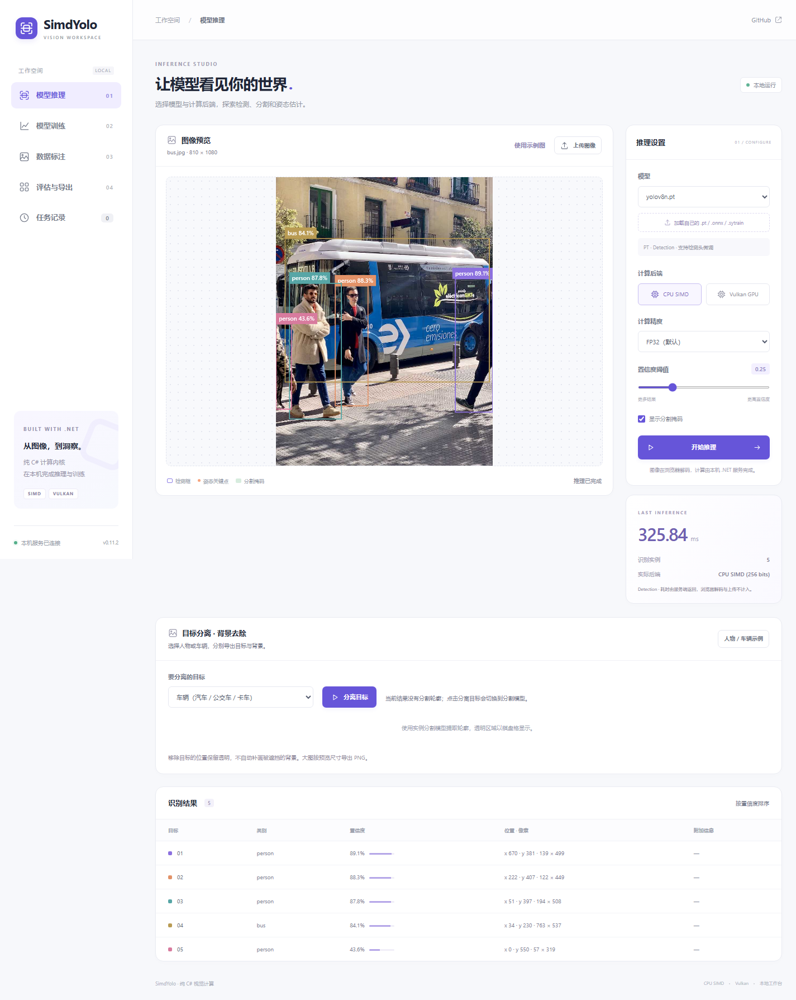

# SimdYolo

[简体中文](README.md) · English · [NuGet](https://www.nuget.org/packages/SimdYolo/) · [Releases](https://github.com/donet-org-cn/SimdYolo/releases)

**A pure C# library for YOLO inference and detection-head fine-tuning on .NET 10.** Load supported PyTorch weights and ONNX models directly, run inference with CPU SIMD, or select Vulkan or Metal for GPU acceleration. The inference and training libraries run without Python, PyTorch, or ONNX Runtime.

## Features

| Feature | Supported use |
| --- | --- |
| Image inference | Object detection, instance segmentation, and pose estimation. One C# API accepts RGB24 or BGR24 pixels and returns boxes, masks, or keypoints. |
| Models | Complete `.pt` / `.pth` model weights, ONNX models using supported operators, and `.sytrain` checkpoints. Selected models from YOLOv8, v9, v10, YOLO11, and YOLO26 have been validated. |
| Inference backends | FP32 by default. The CPU backend uses SIMD. Vulkan requires a compatible graphics driver and loader. Metal is available on macOS. |
| Training and export | `SimdYolo.Training` fine-tunes detection heads with the backbone and feature pyramid frozen. It supports validation, early stopping, saving checkpoints, and resuming training. Supported PT and SYTRAIN models can be exported to ONNX. |
| Web demo | A local ASP.NET Core app for image inference, person and vehicle cutouts, background removal, box annotation, and fine-tuning. |

[Models and licenses](models/README.md) · [Inference API and compatibility](docs/inference.md) · [Training guide](docs/training.md) · [Export and model workflows](docs/model-workflows.md)

## Quick start

### Run the local web demo

Install the .NET 10 SDK and Git LFS, then run these commands.

~~~sh
git clone https://github.com/donet-org-cn/SimdYolo.git
cd SimdYolo
git lfs pull
dotnet run --project examples/SimdYolo.Web -c Release
~~~

Open [http://127.0.0.1:5188](http://127.0.0.1:5188), select a model and a CPU or available GPU backend, then upload a JPG or PNG. Use the built-in person and vehicle sample to try instance segmentation and download a transparent PNG.

### Run inference in a C# project

~~~sh
dotnet new console -f net10.0 -o SimdYoloDemo
cd SimdYoloDemo
dotnet add package SimdYolo --version 0.11.3
~~~

Save the [YOLOv8n weights](https://media.githubusercontent.com/media/donet-org-cn/SimdYolo/v0.11.3/models/pt/yolov8n.pt) as `yolov8n.pt` in the project directory, then replace `Program.cs` with the following.

~~~csharp
using SimdYolo;

if (args.Length != 3)
{
    Console.WriteLine("Usage: dotnet run -- <image.rgb> <width> <height>");
    return;
}

byte[] rgb24 = File.ReadAllBytes(args[0]);
int width = int.Parse(args[1]);
int height = int.Parse(args[2]);

using var detector = new YoloDetector("yolov8n.pt", new DetectorOptions
{
    Device = ComputeDevice.Cpu
});

foreach (var instance in detector.Predict(rgb24, width, height))
{
    var box = instance.Box;
    Console.WriteLine($"{detector.ClassNames[box.ClassId]}: {box.Confidence:P1}");
}
~~~

Use your image library to decode a picture to tightly packed RGB24 bytes in R, G, B order and save it as `image.rgb`. For a 640×480 image, run `dotnet run -- image.rgb 640 480`. Set the device to `ComputeDevice.Vulkan` to use Vulkan on a compatible system. Reuse one `YoloDetector` for successive frames.

To fine-tune a detection head, run `dotnet add package SimdYolo.Training --version 0.11.3` and prepare a dataset using the [training guide](docs/training.md).

## Performance

The 0.11.3 benchmarks compare median steady-state inference latency before and after the optimizations on Windows with a Core i7-12700 and RTX 3060. Tests used FP32, 640×640 inputs, batch size 1, and up to 12 CPU threads. Vulkan measurements include output readback.

| Model | Backend | Before | After |
| --- | --- | ---: | ---: |
| YOLOv8n PT | CPU SIMD | 40.70 ms | 40.23 ms |
| YOLOv8n PT | Vulkan | 6.42 ms | 5.94 ms |
| YOLO11n dynamic ONNX | CPU SIMD | 37.57 ms | 29.04 ms |
| YOLO11n dynamic ONNX | Vulkan | 6.15 ms | 6.88 ms |
| YOLO11n dynamic ONNX, separate retest | Vulkan | 6.16 ms | 5.71 ms |

On the same machine, the single-threaded 5×5 max-pooling benchmark took about **12% less time**, and 2× nearest-neighbor upsampling allocated **488 fewer managed bytes** per call. YOLOv8n PT latency on Vulkan fell by about **7.5%**. The two dynamic ONNX Vulkan runs moved in opposite directions, so the end-to-end improvement remains uncertain. [Methodology, output checks, and limitations](docs/releases/v0.11.3.md)

[0.11.2 comparison with PyTorch and ONNX Runtime across 11 models](artifacts/runtime-comparison-0.11.2.md) · [Startup and first inference](artifacts/startup-optimization-0.11.3.md) · [Image and mask performance](artifacts/image-pipeline-optimization-0.11.1.md) · [Training performance](artifacts/training-optimization-0.10.1.md)

## Documentation and downloads

[Inference package](https://www.nuget.org/packages/SimdYolo/) · [Training package](https://www.nuget.org/packages/SimdYolo.Training/) · [Latest GitHub Release](https://github.com/donet-org-cn/SimdYolo/releases/latest)

[Documentation index](docs/README.md) · [Web demo guide](examples/SimdYolo.Web/README.md) · [Validation reports](VALIDATION.md) · [Third-party notices](THIRD_PARTY_NOTICES.md)
