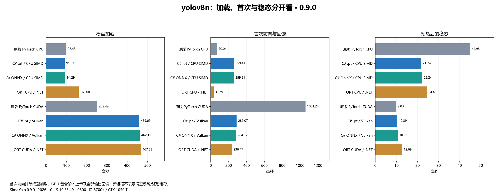
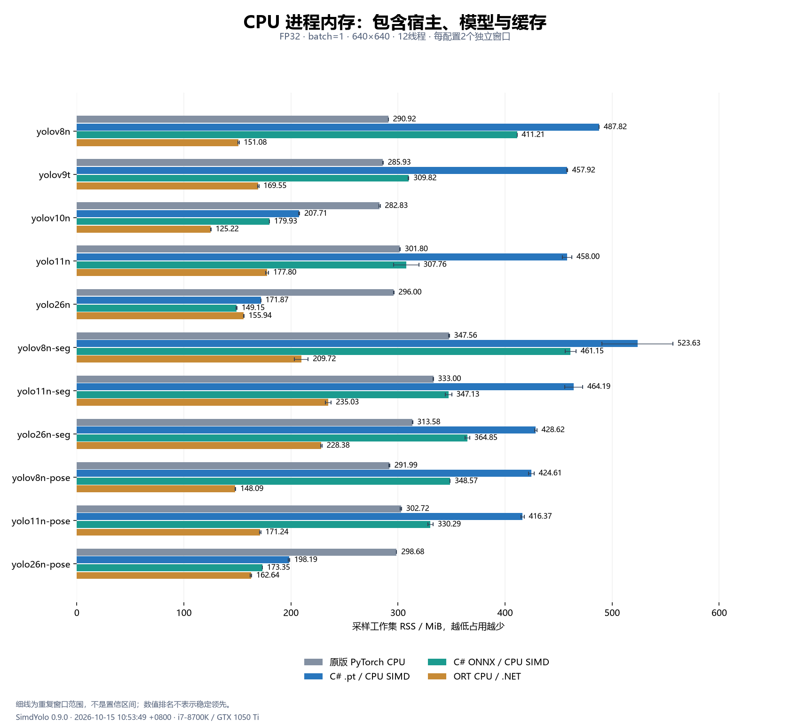

# SimdYolo

**纯 C# / .NET 10 的 YOLO 推理与检测头微调。** CPU 使用 SIMD/intrinsics，GPU 使用 Vulkan/Metal；直接加载支持范围内的 `.pt` 和 ONNX。

[下载 0.10.1](https://github.com/hnlyf168/SimdYolo/releases/tag/v0.10.1) · [网页版示例](examples/SimdYolo.Web/README.md) · [推理 API](docs/inference.md) · [训练说明](docs/training.md) · [模型与许可证](models/README.md)

## 当前版本能力

| 能力 | 0.10.1 发布版 |
| --- | --- |
| 推理任务 | 目标检测、实例分割、姿态估计 |
| 已验证模型 | YOLOv8n、Ultralytics YOLOv9t、YOLOv10n、YOLO11n、YOLO26n；v8/11/26 包含分割、姿态 |
| 模型格式 | 完整 `.pt`/`.pth`、ONNX，本项目训练生成的 `.sytrain` |
| CPU | C# FP32、SIMD/intrinsics、分块 GEMM、Winograd、张量池、专用执行器 |
| GPU | Vulkan/Metal 与包内着色器；本轮 Windows / GTX 1050 Ti / Vulkan 实测，Metal 未实机验证 |
| 训练 | YOLOv8/v9/v10/YOLO11/YOLO26 检测头微调，冻结骨干/FPN；双头、深度卷积、自定义类别、SGD、取消/恢复 |
| 训练设备 | CPU SIMD；Vulkan 加速冻结网络与大 GEMM，小矩阵及深度卷积/BN/损失/SGD 使用 CPU |
| 网页 | 图片推理、数据导入、训练曲线、任务记录、取消/恢复、模型上传/下载 |
| 标签 | `ModelInfo.Read(path).ClassNames` 读取 PT/ONNX/SYTRAIN 类别，不初始化 GPU |

主库和训练核心为纯托管 C#，无 Python、PyTorch、TorchSharp、ORT、BLAS/MKL/OpenBLAS 运行依赖。GPU 通过 P/Invoke 调用系统图形 API。Vulkan 不需要 CUDA Toolkit、cuDNN、cuBLAS，也无需安装 Vulkan SDK 才能运行；需要兼容驱动和 Vulkan loader，修改着色器后才需重新编译。

训练支持表、实际权重和评测见[五代检测头训练](docs/training.md)及[本版训练评测](artifacts/training-optimization-0.10.1.md)。当前仍为**冻结骨干/FPN 的检测头微调**，没有全参数、分割/姿态或 Metal 训练。`.sytrain` 可直接推理与恢复，是本项目归档格式，不能冒充 PyTorch `.pt`，暂不导出 ONNX。梯度累加按图像平均，每图 BN 独立统计。

**0.10.1 发布包已包含五代检测头训练与本轮优化**，可直接下载主库、训练库、网页版、33模型和中文图文包。[中文发布说明](docs/releases/v0.10.1.md)保留验证范围及未通过的参数比较项。

0.10.1重点优化CPU SIMD、卷积反向和临时工作区，并补上五模型训练后参数及保存模型的精度对比：[训练速度、排名与结果](artifacts/training-optimization-0.10.1.md)。

本轮检测头训练每步耗时（ms，越低越快；**粗体为同设备组第一**）。128×128、FP32、2类、4线程、相同冻结特征，两独立窗口；不含骨干、预处理和保存，不代表全参数训练速度。

| 模型 | 原版 PyTorch CPU | 我们 CPU SIMD | 原版 PyTorch CUDA | 我们 Vulkan 混合 |
| --- | ---: | ---: | ---: | ---: |
| yolov8n | 11.37 | **7.17** | 27.13 | **11.43** |
| yolov9t | 10.90 | **6.46** | 27.17 | **10.39** |
| yolov10n | 26.56 | **15.39** | 59.08 | **22.64** |
| yolo11n | 13.33 | **7.05** | 30.58 | **9.77** |
| yolo26n | 26.06 | **9.29** | 64.49 | **10.61** |

## 下载与启动

| 下载 | 内容 |
| --- | --- |
| [0.10.1 Release](https://github.com/hnlyf168/SimdYolo/releases/tag/v0.10.1) | 五代检测头训练、SIMD 优化、中文说明与全部附件 |
| [推理主库](https://github.com/hnlyf168/SimdYolo/releases/download/v0.10.1/SimdYolo.0.10.1.nupkg) | 已验证的 SimdYolo.0.10.1.nupkg、中文 XML 文档及着色器 |
| [训练库](https://github.com/hnlyf168/SimdYolo/releases/download/v0.10.1/SimdYolo.Training.0.10.1.nupkg) | 独立训练库，依赖同版本主库 |
| [33 个模型 ZIP](https://github.com/hnlyf168/SimdYolo/releases/download/v0.10.1/SimdYolo-models-v0.10.1.zip) | 11 个 PT、22 个 ONNX，包含 YOLO26、清单和原许可证 |
| [网页版运行包](https://github.com/hnlyf168/SimdYolo/releases/download/v0.10.1/SimdYolo-Web-v0.10.1.zip) | ASP.NET Core 发布输出、页面、启动说明；模型另下 |
| [文档与图文包](https://github.com/hnlyf168/SimdYolo/releases/download/v0.10.1/SimdYolo-docs-v0.10.1.zip) | 当前 README、中文文档、两篇文章、最新图表与原始结果 |

从源码启动需要 .NET 10 SDK 和 Git LFS：

```powershell
git clone https://github.com/hnlyf168/SimdYolo.git
cd SimdYolo
git lfs pull
dotnet run --project examples/SimdYolo.Web -c Release
```

打开 **http://127.0.0.1:5188**。网页版运行包需要已安装的 .NET 10 / ASP.NET Core 运行时，不含模型与运行时，具体步骤见包内说明。它是本地示例，绑定回环地址，没有公网账号/鉴权配置。

[查看实际推理截图](artifacts/validation/0.10.0/web-browser/web-inference.png) · [网页版详细步骤](examples/SimdYolo.Web/README.md)

## 推理性能：0.9.0 冻结版本实测

日期：2026-10-15 10:53:49 +0800；i7-8700K（12逻辑核心）、GTX 1050 Ti、31.93 GiB RAM。**176/176 个独立窗口、39,134 次推理、224/224 输出校验通过。**

统一 FP32、batch=1、640×640、12线程，每配置两轮；预热60次，每窗口至少4秒/40帧。每格为窗口中位数的中位数，单位 ms，①最快，按未舍入值排名。GPU 包含上传和全部输出回读；排除图片预处理、NMS、最终 mask 后处理、模型加载和冷首帧。

输入沿用0.8.1的固定实拍图张量。额外随机输入下，ORT CUDA 的 YOLO26 分割曾超出既定数值容差，[诊断记录](artifacts/validation/0.9.0-release/synthetic-input-diagnostic.json)单列保留；本页排名仅代表固定图片和本机环境。

## CPU / GPU 速度排名

每格为中位耗时 ms + 名次，①最快、④最慢，第一名加粗；重复窗口取各窗口中位数的中位数，按未舍入值排序。小幅差距不代表稳定胜出或统计显著性。

### CPU 速度排名

| 模型 | 原版 PyTorch CPU | 我们的 `.pt` CPU | 我们的 ONNX CPU | ORT CPU（.NET） |
| --- | ---: | ---: | ---: | ---: |
| yolov8n | 44.98 ④ | **21.74 ①** | 22.24 ② | 24.45 ③ |
| yolov9t | 77.56 ④ | **30.20 ①** | 33.62 ③ | 31.05 ② |
| yolov10n | 49.19 ④ | **21.57 ①** | 22.64 ② | 22.92 ③ |
| yolo11n | 51.80 ④ | **21.71 ①** | 22.72 ② | 23.64 ③ |
| yolo26n | 54.27 ④ | 22.76 ③ | 22.66 ② | **18.54 ①** |
| yolov8n-seg | 57.56 ④ | **28.07 ①** | 28.61 ② | 34.38 ③ |
| yolo11n-seg | 65.14 ④ | **27.99 ①** | 29.48 ② | 33.52 ③ |
| yolo26n-seg | 69.02 ④ | 30.58 ② | 31.44 ③ | **29.57 ①** |
| yolov8n-pose | 56.94 ④ | **26.88 ①** | 28.04 ② | 31.25 ③ |
| yolo11n-pose | 66.76 ④ | **23.27 ①** | 29.65 ③ | 25.35 ② |
| yolo26n-pose | 59.78 ④ | 24.98 ② | 25.49 ③ | **21.91 ①** |
| 第一名次数（完整四配置 11/11 模型） | 0 | 8 | 0 | 3 |

### GPU 速度排名

| 模型 | 原版 PyTorch CUDA | 我们的 `.pt` Vulkan | 我们的 ONNX Vulkan | ORT CUDA（.NET） |
| --- | ---: | ---: | ---: | ---: |
| yolov8n | **9.83 ①** | 10.39 ② | 10.63 ③ | 12.69 ④ |
| yolov9t | 22.27 ④ | **12.87 ①** | 14.09 ② | 17.81 ③ |
| yolov10n | 10.67 ③ | **10.07 ①** | 10.28 ② | 13.52 ④ |
| yolo11n | **10.52 ①** | 10.62 ② | 10.66 ③ | 13.69 ④ |
| yolo26n | 12.37 ③ | **10.99 ①** | 11.08 ② | 13.21 ④ |
| yolov8n-seg | **12.83 ①** | 13.75 ② | 13.88 ③ | 16.56 ④ |
| yolo11n-seg | 13.61 ② | **13.50 ①** | 13.66 ③ | 17.58 ④ |
| yolo26n-seg | 16.44 ③ | 14.75 ② | **14.57 ①** | 17.23 ④ |
| yolov8n-pose | **10.23 ①** | 10.55 ② | 10.86 ③ | 13.17 ④ |
| yolo11n-pose | 11.18 ② | **11.08 ①** | 11.26 ③ | 14.33 ④ |
| yolo26n-pose | 13.52 ③ | **12.00 ①** | 12.22 ② | 14.11 ④ |
| 第一名次数（完整四配置 11/11 模型） | 4 | 6 | 1 | 0 |


细线为两轮窗口范围，**不是置信区间**。接近结果可能随窗口换位，排名不等于稳定领先；本库没有在所有模型或资源指标上全面胜过 ORT。PyTorch 使用原版 `fuse()`，ORT 开启图优化，未比较 `torch.compile`、TensorRT、FP16/INT8。

### 首次使用与资源成本



加载、首次前向和稳态分别计时。首次前向不是完整进程启动；新进程也不表示清空系统文件或驱动缓存。



[CPU 每帧计算成本](artifacts/performance-0.9.0-cpu-time.png) · [GPU 整卡使用率](artifacts/performance-0.9.0-gpu-usage.png) · [GPU 整卡显存](artifacts/performance-0.9.0-vram.png) · [完整报告](artifacts/runtime-comparison-0.9.0.md) · [原始 JSON](artifacts/runtime-comparison-0.9.0.json)

CPU% 以全机逻辑核心归一化，CPU ms/帧衡量计算成本；RSS 包括宿主、模型和缓存，不能据速度排名推断内存优势。GPU/显存是整卡采样，包含桌面及其他进程，不能当作单进程指标。P95、采样、版本、输入/模型/DLL 摘要均在原始 JSON。

## C# 使用

```csharp
using SimdYolo;

using var detector = new YoloDetector("models/pt/yolo26n-seg.pt",
    new DetectorOptions { Device = ComputeDevice.Vulkan });
// rgb 为已解码的 RGB24；width/height 为原图尺寸。
var instances = detector.Predict(rgb, width, height);
foreach (var instance in instances)
    Console.WriteLine($"{detector.ClassNames[instance.Box.ClassId]}: {instance.Box.Confidence:F3}");

var info = ModelInfo.Read("models/onnx/yolo26n.onnx");
```

检测/姿态权重使用相同入口，返回对应的框/关键点；分割实例包含裁剪掩码。CPU 选择 `ComputeDevice.Cpu`。完整输入、布局、标签、后处理与兼容边界见[推理 API](docs/inference.md)。

```csharp
using SimdYolo.Training;

var dataset = TrainingDataset.CreateDemo();
using var trainer = new YoloTrainer("models/pt/yolov8n.pt", dataset,
    new TrainingOptions { ImageSize = 128, Epochs = 20, LearningRate = .003f });
trainer.Train(".cache/my-training", p => Console.WriteLine($"{p.Step}: {p.TotalLoss:F4}"));
// last.sytrain 可由 YoloDetector 加载，或用 YoloTrainer.Resume 恢复。
```


内置方块用于流程验证，不代表业务精度。0.10.0 新增五代检测头的 CPU/Vulkan 梯度、SGD、真实微调与恢复验证，训练速度另与原版 PyTorch 比较；单图损失下降不代表验证集 mAP。[训练说明](docs/training.md) · [本版训练评测](artifacts/training-evaluation-0.10.0.md) · [历史 0.9.0 验证](artifacts/validation/0.9.0/README.md)


本轮精度对照使用COCO128的96张微调图与32张微调留出图，80类、256×256、2轮。两边的 `.pt` / `.sytrain` 均重新加载并运行完整网络。该短程微调的验证精度有下降，不代表有效训练配方或未见数据泛化能力；数值、误差和边界见[本版报告](artifacts/training-optimization-0.10.1.md)，[0.10.0报告](artifacts/training-evaluation-0.10.0.md)保留为历史结果。

图中只计冻结特征后的检测头前向、损失、反向与 SGD，采用128×128、2类、4线程；[GPU训练速度与资源排名](artifacts/training-optimization-0.10.1.md)使用同一口径，不能与上方640×640推理耗时混用。

## 兼容与验证

PT 需要受支持完整 YOLO 模型的 Torch ZIP；单独 `state_dict` 缺少执行结构，TorchScript、未知模块、量化图不支持。ONNX 只支持已实现的算子与布局，不能按扩展名推断任意模型可运行。其他模型尺度、设备及平台需要单独验证。

```powershell
dotnet build SimdYolo.sln -c Release
dotnet run --project tests/SimdYolo.Tests -c Release -- --vulkan --models models/pt
dotnet run --project tests/SimdYolo.Training.Tests -c Release -- --integration --vulkan
```

[全部验证](VALIDATION.md) · [0.8.1 历史性能](artifacts/runtime-comparison-0.8.1.md) · [0.8.0→0.8.1 历史优化](artifacts/optimization-0.8.1.md) · [0.7.0 历史性能](artifacts/optimized-runtime-comparison.md) · [公众号](docs/articles/wechat.md) · [博客园](docs/articles/cnblogs.md)

历史报告、包和测量保持原版本。模型沿用上游 **AGPL-3.0**，保留原许可证和来源；源码暂未新增许可证。[第三方说明](THIRD_PARTY_NOTICES.md)
