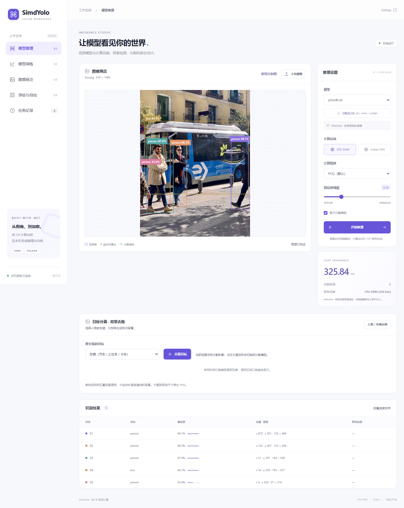

# SimdYolo

简体中文 · [English](README.en.md) · [NuGet](https://www.nuget.org/packages/SimdYolo/) · [Releases](https://github.com/donet-org-cn/SimdYolo/releases)

**面向 .NET 10 的纯 C# YOLO 推理与检测头微调库。** 直接加载受支持的 PyTorch 权重和 ONNX 模型，在 CPU 上使用 SIMD，也可选择 Vulkan 或 Metal 进行 GPU 推理。推理和训练核心无需 Python、PyTorch 或 ONNX Runtime。

## 功能

| 功能 | 支持范围 |
| --- | --- |
| 图片推理 | 目标检测、实例分割、姿态估计。统一的 C# API 接受 RGB24 或 BGR24 像素，返回检测框、掩码或关键点。 |
| 模型 | 支持完整模型权重 `.pt` / `.pth`、受支持算子的 ONNX 和训练检查点 `.sytrain`。已验证 YOLOv8、v9、v10、YOLO11 和 YOLO26 的指定模型。 |
| 推理后端 | 默认 FP32。CPU 使用 SIMD，Vulkan 需要兼容的显卡驱动与 Vulkan loader，Metal 用于 macOS。 |
| 训练与导出 | `SimdYolo.Training` 支持冻结骨干和特征金字塔后的检测头微调，可验证、早停、保存与恢复。受支持的 PT 和 SYTRAIN 模型可导出为 ONNX。 |
| 网页示例 | 本地 ASP.NET Core 应用，支持图片推理、人物与车辆分离、背景去除、检测框标注和微调。 |

[模型与许可证](models/README.md) · [推理 API 与兼容范围](docs/inference.md) · [训练指南](docs/training.md) · [导出与模型工作流](docs/model-workflows.md)

## 快速上手

### 运行本地网页

安装 .NET 10 SDK 和 Git LFS 后运行：

~~~sh
git clone https://github.com/donet-org-cn/SimdYolo.git
cd SimdYolo
git lfs pull
dotnet run --project examples/SimdYolo.Web -c Release
~~~

打开 [http://127.0.0.1:5188](http://127.0.0.1:5188)，选择模型和 CPU 或可用的 GPU 后端，上传 JPG 或 PNG。点击「人物 / 车辆示例」可用内置照片试用实例分割并下载透明 PNG。

### 在 C# 项目中推理

~~~sh
dotnet new console -f net10.0 -o SimdYoloDemo
cd SimdYoloDemo
dotnet add package SimdYolo --version 0.11.3
~~~

把 [YOLOv8n 权重](https://media.githubusercontent.com/media/donet-org-cn/SimdYolo/v0.11.3/models/pt/yolov8n.pt) 保存为项目目录里的 `yolov8n.pt`，然后替换 `Program.cs`：

~~~csharp
using SimdYolo;

if (args.Length != 3)
{
    Console.WriteLine("Usage: dotnet run -- <image.rgb> <width> <height>");
    return;
}

byte[] rgb24 = File.ReadAllBytes(args[0]);
int width = int.Parse(args[1]);
int height = int.Parse(args[2]);

using var detector = new YoloDetector("yolov8n.pt", new DetectorOptions
{
    Device = ComputeDevice.Cpu
});

foreach (var instance in detector.Predict(rgb24, width, height))
{
    var box = instance.Box;
    Console.WriteLine($"{detector.ClassNames[box.ClassId]}: {box.Confidence:P1}");
}
~~~

用图像库将图片解码为紧密排列的 RGB24 字节，每个像素三个字节，按 R、G、B 顺序保存为 `image.rgb`。例如原图为 640×480 时，运行 `dotnet run -- image.rgb 640 480`。将设备设为 `ComputeDevice.Vulkan` 可在支持的设备上启用 Vulkan。处理连续帧时可复用同一个 `YoloDetector`。

需要微调时安装 `dotnet add package SimdYolo.Training --version 0.11.3`，并按[训练指南](docs/training.md)准备检测数据集。

## 性能

0.11.3 在 Windows、Core i7-12700 和 RTX 3060 上对比优化前后的稳态推理中位耗时。使用 FP32、640×640、batch 1，CPU 上限 12 线程，Vulkan 计时包含输出回读。

| 模型 | 后端 | 优化前 | 优化后 |
| --- | --- | ---: | ---: |
| YOLOv8n PT | CPU SIMD | 40.70 ms | 40.23 ms |
| YOLOv8n PT | Vulkan | 6.42 ms | 5.94 ms |
| YOLO11n 动态 ONNX | CPU SIMD | 37.57 ms | 29.04 ms |
| YOLO11n 动态 ONNX | Vulkan | 6.15 ms | 6.88 ms |
| YOLO11n 动态 ONNX，单独复测 | Vulkan | 6.16 ms | 5.71 ms |

同机单线程测试中，5×5 最大池化耗时下降约 **12%**，2 倍最近邻上采样每次少分配 **488 字节**。YOLOv8n PT 的 Vulkan 推理耗时下降约 **7.5%**。动态 ONNX 的 Vulkan 两次测量方向不同，端到端收益仍不确定。[测量口径、输出校验与限制](docs/releases/v0.11.3.md)

[0.11.2 的 11 模型 PyTorch / ONNX Runtime 对照](artifacts/runtime-comparison-0.11.2.md) · [加载与首帧性能](artifacts/startup-optimization-0.11.3.md) · [图片与掩码性能](artifacts/image-pipeline-optimization-0.11.1.md) · [训练性能](artifacts/training-optimization-0.10.1.md)

## 文档与下载

[NuGet 推理包](https://www.nuget.org/packages/SimdYolo/) · [NuGet 训练包](https://www.nuget.org/packages/SimdYolo.Training/) · [最新 GitHub Release](https://github.com/donet-org-cn/SimdYolo/releases/latest)

[文档导航](docs/README.md) · [网页示例说明](examples/SimdYolo.Web/README.md) · [验证记录](VALIDATION.md) · [第三方说明](THIRD_PARTY_NOTICES.md)
