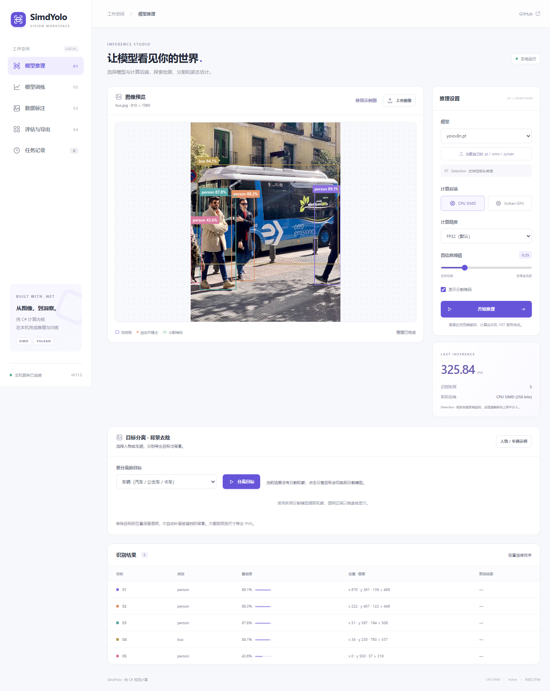

# SimdYolo

简体中文 · [English](README.en.md) · [NuGet](https://www.nuget.org/packages/SimdYolo/) · [Releases](https://github.com/donet-org-cn/SimdYolo/releases)

**面向 .NET 10 的纯 C# YOLO 推理与检测头微调库。** 直接加载受支持的 PyTorch 权重和 ONNX 模型，在 CPU 上使用 SIMD，也可选择 Vulkan 或 Metal 进行 GPU 推理。推理和训练核心无需 Python、PyTorch 或 ONNX Runtime。

## 功能

| 功能 | 支持范围 |
| --- | --- |
| 图片推理 | 目标检测、实例分割、姿态估计。统一的 C# API 接受 RGB24 或 BGR24 像素，返回检测框、掩码或关键点。 |
| 模型 | 支持完整模型权重 `.pt` / `.pth`、受支持算子的 ONNX 和训练检查点 `.sytrain`。已验证 YOLOv8、v9、v10、YOLO11 和 YOLO26 的指定模型。 |
| 推理后端 | 默认 FP32。CPU 使用 SIMD，Vulkan 需要兼容的显卡驱动与 Vulkan loader，Metal 用于 macOS。 |
| 训练与导出 | `SimdYolo.Training` 支持冻结骨干和特征金字塔后的检测头微调，可验证、早停、保存与恢复。受支持的 PT 和 SYTRAIN 模型可导出为 ONNX。 |
| 网页示例 | 本地 ASP.NET Core 应用，支持图片推理、人物与车辆分离、背景去除、检测框标注和微调。 |

[模型与许可证](models/README.md) · [推理 API 与兼容范围](docs/inference.md) · [训练指南](docs/training.md) · [导出与模型工作流](docs/model-workflows.md)

## 快速上手

### 运行本地网页

安装 .NET 10 SDK 和 Git LFS 后运行：

~~~sh
git clone https://github.com/donet-org-cn/SimdYolo.git
cd SimdYolo
git lfs pull
dotnet run --project examples/SimdYolo.Web -c Release
~~~

打开 [http://127.0.0.1:5188](http://127.0.0.1:5188)，选择模型和 CPU 或可用的 GPU 后端，上传 JPG 或 PNG。点击「人物 / 车辆示例」可用内置照片试用实例分割并下载透明 PNG。

### 在 C# 项目中推理

~~~sh
dotnet new console -f net10.0 -o SimdYoloDemo
cd SimdYoloDemo
dotnet add package SimdYolo --version 0.11.6
~~~

把 [YOLOv8n 权重](https://media.githubusercontent.com/media/donet-org-cn/SimdYolo/v0.11.6/models/pt/yolov8n.pt) 保存为项目目录里的 `yolov8n.pt`，然后替换 `Program.cs`：

~~~csharp
using SimdYolo;

if (args.Length != 3)
{
    Console.WriteLine("Usage: dotnet run -- <image.rgb> <width> <height>");
    return;
}

byte[] rgb24 = File.ReadAllBytes(args[0]);
int width = int.Parse(args[1]);
int height = int.Parse(args[2]);

using var detector = new YoloDetector("yolov8n.pt", new DetectorOptions
{
    Device = ComputeDevice.Cpu
});

foreach (var instance in detector.Predict(rgb24, width, height))
{
    var box = instance.Box;
    Console.WriteLine($"{detector.ClassNames[box.ClassId]}: {box.Confidence:P1}");
}
~~~

用图像库将图片解码为紧密排列的 RGB24 字节，每个像素三个字节，按 R、G、B 顺序保存为 `image.rgb`。例如原图为 640×480 时，运行 `dotnet run -- image.rgb 640 480`。将设备设为 `ComputeDevice.Vulkan` 可在支持的设备上启用 Vulkan。处理连续帧时可复用同一个 `YoloDetector`。

需要微调时安装 `dotnet add package SimdYolo.Training --version 0.11.6`，并按[训练指南](docs/training.md)准备检测数据集。

## 性能

0.11.6 与 NuGet 0.11.5 在同一台 Windows 主机对照，使用 Core i7-12700、RTX 3060、640×640 FP32、单帧和 8 个 P 核，AVX-512 关闭。完整图片耗时包括预处理和后处理，Vulkan 耗时包含上传和回读。

| 模型与指标 | NuGet 0.11.5 | 0.11.6 |
| --- | ---: | ---: |
| YOLO26n-seg PT CPU 图片中位耗时 | 41.54 ms | 36.62 ms |
| YOLO26n-seg PT CPU 图片每帧 CPU 时间 | 243.75 ms | 200.81 ms |
| YOLO26n-seg PT Vulkan 前向中位耗时 | 6.57 ms | 5.95 ms |
| YOLOv8n PT Vulkan 图片中位耗时 | 7.03 ms | 4.67 ms |
| YOLOv8n PT CPU 图片峰值工作集 | 484.67 MiB | 222.25 MiB |
| YOLOv8n PT Vulkan 中间缓冲区容量 | 224.00 MiB | 140.30 MiB |

YOLOv8n CPU 图片 P95 由 35.60 ms 增至 36.83 ms，YOLO26n-seg ONNX CPU 前向峰值工作集增加 31.1 MiB。[0.11.6 中英文发布说明](docs/releases/v0.11.6.md) · [完整数据与输出核对](artifacts/inference-forward-performance-2026-11-18.md)

[历史 AVX-512 对照](docs/releases/v0.11.5.md) · [0.11.4 CPU / Vulkan 优化](artifacts/cpu-gpu-optimization-2026-11-11.md) · [0.11.2 的 11 模型 PyTorch / ONNX Runtime 对照](artifacts/runtime-comparison-0.11.2.md) · [加载与首帧性能](artifacts/startup-optimization-0.11.3.md) · [图片与掩码性能](artifacts/image-pipeline-optimization-0.11.1.md) · [训练性能](artifacts/training-optimization-0.10.1.md)

## 文档与下载

[NuGet 推理包](https://www.nuget.org/packages/SimdYolo/) · [NuGet 训练包](https://www.nuget.org/packages/SimdYolo.Training/) · [最新 GitHub Release](https://github.com/donet-org-cn/SimdYolo/releases/latest)

[文档导航](docs/README.md) · [网页示例说明](examples/SimdYolo.Web/README.md) · [验证记录](VALIDATION.md) · [第三方说明](THIRD_PARTY_NOTICES.md)
