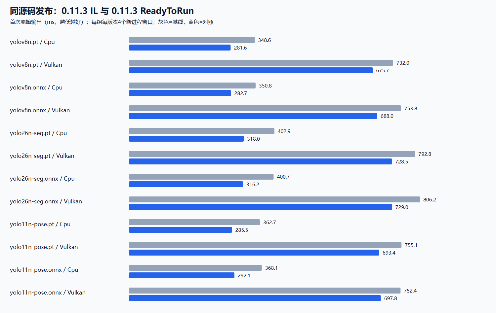
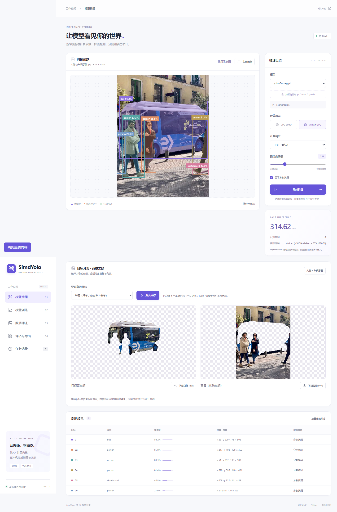
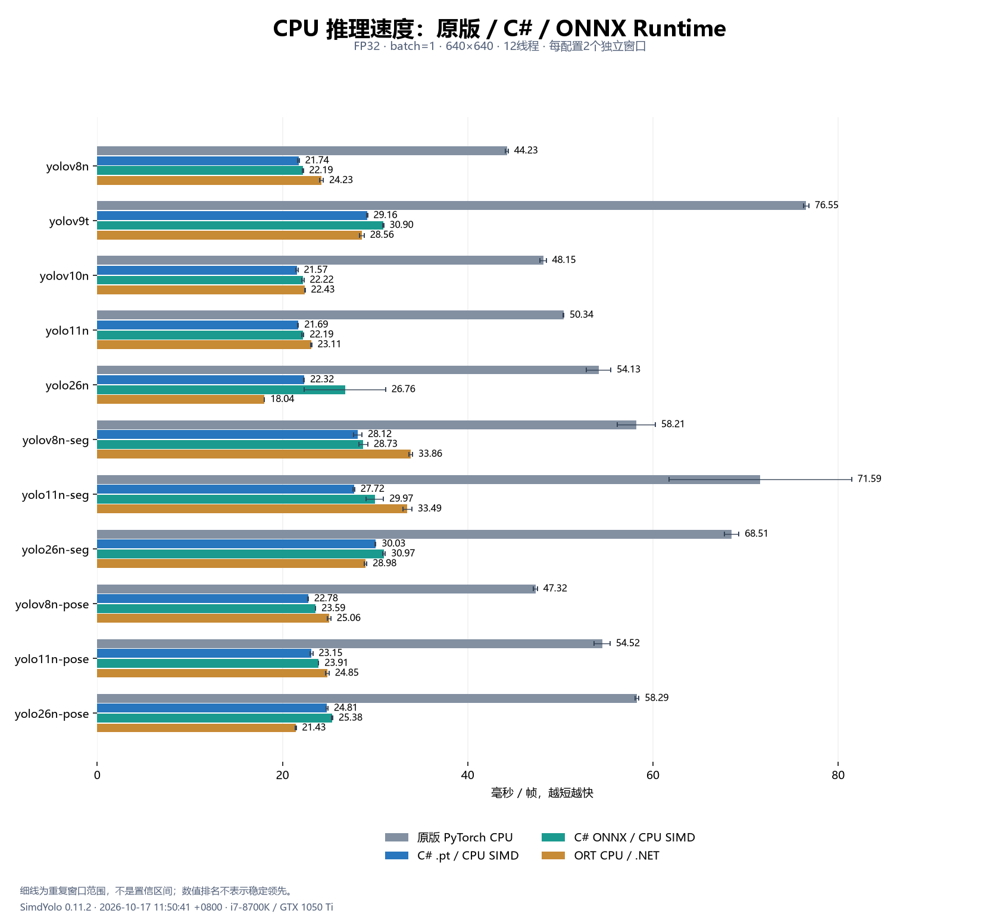
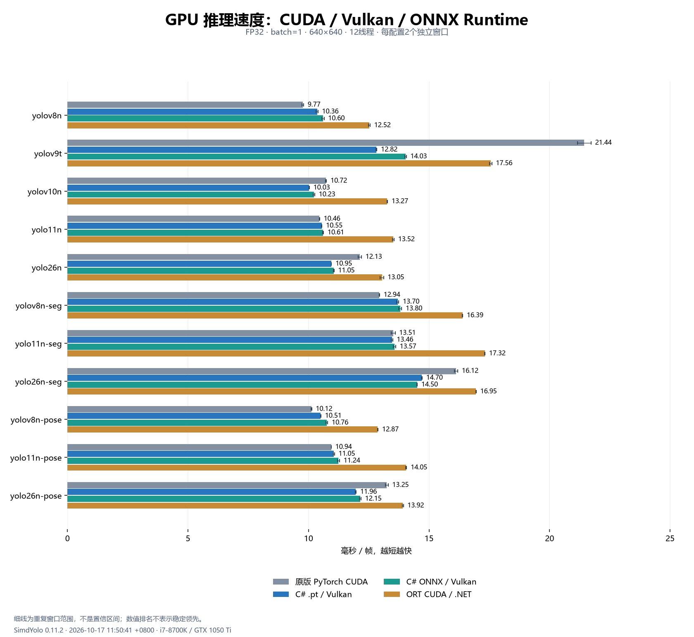
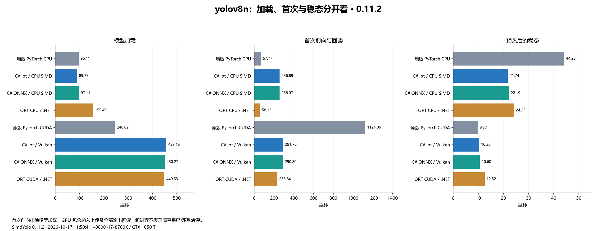

# SimdYolo

**纯 C# / .NET 10 的 YOLO 推理与检测头微调。** CPU 使用 SIMD/intrinsics，GPU 使用 Vulkan/Metal；直接加载支持范围内的 `.pt` 和 ONNX。

[文档导航](docs/README.md) · [0.11.2原版/ORT排名](artifacts/runtime-comparison-0.11.2.md) · [网页版示例](examples/SimdYolo.Web/README.md) · [推理 API](docs/inference.md) · [训练说明](docs/training.md) · [模型与许可证](models/README.md)

**当前源码：0.11.3；最新正式 NuGet / Release：0.11.2。** [下载正式版](https://github.com/donet-org-cn/SimdYolo/releases/tag/v0.11.2) · [0.11.2发布说明](docs/releases/v0.11.2.md)。历史附件保持原内容。

0.11.3继续优化加载与首次推理：PT只读解析、一次扫描BN融合、ONNX整数路由及工作区复用，网页一次读取标签/训练能力；Vulkan复用进程实例，减少驱动反复加载。新增可选`.NET ReadyToRun`快速启动发布，主库普通构建仍为托管IL。[加载/首帧/稳态对照与图](artifacts/startup-optimization-0.11.3.md) · [发布方式、计时口径与复现](docs/startup.md) · [稳定性验证](artifacts/validation/0.11.3/README.md)。本轮结果与下文0.11.2原版排名分别保留。

## 加载与首次结果

同一0.11.3源码，CPU、FP32、640×640、12线程，每组4个新进程窗口。以下为托管入口到首次原始输出，不含.NET宿主启动、图片预处理/NMS及最终掩码。

| 模型 | 普通IL发布 | FastStartup发布 | 耗时减少 |
| --- | ---: | ---: | ---: |
| YOLOv8n PT检测 | 348.63 ms | **281.63 ms** | 19.2% |
| YOLO26n PT分割 | 402.88 ms | **317.97 ms** | 21.1% |
| YOLO11n PT姿态 | 362.72 ms | **285.46 ms** | 21.3% |

网页独立实验（33模型，进程启动到API可用）为0.11.2普通发布 **1.68 s → 0.11.3 FastStartup 1.17 s**，减少30.7%。普通IL源码优化的ONNX CPU稳态中位耗时改善约2–5%，PT CPU基本持平；部分P95没有改善，完整表保留全部窗口。以上不更新历史PyTorch/ORT排名。



## 当前版本能力

当前源码为 **0.11.2**，包含图片推理、目标分离与背景去除优化，并完成与原版PyTorch/ORT的新一轮对照：掩码使用SIMD、坐标表和行缓存，多实例按面积及线程数并行；网页复用RGB与有界掩码缓存，改用RGB24二进制上传，调整置信度无需重载模型。[优化前后实测](artifacts/image-pipeline-optimization-0.11.1.md) · [本版验证与截图](artifacts/validation/0.11.2/README.md)。历史0.10.1下载包不包含这些新增功能。

0.11.0已加入纯.NET的训练验证/早停/最佳模型、PT/SYTRAIN导出ONNX、网页检测框标注与预标注、CPU FP16混合/INT8实验推理。[使用说明与API](docs/model-workflows.md) · [0.11.0验证](artifacts/validation/0.11.0/README.md)。

低精度目前**没有实测速度优势**，默认仍为FP32。FP16使用Half操作数和FP32累加；INT8使用托管整数内核；GPU仍为FP32。应用不引入Python、ORT或原生推理库。

| 能力 | 当前0.11.2源码 |
| --- | --- |
| 推理任务 | 目标检测、实例分割、姿态估计 |
| 已验证模型 | YOLOv8n、Ultralytics YOLOv9t、YOLOv10n、YOLO11n、YOLO26n；v8/11/26 包含分割、姿态 |
| 模型格式 | 完整 `.pt`/`.pth`、ONNX，本项目训练生成的 `.sytrain` |
| CPU | C# FP32、SIMD/intrinsics、分块GEMM、Winograd、张量池、掩码行缓存与多实例并行；实验低精度默认关闭 |
| GPU | Vulkan/Metal 与包内着色器；本轮 Windows / GTX 1050 Ti / Vulkan 实测，Metal 未实机验证 |
| 训练 | 五代检测头微调，冻结骨干/FPN；双头、自定义类别、SGD、取消/恢复；独立验证集、最佳模型与早停 |
| 训练设备 | CPU SIMD；Vulkan 加速冻结网络与大 GEMM，小矩阵及深度卷积/BN/损失/SGD 使用 CPU |
| 网页 | 大图推理、人物/车辆分离与背景去除、数据标注与预标注、训练验证、评估/对比/导出、任务记录 |
| 导出 | 完整PT或训练SYTRAIN纯.NET导出标准ONNX；静态batch1、FP32、opset17 |
| 标签 | `ModelInfo.Read(path).ClassNames` 读取 PT/ONNX/SYTRAIN 类别，不初始化 GPU |

主库和训练核心为纯托管 C#，无 Python、PyTorch、TorchSharp、ORT、BLAS/MKL/OpenBLAS 运行依赖。GPU 通过 P/Invoke 调用系统图形 API。Vulkan 不需要 CUDA Toolkit、cuDNN、cuBLAS，也无需安装 Vulkan SDK 才能运行；需要兼容驱动和 Vulkan loader，修改着色器后才需重新编译。

训练支持表、实际权重和评测见[五代检测头训练](docs/training.md)及[0.10.1训练评测](artifacts/training-optimization-0.10.1.md)。当前仍为**冻结骨干/FPN 的检测头微调**，没有全参数、分割/姿态或 Metal 训练。`.sytrain` 可直接推理与恢复，是本项目归档格式，不能冒充 PyTorch `.pt`；0.11.0源码已支持纯.NET导出标准ONNX。梯度累加按图像平均，每图 BN 独立统计。

**历史0.10.1发布包**包含五代检测头训练及该版本训练优化。[中文发布说明](docs/releases/v0.10.1.md)保留验证范围及未通过的参数比较项；0.11.x新增功能使用当前源码或包。

0.10.1重点优化CPU SIMD、卷积反向和临时工作区，并补上五模型训练后参数及保存模型的精度对比：[训练速度、排名与结果](artifacts/training-optimization-0.10.1.md)。

下表为0.10.1检测头训练每步耗时（ms，越低越快；**粗体为同设备组第一**）。128×128、FP32、2类、4线程、相同冻结特征，两独立窗口；不含骨干、预处理和保存，不代表全参数训练速度。

| 模型 | 原版 PyTorch CPU | 我们 CPU SIMD | 原版 PyTorch CUDA | 我们 Vulkan 混合 |
| --- | ---: | ---: | ---: | ---: |
| yolov8n | 11.37 | **7.17** | 27.13 | **11.43** |
| yolov9t | 10.90 | **6.46** | 27.17 | **10.39** |
| yolov10n | 26.56 | **15.39** | 59.08 | **22.64** |
| yolo11n | 13.33 | **7.05** | 30.58 | **9.77** |
| yolo26n | 26.06 | **9.29** | 64.49 | **10.61** |

## 下载与启动

| 附件 | 内容 |
| --- | --- |
| [SimdYolo.0.11.2.nupkg](https://github.com/donet-org-cn/SimdYolo/releases/download/v0.11.2/SimdYolo.0.11.2.nupkg) | 推理主库、中文XML及GPU着色器 |
| [SimdYolo.Training.0.11.2.nupkg](https://github.com/donet-org-cn/SimdYolo/releases/download/v0.11.2/SimdYolo.Training.0.11.2.nupkg) | 五代检测头微调、验证/最佳模型/早停，依赖同版主库 |
| [SimdYolo-models-v0.11.2.zip](https://github.com/donet-org-cn/SimdYolo/releases/download/v0.11.2/SimdYolo-models-v0.11.2.zip) | 11个PT、22个ONNX、来源、SHA256和原许可证 |
| [SimdYolo-Web-v0.11.2.zip](https://github.com/donet-org-cn/SimdYolo/releases/download/v0.11.2/SimdYolo-Web-v0.11.2.zip) | ASP.NET Core网页、启动脚本；模型和.NET运行时另备 |
| [SimdYolo-docs-v0.11.2.zip](https://github.com/donet-org-cn/SimdYolo/releases/download/v0.11.2/SimdYolo-docs-v0.11.2.zip) | 当前README、API/训练说明、图文、完整评测与复现输入 |
| [SHA256SUMS-v0.11.2.txt](https://github.com/donet-org-cn/SimdYolo/releases/download/v0.11.2/SHA256SUMS-v0.11.2.txt) | 全部附件的SHA256 |

从源码启动需要 .NET 10 SDK 和 Git LFS：

```powershell
git clone https://github.com/donet-org-cn/SimdYolo.git
cd SimdYolo
git lfs pull
dotnet run --project examples/SimdYolo.Web -c Release
```

打开 **http://127.0.0.1:5188**。网页版运行包需要已安装的 .NET 10 / ASP.NET Core 运行时，不含模型与运行时，具体步骤见包内说明。它是本地示例，绑定回环地址，没有公网账号/鉴权配置。

[查看0.11.2实际推理截图](artifacts/validation/0.11.2/web/web-inference.png) · [网页版详细步骤](examples/SimdYolo.Web/README.md)

当前源码网页版支持[人物/车辆分离与背景去除](examples/SimdYolo.Web/README.md)：点击“人物 / 车辆示例”，分别预览并下载“只保留目标”和“移除目标的背景”透明PNG；支持大图有界处理。[0.11.2实际截图与下载验证](artifacts/validation/0.11.2/README.md)。本版网页运行包已包含这些功能。



## 0.11.2 与原版PyTorch、ORT重新实测

实测日期：2026-10-17 11:50:41 +0800；Intel(R) Core(TM) i7-8700K CPU @ 3.70GHz，NVIDIA GeForce GTX 1050 Ti。FP32、batch1、640×640、CPU12线程。11模型×8配置×两轮，共**176个独立窗口、39,264次推理、224/224项输出校验通过**。预热60次，每窗口至少4秒/40帧。

本表计入网络前向与输出头解码；GPU包含输入上传和全部输出回读，排除图片预处理、NMS、最终实例掩码、模型加载和首帧。原版PyTorch使用官方Ultralytics fuse()，ORT启用全部图优化，CUDA关闭TF32。每格为两个独立窗口中位数的中位数，①最快，按未舍入值排名；接近结果不能解释为稳定胜出。

## CPU / GPU 速度排名

每格为中位耗时 ms + 名次，①最快、④最慢，第一名加粗；重复窗口取各窗口中位数的中位数，按未舍入值排序。小幅差距不代表稳定胜出或统计显著性。

### CPU 速度排名

| 模型 | 原版 PyTorch CPU | 我们的 `.pt` CPU | 我们的 ONNX CPU | ORT CPU（.NET） |
| --- | ---: | ---: | ---: | ---: |
| yolov8n | 44.23 ④ | **21.74 ①** | 22.19 ② | 24.23 ③ |
| yolov9t | 76.55 ④ | 29.16 ② | 30.90 ③ | **28.56 ①** |
| yolov10n | 48.15 ④ | **21.57 ①** | 22.22 ② | 22.43 ③ |
| yolo11n | 50.34 ④ | **21.69 ①** | 22.19 ② | 23.11 ③ |
| yolo26n | 54.13 ④ | 22.32 ② | 26.76 ③ | **18.04 ①** |
| yolov8n-seg | 58.21 ④ | **28.12 ①** | 28.73 ② | 33.86 ③ |
| yolo11n-seg | 71.59 ④ | **27.72 ①** | 29.97 ② | 33.49 ③ |
| yolo26n-seg | 68.51 ④ | 30.03 ② | 30.97 ③ | **28.98 ①** |
| yolov8n-pose | 47.32 ④ | **22.78 ①** | 23.59 ② | 25.06 ③ |
| yolo11n-pose | 54.52 ④ | **23.15 ①** | 23.91 ② | 24.85 ③ |
| yolo26n-pose | 58.29 ④ | 24.81 ② | 25.38 ③ | **21.43 ①** |
| 第一名次数（完整四配置 11/11 模型） | 0 | 7 | 0 | 4 |

### GPU 速度排名

| 模型 | 原版 PyTorch CUDA | 我们的 `.pt` Vulkan | 我们的 ONNX Vulkan | ORT CUDA（.NET） |
| --- | ---: | ---: | ---: | ---: |
| yolov8n | **9.77 ①** | 10.36 ② | 10.60 ③ | 12.52 ④ |
| yolov9t | 21.44 ④ | **12.82 ①** | 14.03 ② | 17.56 ③ |
| yolov10n | 10.72 ③ | **10.03 ①** | 10.23 ② | 13.27 ④ |
| yolo11n | **10.46 ①** | 10.55 ② | 10.61 ③ | 13.52 ④ |
| yolo26n | 12.13 ③ | **10.95 ①** | 11.05 ② | 13.05 ④ |
| yolov8n-seg | **12.94 ①** | 13.70 ② | 13.80 ③ | 16.39 ④ |
| yolo11n-seg | 13.51 ② | **13.46 ①** | 13.57 ③ | 17.32 ④ |
| yolo26n-seg | 16.12 ③ | 14.70 ② | **14.50 ①** | 16.95 ④ |
| yolov8n-pose | **10.12 ①** | 10.51 ② | 10.76 ③ | 12.87 ④ |
| yolo11n-pose | **10.94 ①** | 11.05 ② | 11.24 ③ | 14.05 ④ |
| yolo26n-pose | 13.25 ③ | **11.96 ①** | 12.15 ② | 13.92 ④ |
| 第一名次数（完整四配置 11/11 模型） | 5 | 5 | 1 | 0 |








[CPU计算成本](artifacts/performance-0.11.2-cpu-time.png) · [CPU内存](docs/articles/assets/0.11.2/09-cpu-memory.png) · [GPU整卡使用率](artifacts/performance-0.11.2-gpu-usage.png) · [整卡显存](artifacts/performance-0.11.2-vram.png) · [完整结果](artifacts/runtime-comparison-0.11.2.md) · [原始JSON](artifacts/runtime-comparison-0.11.2.json)

CPU%按全机逻辑核心归一化；RSS包含宿主、模型和缓存，不能由速度排名推断内存优势。GPU/显存是整卡采样，包含桌面及其他进程。加载、首帧单列，未清空OS/驱动缓存。本轮未比较torch.compile、TensorRT、FP16/INT8，也没有Metal实机结果。

[0.9.0历史排名](artifacts/runtime-comparison-0.9.0.md)保留原始结果；下方0.11.1图片管线测量包含预处理与原图掩码，口径不同。

## 0.11.1掩码与网页优化（历史测量）

对照0.11.0，FP32、640模型输入、CPU四线程；计入真实图片预处理、网络、检测筛选与原图掩码，单位ms。主要分割配置各两个独立进程窗口，大图各一对。网页、HTTP和8位转换单独测量，不能与下方历史纯前向排名混用。

| 图片 / 模型 / 后端 | 优化前 ms | 优化后 ms | 耗时下降 |
| --- | ---: | ---: | ---: |
| 810×1080 / v8分割 / CPU | 54.11 | 40.40 | 25.3% |
| 810×1080 / v8分割 / Vulkan | 30.05 | 17.49 | 41.8% |
| 810×1080 / YOLO26分割 / CPU | 52.74 | 41.66 | 21.0% |
| 810×1080 / YOLO26分割 / Vulkan | 27.63 | 16.56 | 40.1% |
| 2048×1536 / v8分割 / CPU | 62.34 | 41.60 | 33.3% |
| 2048×1536 / v8分割 / Vulkan | 39.75 | 17.79 | 55.2% |


主要收益来自掩码与网页管线，纯检测控制组基本持平，网络前向内核没有修改。24个性能窗口与12组实际最终帧对照通过，约757万掩码概率无0.5阈值翻转；网页新增有界缓存和RGB24上传。[完整表格、资源口径与限制](artifacts/image-pipeline-optimization-0.11.1.md) · [原始证据与复现](artifacts/validation/0.11.1/README.md)。该次0.11.1没有重测PyTorch/ORT，也未实测Metal。

## C# 使用

```csharp
using SimdYolo;

using var detector = new YoloDetector("models/pt/yolo26n-seg.pt",
    new DetectorOptions { Device = ComputeDevice.Vulkan });
// rgb 为已解码的 RGB24；width/height 为原图尺寸。
var instances = detector.Predict(rgb, width, height);
foreach (var instance in instances)
    Console.WriteLine($"{detector.ClassNames[instance.Box.ClassId]}: {instance.Box.Confidence:F3}");

var info = ModelInfo.Read("models/onnx/yolo26n.onnx");
```

检测/姿态权重使用相同入口，返回对应的框/关键点；分割实例包含裁剪掩码。CPU 选择 `ComputeDevice.Cpu`。完整输入、布局、标签、后处理与兼容边界见[推理 API](docs/inference.md)。

```csharp
using SimdYolo.Training;

var dataset = TrainingDataset.CreateDemo();
using var trainer = new YoloTrainer("models/pt/yolov8n.pt", dataset,
    new TrainingOptions { ImageSize = 128, Epochs = 20, LearningRate = .003f });
trainer.Train(".cache/my-training", p => Console.WriteLine($"{p.Step}: {p.TotalLoss:F4}"));
// last.sytrain 可由 YoloDetector 加载，或用 YoloTrainer.Resume 恢复。
```


内置方块用于流程验证，不代表业务精度。0.10.0 新增五代检测头的 CPU/Vulkan 梯度、SGD、真实微调与恢复验证，训练速度另与原版 PyTorch 比较；单图损失下降不代表验证集 mAP。[训练说明](docs/training.md) · [本版训练评测](artifacts/training-evaluation-0.10.0.md) · [历史 0.9.0 验证](artifacts/validation/0.9.0/README.md)


0.10.1精度对照使用COCO128的96张微调图与32张微调留出图，80类、256×256、2轮。两边的 `.pt` / `.sytrain` 均重新加载并运行完整网络。该短程微调的验证精度有下降，不代表有效训练配方或未见数据泛化能力；数值、误差和边界见[本版报告](artifacts/training-optimization-0.10.1.md)，[0.10.0报告](artifacts/training-evaluation-0.10.0.md)保留为历史结果。

图中只计冻结特征后的检测头前向、损失、反向与 SGD，采用128×128、2类、4线程；[GPU训练速度与资源排名](artifacts/training-optimization-0.10.1.md)使用同一口径，不能与上方640×640推理耗时混用。

## 兼容与验证

PT 需要受支持完整 YOLO 模型的 Torch ZIP；单独 `state_dict` 缺少执行结构，TorchScript、未知模块、量化图不支持。ONNX 只支持已实现的算子与布局，不能按扩展名推断任意模型可运行。其他模型尺度、设备及平台需要单独验证。

```powershell
dotnet build SimdYolo.sln -c Release
dotnet run --project tests/SimdYolo.Tests -c Release -- --vulkan --models models/pt
dotnet run --project tests/SimdYolo.Training.Tests -c Release -- --integration --vulkan
```

[全部验证](VALIDATION.md) · [0.8.1 历史性能](artifacts/runtime-comparison-0.8.1.md) · [0.8.0→0.8.1 历史优化](artifacts/optimization-0.8.1.md) · [0.7.0 历史性能](artifacts/optimized-runtime-comparison.md) · [公众号](docs/articles/wechat.md) · [博客园](docs/articles/cnblogs.md)

历史报告、包和测量保持原版本。模型沿用上游 **AGPL-3.0**，保留原许可证和来源；源码暂未新增许可证。[第三方说明](THIRD_PARTY_NOTICES.md)
