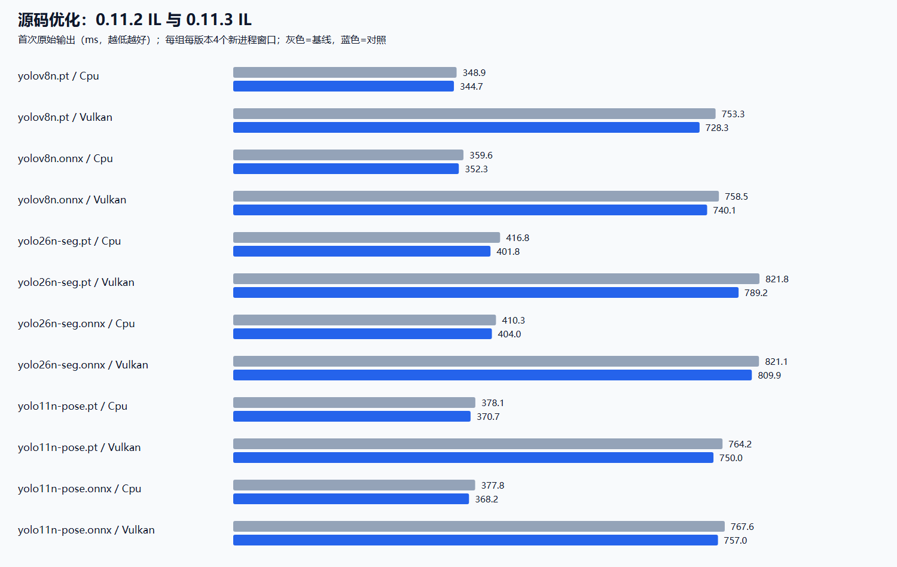

# 0.11.3 加载、首次推理与稳定性优化

实测：Windows / i7-8700K / GTX 1050 Ti，FP32、batch1、640×640、12线程，固定真实图片输入。检测、分割、姿态各一个模型，PT/ONNX、CPU/Vulkan，共两组 **192 个独立进程窗口、35,581 次稳态推理**；每窗口另预热60帧，稳态至少3秒/40帧。每组每配置每版本4个窗口，先计算窗口内稳态中位数，再取窗口间中位数；加载和首次输出也取窗口间中位数。

当前是0.11.3源码更新，正式下载仍为 [v0.11.2](https://github.com/hnlyf168/SimdYolo/releases/tag/v0.11.2)。本轮没有重跑 Python/ORT，[0.11.2原版排名](runtime-comparison-0.11.2.md)保留原始口径，不据此宣称后续源码在所有配置领先。Metal未新增实机验证。

## 普通 IL：源码优化前后

基线为0.11.2正式版DLL，对照为0.11.3普通托管IL。减少PT解析临时数组、合并BN复制/缩放；ONNX采用整数路由、复用参数和存活工作区，相同形状只分析一次常量依赖；标签使用独立只读字典减少冷启动特化构造。

| 模型 / 格式 | 设备 | 加载 ms：基线 → 对照 | 首次输出 ms：基线 → 对照 | 稳态 ms：基线 → 对照 | P95 ms：基线 → 对照 | 每帧分配变化 |
| --- | --- | ---: | ---: | ---: | ---: | ---: |
| yolov8n.pt | Cpu | 91.17 → 77.73 | 348.86 → 344.66 | 21.62 → 21.70 | 27.43 → 26.29 | -0.01% |
| yolov8n.pt | Vulkan | 471.25 → 454.10 | 753.32 → 728.30 | 10.36 → 10.33 | 10.73 → 10.76 | +0.00% |
| yolov8n.onnx | Cpu | 91.16 → 85.81 | 359.58 → 352.32 | 22.24 → 21.71 | 29.50 → 27.72 | -2.15% |
| yolov8n.onnx | Vulkan | 459.96 → 451.80 | 758.49 → 740.11 | 10.56 → 10.54 | 10.97 → 10.93 | -0.00% |
| yolo26n-seg.pt | Cpu | 104.14 → 92.08 | 416.75 → 401.80 | 30.05 → 30.56 | 41.04 → 42.06 | -0.02% |
| yolo26n-seg.pt | Vulkan | 484.19 → 460.40 | 821.82 → 789.21 | 14.48 → 14.45 | 14.91 → 15.05 | -0.00% |
| yolo26n-seg.onnx | Cpu | 99.24 → 95.97 | 410.35 → 403.95 | 30.99 → 29.47 | 41.81 → 40.41 | -2.29% |
| yolo26n-seg.onnx | Vulkan | 463.16 → 461.71 | 821.08 → 809.90 | 14.51 → 14.51 | 15.06 → 14.99 | +0.00% |
| yolo11n-pose.pt | Cpu | 99.89 → 86.25 | 378.12 → 370.68 | 23.17 → 23.09 | 28.07 → 27.46 | -0.00% |
| yolo11n-pose.pt | Vulkan | 469.92 → 453.73 | 764.16 → 750.00 | 10.89 → 10.88 | 11.19 → 11.22 | +0.00% |
| yolo11n-pose.onnx | Cpu | 95.60 → 90.47 | 377.81 → 368.22 | 23.88 → 23.23 | 32.65 → 35.32 | -3.24% |
| yolo11n-pose.onnx | Vulkan | 461.63 → 458.75 | 767.63 → 757.01 | 11.19 → 11.19 | 11.50 → 11.45 | -0.00% |

[SVG矢量图](startup-source-0.11.3.svg)

## 相同源码：可选快速启动发布

基线为上表**相同SHA256的0.11.3 IL**，对照为0.11.3 ReadyToRun主库。两边使用相同计时程序，只替换主库；表中加载、首次输出、稳态均是这一组独立ABBA测量，不能把两组窗口拼接成同一次调用。实际网页和CLI的FastStartup配置已发布到隔离目录验证。

| 模型 / 格式 | 设备 | 加载 ms：基线 → 对照 | 首次输出 ms：基线 → 对照 | 稳态 ms：基线 → 对照 | P95 ms：基线 → 对照 | 每帧分配变化 |
| --- | --- | ---: | ---: | ---: | ---: | ---: |
| yolov8n.pt | Cpu | 79.10 → 46.82 | 348.63 → 281.63 | 21.78 → 21.58 | 27.98 → 29.28 | +0.08% |
| yolov8n.pt | Vulkan | 447.17 → 413.09 | 731.95 → 675.73 | 10.36 → 10.38 | 10.70 → 10.75 | +0.00% |
| yolov8n.onnx | Cpu | 85.84 → 48.96 | 350.85 → 282.67 | 21.72 → 21.66 | 27.53 → 28.27 | +0.08% |
| yolov8n.onnx | Vulkan | 458.57 → 414.27 | 753.77 → 688.03 | 10.58 → 10.61 | 10.96 → 11.10 | +0.00% |
| yolo26n-seg.pt | Cpu | 90.83 → 62.58 | 402.88 → 317.97 | 30.29 → 30.24 | 40.68 → 40.77 | +0.08% |
| yolo26n-seg.pt | Vulkan | 459.76 → 420.58 | 792.79 → 728.51 | 14.48 → 14.46 | 14.86 → 14.87 | -0.00% |
| yolo26n-seg.onnx | Cpu | 95.09 → 54.79 | 400.72 → 316.16 | 29.45 → 29.38 | 42.33 → 42.57 | +0.07% |
| yolo26n-seg.onnx | Vulkan | 461.29 → 415.34 | 806.21 → 729.01 | 14.49 → 14.48 | 14.94 → 14.96 | -0.00% |
| yolo11n-pose.pt | Cpu | 84.26 → 53.35 | 362.72 → 285.46 | 23.13 → 23.02 | 31.21 → 32.69 | +0.14% |
| yolo11n-pose.pt | Vulkan | 454.91 → 417.91 | 755.05 → 693.42 | 10.92 → 10.92 | 11.18 → 11.19 | -0.00% |
| yolo11n-pose.onnx | Cpu | 90.49 → 53.07 | 368.06 → 292.07 | 23.25 → 23.34 | 30.16 → 31.11 | +0.13% |
| yolo11n-pose.onnx | Vulkan | 454.67 → 416.31 | 752.41 → 697.81 | 11.23 → 11.22 | 11.50 → 11.46 | +0.00% |

[SVG矢量图](startup-publish-0.11.3.svg)

ReadyToRun是.NET SDK的预编译发布方式，源代码仍为C#，不会引入Python或其他推理运行库。**应用发布程序集包含IL与平台相关预编译代码，NuGet主库及普通构建保持托管IL。** 发布体积和持续运行结果一起评估，使用方式与平台约束见[启动文档](../docs/startup.md)。

## 网页启动与同进程再次加载

| 独立场景 | 基线 | 对照 | 变化 |
| --- | ---: | ---: | ---: |
| 进程启动至33模型API列表可用：0.11.2普通发布 → 0.11.3 FastStartup | 1681.28 ms | 1165.57 ms | -30.67% |
| 同进程再次构造v8n PT/Vulkan会话：0.11.2 IL → 0.11.3 IL | 278.87 ms | 227.40 ms | -18.46% |

网页数据来自8个ABBA进程，包含dotnet宿主和ASP.NET启动，不包含网页渲染或图片推理；模型列表内容摘要完全一致。[原始JSON](validation/0.11.3/web-startup.json)。再次加载使用4个ABBA进程，每进程4次完整新建/释放，后3次作为再加载样本，每版本2个进程/6个相关样本，不将同进程样本视为6个独立实验。Vulkan仅共享进程实例，各会话设备和显存仍独立，详见[生命周期与稳定性证据](validation/0.11.3/README.md)。

## 口径与原始证据

- 加载包含后端创建、模型解析和权重准备。首次输出从托管Main首条语句开始，包含输入读取、加载和首次PredictRaw；不包含dotnet宿主启动和入口JIT，不等于图片端到端响应时间。
- GPU包含输入上传和所有输出读回；图片缩放、NMS、最终掩码、浏览器绘制不在此计时范围。默认继承应用Vulkan缓存，保留操作系统与驱动缓存，不称为硬件冷启动。
- 稳态列为每帧中位数，分配列为精确托管分配变化，负数表示减少。工作集、CPU占用、P95、首帧单独耗时及完整样本保存在JSON中；本轮没有重新采样GPU利用率。
- [源码ABBA记录](lifecycle-source-0.11.3.json)、[发布方式ABBA记录](lifecycle-publish-0.11.3.json)、[功能/稳定性与独立官方输出校验](validation/0.11.3/README.md)。原始f32位于记录中的本机.cache路径，没有随源码提交，迁移及独立验证方法见[工具说明](../tools/LifecycleBenchmark/README.md)。
- 官方参考采用与实测一致的12线程，首帧/末帧共520/520项通过。另保留4线程参考旧版两个窗口的严格匹配失败，新版窗口通过；参考线程和所有容差在独立校验JSON中明确记录。

| 实测程序集 | SHA256 |
| --- | --- |
| 0.11.2 IL | `0db578d4537e21424babdcb3a430216e1ac170dd767d59930008a046adaed199` |
| 0.11.3 IL | `72d6c746134df7b5088fb96e930b3616e57b2893dedccfb4c5556621456cc6ea` |
| 0.11.3 ReadyToRun | `33c6e6c53f5ec831bbbf3fca290e445821c0746b8163ebcae880f0989cedf203` |

输入SHA256：`4312bccf98b9fcd92bbb73c7530f757d62bebb46da5a585bf1da1d642d8040af`。复现脚本：[run-startup-comparison.ps1](../tools/run-startup-comparison.ps1)。
