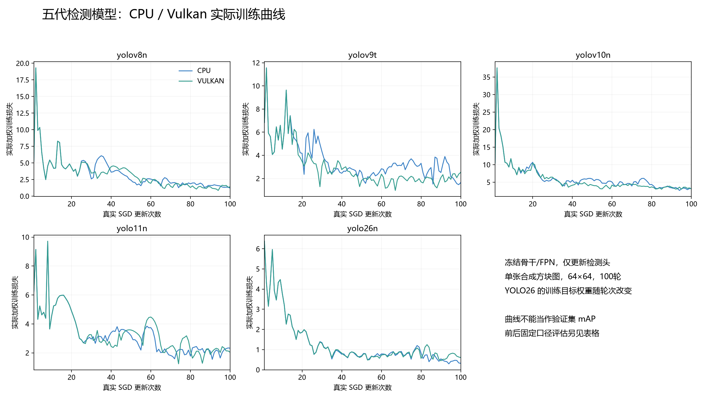
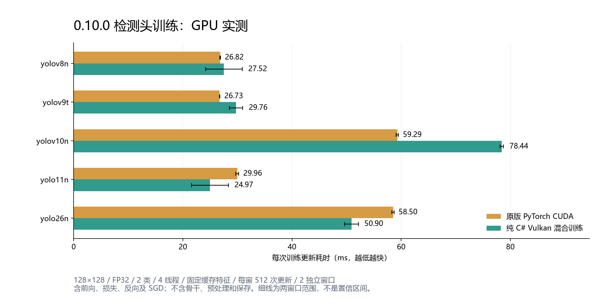

# 0.10.0 五代检测头训练测试与评测

本版把 v8、Ultralytics v9、v10、YOLO11、YOLO26 接入同一个纯 C# 检测头微调入口和网页。骨干/FPN 冻结；v10/26 两个分支均训练。分割/姿态、全参数与 Metal 训练尚未实现。

## 正确性与实际训练

固定官方 Ultralytics 8.4.0 / PyTorch 2.11.0 CPU 参考：**34/34 组、19,620/19,620 项检查通过**。五模型 × CPU/Vulkan × 普通/小目标/空标签，另含 YOLO26 两设备的中间轮和末轮。检查完整分支前向、官方单/双头组合目标、标签分配、logits 梯度、全部参数梯度、梯度连接状态、BN、SGD 后权重及动量；保留固定容差。性能所用128尺寸另有五组夹具检查。

| 实际权重 | CPU 评估损失（前→后） | Vulkan 评估损失（前→后） | 实际更新 | 保存/恢复/推理 |
| --- | ---: | ---: | ---: | --- |
| yolov8n.pt | 4.3659 → 1.5440 | 4.3659 → 1.7915 | 各100步 | 通过 |
| yolov9t.pt | 6.7364 → 1.8002 | 6.7364 → 2.7761 | 各100步 | 通过 |
| yolov10n.pt | 10.0107 → 3.9812 | 10.0107 → 3.4818 | 各100步 | 通过 |
| yolo11n.pt | 5.2309 → 2.2268 | 5.2309 → 2.1137 | 各100步 | 通过 |
| yolo26n.pt | 4.6971 → 0.4148 | 4.6971 → 0.4829 | 各100步 | 通过 |

上表为固定单图合成方块、64×64、SGD学习率0.005、100轮的 BN 推理模式损失；YOLO26 评估固定初始0.8/0.2双头权重。曲线是每步实际优化目标，YOLO26会随轮次调权；两者不能混为一个指标。单图损失下降只证明真实更新和可拟合性，**没有在 COCO 或业务留出集测量 mAP**。

恢复测试比较同一调度下连续三轮和取消后恢复：参数/BN绝对容差2e-5，训练后的动量使用与梯度相同的5e-4+2e-3×|参考值|；加载时动量字节必须完全一致。重新提取的冻结特征存在 FP32 舍入，未要求 CPU 跨会话训练过程逐位相同。原生检查点元数据、类别、输出形状和 CPU/Vulkan 推理另检。

修正了两种 SGD 行为：全背景框分支未连接时跳过衰减/动量；有正样本时所有回归尺度获得显式零梯度，未命中尺度仍执行 SGD。两种情况均由官方梯度连接及更新结果检查。

## 训练速度排名

本机 i7-8700K / GTX 1050 Ti。128×128、2类、FP32、单图BN、4线程、固定初始权重和**完全相同的缓存特征**。各引擎独立进程串行运行，预热10步，每窗固定512次 SGD 更新；两轮反转后端顺序。40/40 窗口、20,480次计时更新完成。

计时含头部前向、标签分配/损失、反向、SGD及梯度清零；Vulkan包含头部 GEMM 上传/回读，PyTorch CUDA每步等待GPU完成。排除冻结骨干、图像预处理、模型加载和每轮检查点压缩写盘。PyTorch保持训练BN，未做推理融合；优化器均为SGD。YOLO26在此固定调度首轮权重，未运行官方MuSGD全配方。

PyTorch参考直接使用官方检测头模块、loss及torch.optim.SGD，与C#一样仅替换原预训练头的分类末层为2类、保留隐藏通道。此处的“原版”表示官方算子与损失参考，不是包含DataLoader、数据增强、全参数反向与保存的Ultralytics train全流程耗时。

每格为两窗口中位数的中位数，单位ms，①较快；只在同一 CPU/GPU 分组内排名，小差异不能证明稳定领先。

| 模型 | 原版 PyTorch CPU | 我们 CPU SIMD | CPU 最快 | 原版 PyTorch CUDA | 我们 Vulkan 混合 | GPU 最快 |
| --- | ---: | ---: | --- | ---: | ---: | --- |
| yolov8n | **11.09 ①** | 16.38 ② | PyTorch | **26.82 ①** | 27.52 ② | PyTorch |
| yolov9t | **10.65 ①** | 14.89 ② | PyTorch | **26.73 ①** | 29.76 ② | PyTorch |
| yolov10n | **25.09 ①** | 32.19 ② | PyTorch | **59.29 ①** | 78.44 ② | PyTorch |
| yolo11n | **12.67 ①** | 14.61 ② | PyTorch | 29.96 ② | **24.97 ①** | 我们的实现 |
| yolo26n | 22.62 ② | **21.42 ①** | 我们的实现 | 58.50 ② | **50.90 ①** | 我们的实现 |

Vulkan训练是混合路径，头部深度卷积、BN、激活、损失、SGD及数据整理仍在CPU。当前推理专用优化不能直接用于持续变化的训练权重；速度结果以本表为准，不能宣称全面超越PyTorch。普通ONNX Runtime未安装Training/ORTModule，本轮不提供其训练耗时，亦不以ORT推理速度代替训练。

## CPU、内存与GPU资源

CPU%按全机逻辑核心归一化，RSS是训练窗口采样峰值的两轮中位数，包含宿主、冻结模型和缓存；GPU%/显存为两窗口整卡样本均值，包含桌面及其他进程，不能解释成训练进程独占。采样数保留在JSON，短窗口的整卡采样只作粗略参考。

| 模型 | 引擎 | CPU %（全机） | RSS采样峰值 MiB | GPU %（整卡） | 显存 MiB（整卡） |
| --- | --- | ---: | ---: | ---: | ---: |
| yolov8n | 原版 PyTorch CPU | 33.4 | 314.1 | — | — |
| yolov8n | 纯 C# CPU SIMD | 13.3 | 280.2 | — | — |
| yolov8n | 原版 PyTorch CUDA | 8.1 | 1378.8 | 22.3 | 1257.0 |
| yolov8n | 纯 C# Vulkan 混合训练 | 5.7 | 395.4 | 23.9 | 1206.1 |
| yolov9t | 原版 PyTorch CPU | 33.4 | 308.9 | — | — |
| yolov9t | 纯 C# CPU SIMD | 14.8 | 139.7 | — | — |
| yolov9t | 原版 PyTorch CUDA | 8.1 | 1378.0 | 20.2 | 1254.3 |
| yolov9t | 纯 C# Vulkan 混合训练 | 5.2 | 271.1 | 27.8 | 1242.2 |
| yolov10n | 原版 PyTorch CPU | 33.3 | 318.0 | — | — |
| yolov10n | 纯 C# CPU SIMD | 12.7 | 182.6 | — | — |
| yolov10n | 原版 PyTorch CUDA | 8.1 | 1375.8 | 29.3 | 1265.2 |
| yolov10n | 纯 C# Vulkan 混合训练 | 4.4 | 292.0 | 31.0 | 1203.9 |
| yolo11n | 原版 PyTorch CPU | 33.3 | 308.9 | — | — |
| yolo11n | 纯 C# CPU SIMD | 12.8 | 182.0 | — | — |
| yolo11n | 原版 PyTorch CUDA | 8.1 | 1383.8 | 24.4 | 1252.0 |
| yolo11n | 纯 C# Vulkan 混合训练 | 6.1 | 264.6 | 18.9 | 1204.0 |
| yolo26n | 原版 PyTorch CPU | 33.3 | 306.6 | — | — |
| yolo26n | 纯 C# CPU SIMD | 12.2 | 157.0 | — | — |
| yolo26n | 原版 PyTorch CUDA | 8.1 | 1361.2 | 30.5 | 1242.5 |
| yolo26n | 纯 C# Vulkan 混合训练 | 4.8 | 280.9 | 25.0 | 1213.4 |

## 证据与复现

- 主库 SHA256：`30970ba0592dabd32bd848521fb9c8a6218165cd5960238f395abc84fbd82d18`。
- 训练库 SHA256：`e5971a8d0671a5b97ae72ee02146860391194e2102b3b63414e92e4ebb143232`。
- [训练速度原始JSON](validation/0.10.0/performance/training-runtime-comparison.json)，SHA256：`2743ce7483b1f7e62bcd379da451fa5bc5e957926fcd2510092216ad88d9f198`。
- [数值对照矩阵](validation/0.10.0/oracle-matrix.json)、[CPU微调](validation/0.10.0/integration-cpu.json)、[Vulkan微调](validation/0.10.0/integration-vulkan.json)。
- [完整复现命令与网页验证](validation/0.10.0/README.md)、[训练API及支持范围](../docs/training.md)。

历史0.9.0推理图表继续绑定旧DLL；本报告只表示0.10.0检测头训练，不改写历史排名。Python/PyTorch和绘图库仅用于开发评测，运行库继续保持纯C#。
