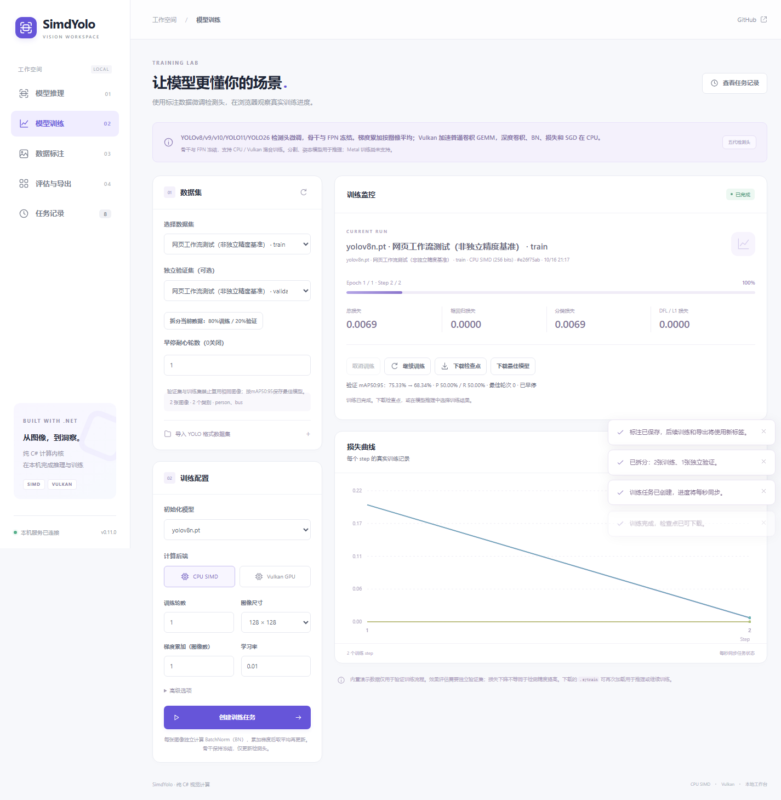
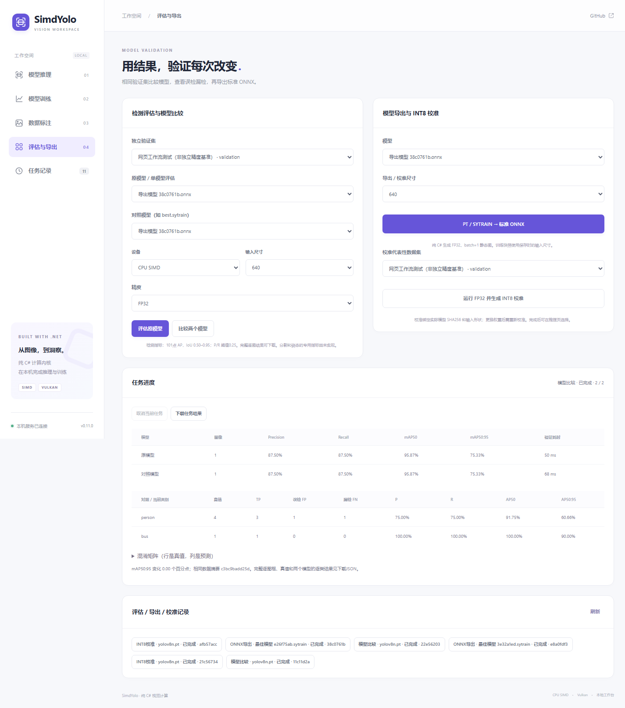

# 0.11.0 源码验证

2026-10-16，Windows 11 / i7-8700K / GTX 1050 Ti。主库、训练与新增模型工作流均为纯 C# / .NET 10；没有Python/ORT运行依赖。浏览器解码图片、编辑标注和合成透明PNG。Vulkan/Metal仍通过系统图形API工作，Metal本机未验证。

## 功能和回归

| 检查 | 结果 | 原始证据 |
| --- | --- | --- |
| 新增托管数值/真实模型用例 | 23项通过 | [features.json](features.json)、[日志](features.log) |
| 纯.NET导出 → 本库回读 | 五代原模型及两类别实训SYTRAIN、v8/26分割姿态、v10/26大锚点TopK | 同上 |
| 标准ONNX与独立ORT | 16个文件全部通过 | [onnx-export.json](onnx-export.json) |
| CPU / Vulkan原推理回归 | 113项通过 | [日志](inference-tests.log) |
| 训练单元/集成/Vulkan回归 | 19项通过 | [日志](training-tests.log) |
| 真正浏览器工作流与旧功能 | 41条流程检查，0浏览器错误 | [web-browser.json](web-workflows/web-browser.json) |
| 包与中文XML | 托管IL、框架引用、中文公开API、33原模型及许可证审查 | [package-audit.json](package-audit.json) |

23项包含101点AP的完美/重复/先误检/错类/无真值用例，固定拆分及照片隔离，整数点积尾数与防溢出，独立整数卷积/GEMM参考（分组、深度卷积、批次、非对称填充、膨胀、SiLU），校准的模型/形状/缺层/损坏拒绝，以及最佳模型、早停和验证集绑定恢复。PT、ONNX和SYTRAIN均实际运行FP16混合/INT8。

10个基础检测导出文件使用64输入；额外v8/26分割姿态4个文件，以及v10/26的320输入2个文件，共16个。五份SYTRAIN经过真实1轮训练、自定义两类别，未用原权重冒充训练后导出。ONNX checker启用完整形状检查，ORT使用CPUExecutionProvider；逐张量门槛为0.004×(1+|参考|)，本轮最大归一化误差约6.66e-5。

端到端TopK允许极低分、近同分候选的顺序变化，分数门槛固定2e-6；必须同类别、全部坐标及附加字段一对一匹配，不删除、不补造候选。原始PT输出保留在开发缓存，不先排序改写。导出分类概率使用显式1/(1+exp(-x))，避免部分运行时Sigmoid的低分相消舍入影响TopK边界。

## 网页实际操作

浏览器用真正鼠标在画布画框、改变类别并保存；从.NET接口回读坐标核对，并验证旧版本保存返回409。运行真实模型预标注后，先检查数据集没有被自动修改，再点击保存。下载的[YOLO ZIP](web-workflows/annotation-dataset.zip)包含.NET编码的PNG和对应标签。

随后通过网页拆分训练/验证集，完成训练前和轮次验证，注册最佳模型，比较原PT与实际best.sytrain，并导出ONNX、生成校准、执行校准INT8及FP16混合CPU推理。完整比较包括逐图真值与预测：[JSON](web-workflows/web-model-comparison.json)。此小数据集使用同一公交照片的不同尺寸和部分手工/模型建议框，**只证明工作流，不能作为独立精度或训练效果基准**。

同一次浏览器运行还覆盖4K检测、8K分割及Vulkan姿态、原图坐标映射、有界RGB、人物/车辆分离、透明PNG实际下载、取消/恢复及手机布局。新增页面390px宽度无横向溢出。原有功能的独立记录保留于[web-regression](web-regression/web-browser.json)；历史记录不覆盖。

## 低精度精度和速度

五个原始检测模型，batch1、320×320、CPU四线程。复用既有COCO128固定拆分：从96张训练侧取前8张校准，32张验证侧评估。预训练模型已见过COCO train2017，这里仅作实现诊断，不能声称未见数据泛化。

FP16为Half操作数、FP32 SIMD累加；INT8为托管整数计算，不使用ORT。非线性及输出仍为FP32。静态最大值校准不能保证优于动态量化，权重和输入形状必须与JSON绑定一致。GPU目前仍为FP32。

原始模型SHA、校准/验证数量、P/R与mAP、加载/首帧/稳态采样、每帧托管分配及程序集SHA均在[precision.json](precision.json)；[直观表格](precision-table.md)从该文件生成。计时使用同一真实图片输入，预热20次、测量15次取中位数，仅包括网络前向，不包含预处理、NMS、加载或HTTP。整个矩阵串行，单进程诊断，不是多进程统计显著性比较，也不替换历史640尺寸排名。

**当前低精度模式均慢于现有FP32执行器，作为实验功能提供，默认FP32。** 小样本mAP的上下波动不代表量化能提高精度。没有根据模式名称推断速度或内存优势，FP16也不声称使用原生半精度乘加。

## 复现和程序集

源码功能见[使用说明](../../../docs/model-workflows.md)。从仓库根目录：

~~~powershell
dotnet run --project tests/SimdYolo.Training.Tests -c Release -- features .cache/features-011
python tools/validate-managed-onnx.py
dotnet run --project tests/SimdYolo.Tests -c Release -- --vulkan
dotnet run --project tests/SimdYolo.Training.Tests -c Release -- --integration --vulkan
# 使用既有真实照片RGB与标签清单，不在产品中引入图片解码依赖：
dotnet run --project tests/SimdYolo.Training.Tests -c Release -- precision-validation .cache/training-011/outcomes/dataset.json artifacts/validation/0.11.0/precision.json
dotnet run --project examples/SimdYolo.Web -c Release
# 另一个终端：
node tools/validate-web-browser.mjs --image .cache/bus.jpg --features --large-images --cutout --output artifacts/validation/0.11.0/web-workflows
python tools/audit-package.py --version 0.11.0
~~~

开发用Python验证需要onnx1.21.0、onnxruntime1.26.0和NumPy；浏览器测试用Node24及本机Edge。应用运行不需要这些工具。数据清单的准备沿用[0.10.1训练结果验证](../0.10.1/README.md)，照片和标签原始来源及摘要保留。

新增用例、低精度记录和包审查分别保存实际程序集摘要；[manifest.json](manifest.json)绑定最终源码文件、DLL、测试和浏览器版本。数值/计时结束后，仅补全训练库三个参数的中文XML说明；原测量SHA保持不变，最终包另经[离线NuGet实际消费](package-consumer.json)和[训练库文档审查](training-metadata.json)。主库计时DLL与最终包一致。源码版本0.11.0不等于已创建GitHub Release，历史0.10.1附件保持不变。
