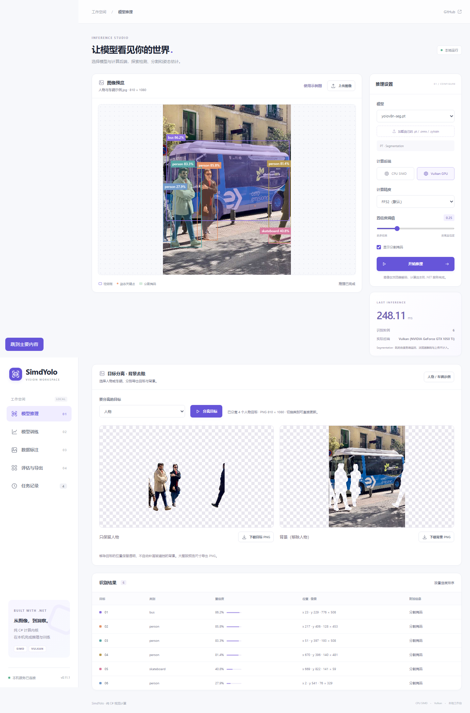

# 0.11.1 图片推理与分离验证

本轮优化纯.NET的原图掩码处理，以及网页目标分离/背景去除管线。冻结0.11.0基线来自提交039ee0f0c178da68b68d6ae69e46d6e719726b36和仓库内原始NuGet，主库SHA256为e43524574bbfbe0d3bdc0914d71f91dbf02a466c819a47af295aa8f275e6276f。

[速度、分配、直观表格与图](../../image-pipeline-optimization-0.11.1.md) · [实际分离PNG](web/cutout-foreground.png) · [实际背景PNG](web/cutout-background.png)

## 检查及证据

| 检查 | 结果 | 证据 |
| --- | --- | --- |
| CPU/Vulkan推理回归 | 116项通过，含3项新增用例 | [日志](inference-tests.log) |
| 关闭全部硬件intrinsics | 两项新增掩码专项通过 | [日志](masks-software.log) |
| 训练集成、保存恢复、Vulkan | 19项通过 | [日志](training-tests.log) |
| 真实浏览器完整工作流 | 41条检查，0浏览器错误 | [JSON](web/web-browser.json) |
| 传输及缓存专项 | 15项通过，24,576 RGBA字节与旧实现完全一致 | [JSON](image-web.json) |
| 冻结/当前核心实测 | 24个串行进程窗口，12组最终帧对照 | [完整采样](image-performance.json) |
| 实际UI整轮 | 两尺寸×CPU/Vulkan×旧/新，含RGB、HTTP和合成 | [采样](web-performance.json) |
| 纯托管、中文XML、33原模型许可证 | 审查通过 | [主包](package-audit.json)、[训练元数据](training-metadata.json) |
| 离线NuGet实际消费 | CPU/Vulkan各4个真实PT/ONNX分割，训练保存/恢复/导出 | [CPU](package-consumer-cpu.json)、[Vulkan](package-consumer-vulkan.json) |

独立标量掩码参考使用原有半像素采样、填边ROI和浮点运算顺序，门槛3e-6。覆盖非整数/极小边框、窄图、1×1原型、SIMD尾部、舍入与非有限值；公开输出不引用池内存。真实模型对照固定框0.01像素、置信度2e-5和概率2e-5门槛，记录全部像素及0.5阈值翻转数，不删除接近边界的值。旧JSON与新RGB接口在实际照片上的最大掩码字节差为1，框最大约0.00016像素。

浏览器覆盖4K检测、8K分割、8K Vulkan姿态，所有RGB及预览边长不超过2048。分离前景/背景的透明度互补，下载两张真实PNG；重叠实例、孔洞、自定义类别顺序、无目标、原图坐标映射和旧结果失效均通过。RGB二进制接口校验有限元数据、精确字节数、截断和额外chunked字节；改变置信度返回reusedSession=true与modelLoadMs=0。新增缓存验证覆盖内容变化、彩色层复用、LRU上限、清空以及超预算临时结果。

## 性能口径

Windows 11 / i7-8700K / GTX 1050 Ti，FP32、batch1、模型640×640、四线程。公交实拍图为仓库示例照片，RGB由同一浏览器解码产生；2048×1536大图使用白色填充并等比放置该照片。输入、模型及DLL摘要在每个窗口记录。

主要分割配置按旧→新→新→旧运行，每版两个独立进程；检测控制和大图各一对。每段预热12次，至少2秒/40帧。Predict为实际完整图像推理，不含HTTP与网页；8位转换单独测量，不把分段中位数相加。CPU百分比为进程核心百分比，托管分配不等于保留内存；本轮不采集GPU利用率/显存，也未清空OS/驱动缓存。网页每配置预热3次/测5次，旧全部→新全部，包含相同响应克隆和完成轮询开销，仅作开发诊断。

没有重新执行PyTorch/ORT性能矩阵，不将本轮完整图像耗时与历史纯前向排名混在一起。GPU前向着色器没有修改，Metal未实机测试。0.11.1版本源码/本地包不表示已经创建GitHub Release；历史附件保留原字节。

## 复现

先按源码构建并启动网页版，使用自己的空DataRoot以避免混入现有任务。Node24及本机Edge仅用于开发验证，产品不依赖它们。

~~~powershell
dotnet run --project tests/SimdYolo.Tests -c Release -- --vulkan
dotnet run --project tests/SimdYolo.Training.Tests -c Release -- --integration --vulkan
node tools/validate-web-browser.mjs --url http://127.0.0.1:5201 --image .cache/bus.jpg --large-images --cutout --features --output artifacts/validation/0.11.1/web
node tools/validate-image-web.mjs http://127.0.0.1:5201
~~~

性能工具需要两个独立网站：5200使用提交039ee0f0的网页发布输出，5201使用0.11.1输出，均以当前仓库作为RepositoryRoot，以各自空目录作为DataRoot。必须在各自发布目录启动，或显式设置contentRoot，确保真实静态页面可访问。可在独立worktree构建历史网页，模型从当前仓库读取，无需复制权重。

~~~powershell
# 页面基准同时保存两个真实RGB/PNG输入至.cache/image-optimization/fixtures。
node tools/benchmark-image-web.mjs
# 从artifacts/SimdYolo.0.11.0.nupkg提取lib/net10.0/SimdYolo.dll到下列baseline路径。
dotnet build tools/ImagePipelineBenchmark -c Release -o .cache/image-optimization/baseline-worker -p:SimdYoloLibraryPath=F:/simdyolo/.cache/image-optimization/baseline/SimdYolo.dll
dotnet build tools/ImagePipelineBenchmark -c Release -o .cache/image-optimization/optimized-worker
python tools/run-image-benchmark.py
python tools/summarize-image-benchmark.py
python tools/audit-package.py --version 0.11.1
dotnet pack src/SimdYolo.Training -c Release --no-build -o artifacts
dotnet run --project tools/ImagePackageConsumer -c Release -- Cpu .cache/image-package-consumer/Cpu
dotnet run --project tools/ImagePackageConsumer -c Release -- Vulkan .cache/image-package-consumer/Vulkan
~~~

独立缓存专项还需将原提交的wwwroot/cutout.js保存在.cache/image-optimization/baseline/cutout.js，用于浏览器逐字节对照。测试照片可直接使用examples/SimdYolo.Web/wwwroot/samples/bus.jpg，.cache/bus.jpg为本机副本。Python标准库只编排.NET宿主和校验二进制；绘图另外需要Matplotlib及中文字体，不进入应用运行依赖。[manifest.json](manifest.json)记录最终DLL、网页、输入、包与证据摘要。
