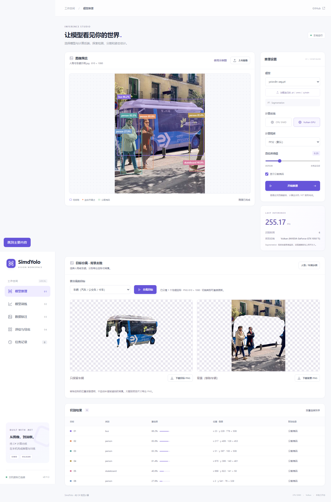

# 0.11.3 源码优化验证

本轮保持 C#/.NET 推理与训练核心，优化 PT 加载、ONNX 执行工作区和 Vulkan 会话生命周期，并提供可选 ReadyToRun 发布。正式下载仍为 [v0.11.2](https://github.com/hnlyf168/SimdYolo/releases/tag/v0.11.2)，本目录不表示已发布新版本。

| 验证 | 证据 |
| --- | --- |
| CPU/Vulkan 推理完整回归120项 | [日志](inference-tests.log) |
| 训练集成20项，含33模型的单次标签/训练能力检查 | [日志](training-tests.log) |
| Vulkan 50次设备创建，交错释放及零会话后重载 | [日志](vulkan-lifetime.log) |
| ONNX在已分配中间张量后异常恢复，动态尺寸/可选输入/别名/公开输出保护 | [专项日志](onnx-recovery.log) |
| 12配置、3模型×PT/ONNX×CPU/Vulkan，每配置4次新建/释放、324帧逐输出核验 | `session-*.json`；合计3,888帧、48次会话 |
| ReadyToRun 分割CPU/Vulkan，每配置4次会话、124帧核验 | [CPU](ready-session-yolo26n-seg-cpu.json)、[Vulkan](ready-session-yolo26n-seg-vulkan.json) |
| 浏览器41条完整流程，含8K图片、真实前景/背景PNG、标注、训练/验证/导出/恢复 | [JSON](web/web-browser.json) |
| 网页15项上传/缓存检查，24,576个RGBA字节与原流程一致 | [JSON](image-web.json) |
| 33模型API就绪时间，8个独立ABBA进程 | [JSON](web-startup.json) |
| 同进程再加载：4个ABBA进程，每进程4次会话 | [基线1](reload-1-baseline.json)、[新版1](reload-2-il.json)、[新版2](reload-3-il.json)、[基线2](reload-4-baseline.json) |
| 纯.NET程序集及中文XML参数/返回值/属性/异常文档 | [主库](core-metadata.json)、[训练库](training-metadata.json) |
| 离线NuGet实际消费：CPU/Vulkan分割、单次模型检查、训练/恢复/导出，DLL与计时冻结版本一致 | [CPU](package-consumer-cpu.json)、[Vulkan](package-consumer-vulkan.json)、[本地包审查](local-package-audit.json) |
| 首帧/末帧与官方PyTorch独立数值对照 | [源码组](source-outputs.json)、[发布方式组](publish-outputs.json)、[独立应用缓存组](isolated-outputs.json) |

## 计时与程序集

[加载、首次输出、稳态、P95与分配表格/图](../../startup-optimization-0.11.3.md)。源码IL对照和同源码ReadyToRun对照各96个新进程窗口；另有4个使用独立Vulkan应用缓存的窗口。GPU均验证没有回退CPU；默认Vulkan应用缓存、操作系统文件缓存与驱动缓存的处理方式在原始记录中保留，不能把这些测试称为硬件冷启动。

[源码记录](../../lifecycle-source-0.11.3.json) · [发布方式记录](../../lifecycle-publish-0.11.3.json) · [独立应用缓存](../../lifecycle-isolated-0.11.3.json) · [最终程序集与来源审查](final-audit.json)。原始FP32首帧/末帧保存在记录的本机.cache路径，JSON和哈希随源码保留；仅下载JSON不能重做原始字节核验。[复现与迁移](../../../tools/LifecycleBenchmark/README.md)。

普通主库仅引用.NET框架，训练库额外引用本项目主库。ReadyToRun属于可选应用发布方式，发布目录中的程序集包含平台相关预编译代码；普通构建和NuGet主库保持托管IL。[使用及平台约束](../../../docs/startup.md)。

独立参考使用CPU PyTorch 2.11.0、Ultralytics 8.4.0，与性能实测一致的12线程。源码组256/256、发布组256/256、独立应用缓存8/8，合计**520/520**项通过。另保留[4线程参考原始结果](source-outputs-reference4.json)：旧版ONNX分割的两个末帧未通过严格候选匹配，新版窗口均通过。两次验证使用相同输入、权重、FP32及同一容差，没有删除窗口或放宽门槛；参考线程变化会影响临界候选的数值/匹配，不据此推断模型精度变化。

## 稳定性口径

连续检查使用同一真实图片输入，逐输出扫描有限数值，以 `abs 0.003 + rel 0.0003` 比较首帧参考；之前返回的首帧还进行逐字节检查，确保后续调用没有覆盖它。每配置执行4次构造与释放，释放后调用必须抛出 `ObjectDisposedException`，重复释放安全。动态形状和图像数据变化由单独的路由回归及真实浏览器大图检查覆盖。

内存指标比较预热后、完整GC后的存活托管字节，增长门槛32 MiB；工作集峰值另记。报告中的少量增长可能包括当前保留的一份返回输出，不等于泄漏。这个窗口检查没有定义任意设备、任意输入或无限运行的内存上限，也不把吞吐中位数视为尾延迟保证。

最初探索时出现一次访问异常。Windows记录指向 `nvoglv64.dll_unloaded`（[事件摘录](native-event-initial.json)），没有捕获驱动内部调用栈。随后改为保留进程唯一VkInstance，避免会话之间反复卸载驱动；各会话的设备、命令及显存仍独立释放。完整回归、多会话交错释放、零会话后重载和连续推理检查在此改动后执行；早期探索数据没有纳入正式性能表。
