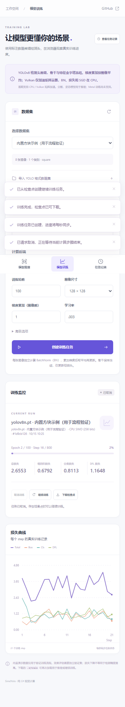

# 0.9.0 训练与网页验证

本轮交付冻结骨干/FPN 的 YOLOv8 检测头微调及本地 ASP.NET Core 示例。主库和训练库均为纯托管 C#；训练库仅依赖主库与 .NET 标准库。以下验证针对正确性和可运行性，没有进行训练性能或独立数据集 mAP 测量。

## 结果

| 检查 | 结果 | 原始记录 |
| --- | --- | --- |
| Release 解决方案构建 | 0 警告、0 错误 | [build.log](build.log) |
| 原有 CPU/Vulkan 回归 | 117 项通过，包含四个真实 PT 的形状变化/batch/输出所有权 | [inference-tests.log](inference-tests.log) |
| 训练单元/集成 | 12 项通过 | [training-tests.log](training-tests.log) |
| CPU 原版数值对照 | 160/160 | [training-oracle-cpu.json](training-oracle-cpu.json) |
| Vulkan 头 GEMM 原版数值对照 | 160/160，与原版 CPU FP32 对照 | [training-oracle-vulkan.json](training-oracle-vulkan.json) |
| 小目标原版数值对照 | 160/160，正样本分配一致 | [training-oracle-small.json](training-oracle-small.json) |
| 空标签原版数值对照 | 160/160，原版断开的框梯度按零比较并单列记录 | [training-oracle-empty.json](training-oracle-empty.json) |
| 原始单图真实微调 | 推理模式损失 4.365893 → 1.1628115，64×64、100轮 | [training-loss.json](training-loss.json) |
| 网页 API | CPU/Vulkan 训练、恢复、取消、模型上传/下载/推理、会话复用、错误 RGB 拒绝 | [web-api.json](web-api.json) |
| 真实浏览器 | Edge 无头模式，图像输入/推理、16步训练、继续、取消、移动布局；无控制台错误 | [web-browser.json](web-browser.json) |
| 服务重启 | 上传 PT 名称/训练资格、数据集和任务恢复，重启后继续训练成功 | [web-restart.json](web-restart.json) |
| 主库包 | DLL/XML 与最终 Release 输出一致；33 个原模型摘要/许可证校验通过 | [package-audit.json](package-audit.json) |
| 训练库包 | 仅引用 SimdYolo 0.9.0；中文 XML 结构无缺项 | [training-package-audit.json](training-package-audit.json)、[training-xml-audit.json](training-xml-audit.json) |
| 独立 NuGet 消费 | CPU、Vulkan 均完成训练、SGD 恢复和 `.sytrain` 推理 | [CPU](package-consumer-cpu.json)、[Vulkan](package-consumer-vulkan.json) |

正式对照使用固定 **Ultralytics 8.4.0 / PyTorch 2.11.0+cpu**，640 项覆盖头前向、加权损失、原始输出梯度、参数梯度和 BN 统计。参考工具调用官方 `v8DetectionLoss` 和原始模块，未共享 C# 损失代码；固定容差，未在失败后放宽。小目标最初暴露了候选范围和全局 TopK 交集问题，修正 C# 分配语义后通过。

固定输入来自真实 `yolov8n.pt` 冻结网络；Vulkan 组将训练头 GEMM 放在实际 NVIDIA GeForce GTX 1050 Ti 上运行。该组仍使用 CPU 冻结特征，与参考共享输入，目的是隔离训练头算子；另有真正 Vulkan 冻结网络及完整更新的集成、网页和包消费测试。GPU 训练仍包含 CPU BN/损失/优化器及数据搬运，不是全流程驻留 GPU 的实现。

单图损失只验证可学习性，不能代替独立验证集 mAP，也未验证大数据集收敛。只实测标准 `yolov8n.pt`；其他尺度只有结构兼容检查，没有宣称所有版本/任务都能训练。Metal 未进行本机硬件验证。网页截图的耗时包含首帧及测试并行负载，不能当成性能基准；历史 0.8.1 报告保持原 DLL 和数据。

## 复现

从仓库根目录执行：

```powershell
dotnet build SimdYolo.sln -c Release
dotnet run --project tests/SimdYolo.Tests -c Release -- --vulkan --models models/pt
dotnet run --project tests/SimdYolo.Training.Tests -c Release -- --integration --vulkan
```

无 Vulkan 的机器去掉两个测试命令中的 `--vulkan`；真实模型 `--models` 扩展用例使用 Vulkan，CPU 环境也应省去它。不将 GPU 缺失时未执行的用例算作通过。

开发用 Python 环境需要 NumPy、PyTorch、Ultralytics 相关依赖，`--ultralytics-dir` 必须指向固定 8.4.0 源码。现有目录来自项目先前的独立参考环境，未打入运行包。可在隔离环境安装依赖，然后用 `pip install --target .cache/yolo26-release-reference --no-deps ultralytics==8.4.0` 准备参考源码。仅加载可信的官方 PT 进行原版对照。

```powershell
dotnet run --project tests/SimdYolo.Training.Tests -c Release -- emit-oracle .cache/training-validation/oracle-cpu
python tools/validate-training.py --fixture .cache/training-validation/oracle-cpu --ultralytics-dir .cache/yolo26-release-reference --output artifacts/validation/0.9.0/training-oracle-cpu.json
```

分别在 `emit-oracle 目录` 后加 `--vulkan`、`--small-boxes`、`--empty` 并使用独立目录和报告文件，可复现另外三组。每组保存 `training-fixture-*.json` 元数据、二进制文件摘要、原模型与参考源码摘要。体积较大的 `.f32` 和原始 PT 位于本地缓存，未重复上传；可通过 `emit-oracle` 重建。夹具包含最终主 DLL/训练 DLL SHA256，全部与包内程序集一致；[final-audit.json](final-audit.json)汇总身份和证据摘要。

网页启动及 API/浏览器复现见 [网页 README](../../../examples/SimdYolo.Web/README.md)。验证使用 Ultralytics 官方 `bus.jpg` 进行检测/分割/姿态输入，图片来源为 <https://ultralytics.com/images/bus.jpg>，截图保留实际预测；它不是训练数据或精度验证集。

```powershell
python tools/audit-package.py
dotnet pack src/SimdYolo.Training -c Release --no-build -o artifacts
dotnet restore tools/TrainingPackageConsumer --source artifacts
dotnet run --project tools/TrainingPackageConsumer -c Release --no-restore -- models/pt/yolov8n.pt .cache/training-package-demo Cpu
# 最后一个参数换成 Vulkan 可验证 GPU 包消费
```

下载 [主库包](../../SimdYolo.0.9.0.nupkg) / [训练库包](../../SimdYolo.Training.0.9.0.nupkg)。训练 API 和当前限制见[训练说明](../../../docs/training.md)。



