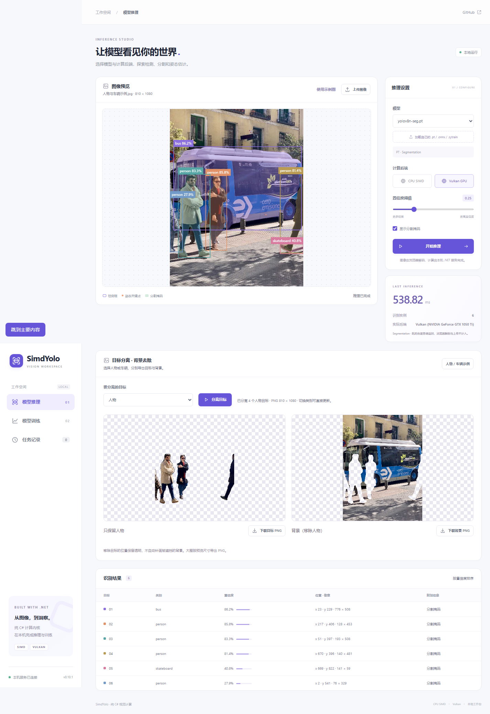

# 网页目标分离与背景去除验证

当前源码的网页示例新增功能；历史0.10.1发布附件保持原内容。推理仍由纯C#库完成，浏览器合成透明图层并编码PNG。

[真实浏览器原始结果](web-browser.json)状态为`passed`，没有浏览器错误。本轮实际使用Vulkan的YOLOv8n分割模型处理示例照片，识别并分离1个公交车实例；目标层覆盖254,477个像素，目标与背景两层的alpha互补误差为0。下载按钮生成的两张PNG均重新解码，实际尺寸810×1080，透明通道互补误差同样为0。

验证同时覆盖：人物快捷选择；自定义类别顺序；单独类别筛选；多实例合并；掩码内孔洞不被检测框填满；原图坐标映射；未匹配类别不伪造目标；非法掩码拒绝；切换类别不重复推理；更换图片后清除旧预览和下载状态。

4K检测、8K分割、8K Vulkan姿态与有界RGBA读取继续通过。分割大图自动生成目标分离预览，处理宽高不超过2048长边。原有网页训练16步、检查点下载、恢复到第3轮、取消训练与移动布局也通过。

```powershell
# 先启动当前源码网页版，再指定实际端口。
node tools/validate-web-browser.mjs --url http://127.0.0.1:5199 --image .cache/bus.jpg --cutout --large-images --output artifacts/validation/web-cutout
```

示例照片与[随网页提供的原图](../../../examples/SimdYolo.Web/wwwroot/samples/bus.jpg)保持相同字节；来源和原许可证见[NOTICE](../../../examples/SimdYolo.Web/wwwroot/samples/NOTICE.txt)。它用于验证功能，不用于独立准确率评估。




[实际目标PNG](cutout-foreground.png) · [实际背景PNG](cutout-background.png)

移除区域为透明洞，不包含内容补全。输出保持预览尺寸；图片中被人物遮挡的车身不会凭空重建。
