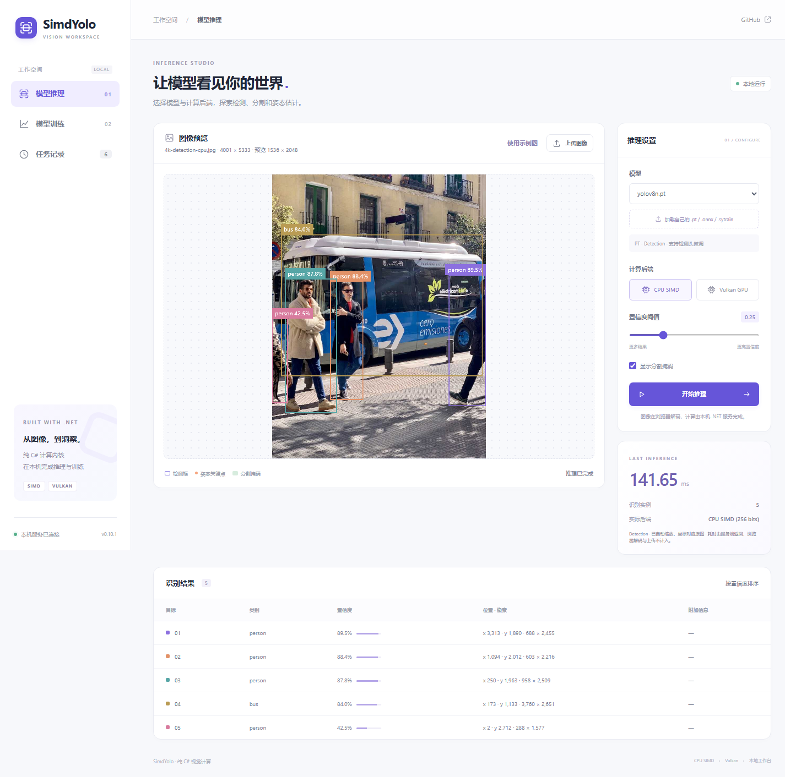
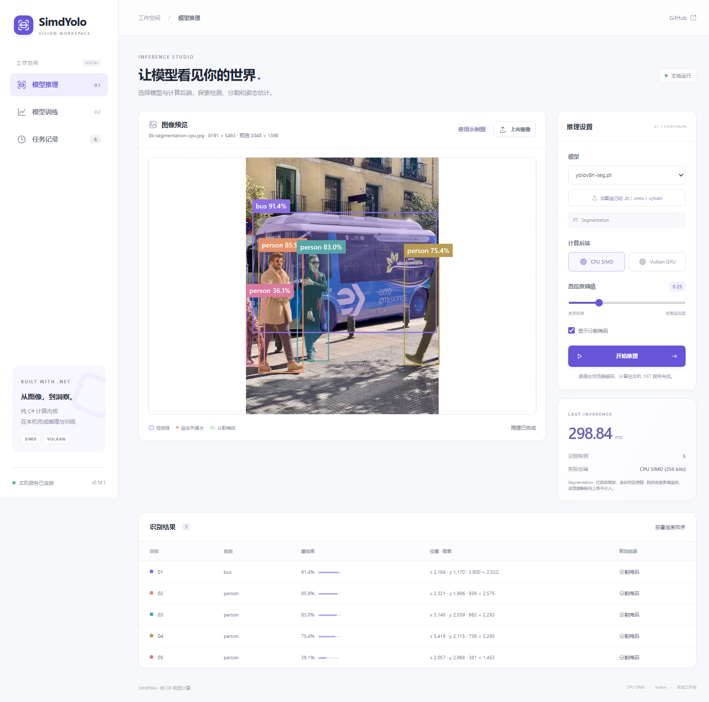
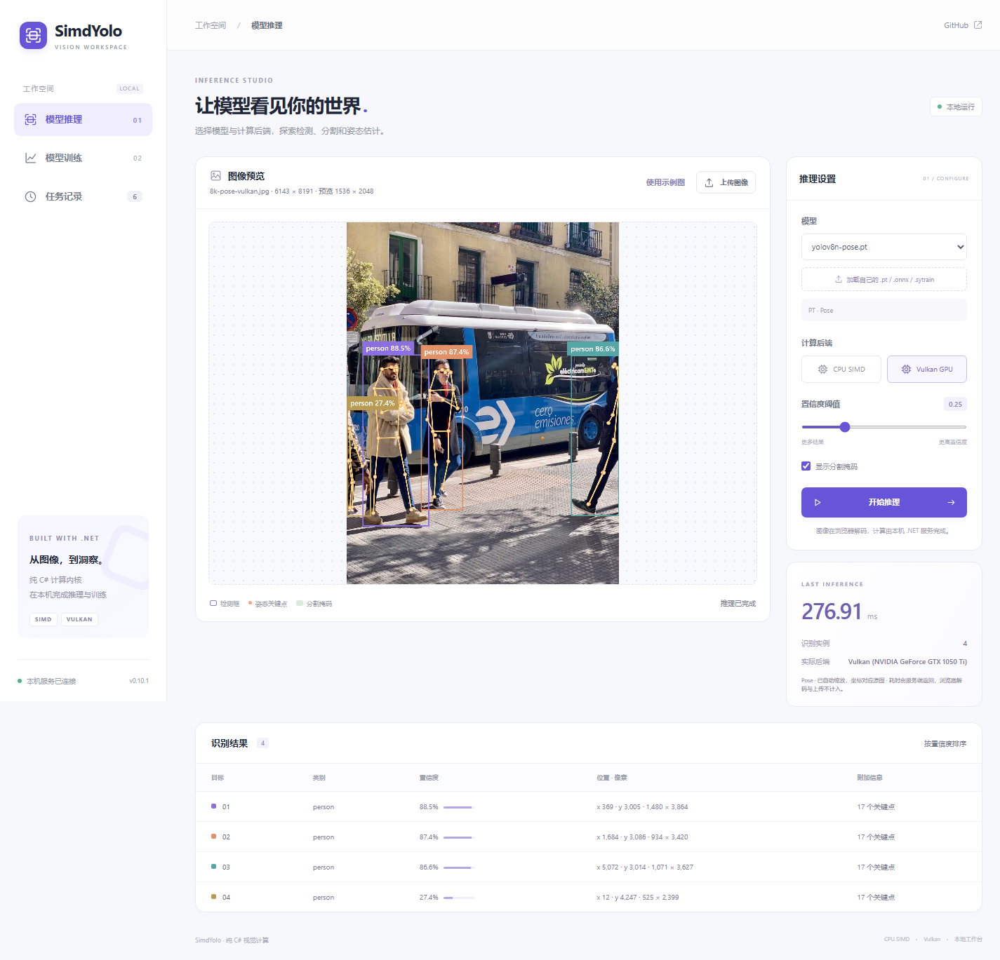

# 网页大图处理验证

当前源码的网页修复；历史0.10.1发布附件保持原内容。检测核心与训练核心没有修改，仅调整网页的图像准备、请求元数据、结果映射和绘制。

| 实际上传照片 | 任务 / 后端 | RGB与预览尺寸 | 实际结果 |
| --- | --- | --- | --- |
| 4001×5333 | YOLOv8n检测 / CPU SIMD | 1536×2048 | 5个检测框 |
| 8191×5463 | YOLOv8n分割 / CPU SIMD | 2048×1366 | 5个实例及5张掩码 |
| 6143×8191 | YOLOv8n姿态 / Vulkan | 1536×2048 | 4个人体、68个关键点，55个满足显示置信度的点 |

测试照片由官方`bus.jpg`等比例放入上述大尺寸JPEG生成，用于检查大图处理和坐标映射，不用于评估检测精度或增加图像细节。[浏览器原始结果](web-browser.json)记录每次上传尺寸、RGB编码长度、坐标误差、绘制次数和画布变换；三组原图坐标对照的最大误差小于0.002像素。

浏览器测试实际选择JPEG文件，完成上传、模型推理和结果绘制；拦截RGBA读取，确认没有读取超过2048长边的缓冲区。掩码概率保持处理图像的位图尺寸，原图显示范围单独返回。检查检测框、掩码与关键点的画布变换，确认原图坐标正确映射到有界预览。

兼容省略`originalWidth/originalHeight`的旧RGB请求。两次FP32前向的固定容差：原图坐标0.01像素、置信度1e-5、8位掩码概率1级；不要求并行归约和量化后的概率逐位一致。9个非法尺寸/缺少配对元数据/超面积/无效RGB请求全部返回HTTP 400。

原有网页训练、检查点下载、恢复到第3轮、取消和移动端布局也通过；[API回归](web-api.json)覆盖CPU与Vulkan训练、模型上传、检查点推理、会话复用、检测/分割/姿态及YOLO26 ONNX Vulkan推理。

```powershell
# 先启动当前源码网页版；端口可通过--url指定。
node tools/validate-web-browser.mjs --url http://127.0.0.1:5199 --image .cache/bus.jpg --large-images --output artifacts/validation/web-large-images
python tools/validate-web.py --url http://127.0.0.1:5199 --image .cache/bus.jpg --version 0.10.1 --output artifacts/validation/web-large-images/web-api.json
```






