# SimdYolo 0.9.0：纯 C# YOLO 推理、检测头微调与 CPU/GPU 实测

> 0.10.0 源码更新：已扩展五代检测头微调，覆盖仓库 v8n、v9t、v10n、11n、26n。新增的双头梯度、SGD/动量、断点恢复及 CPU/Vulkan/PyTorch 训练比较见[训练评测](../../artifacts/training-evaluation-0.10.0.md)。下文保留 0.9.0 推理测量与当时的能力表；不能把旧发布包当作新训练实现。

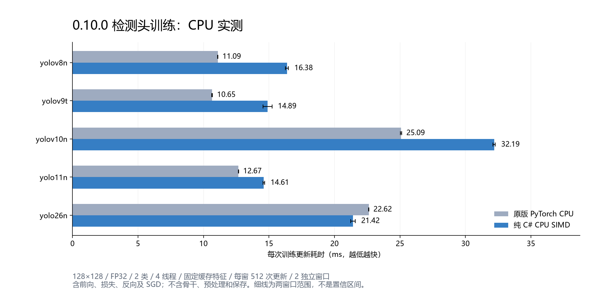

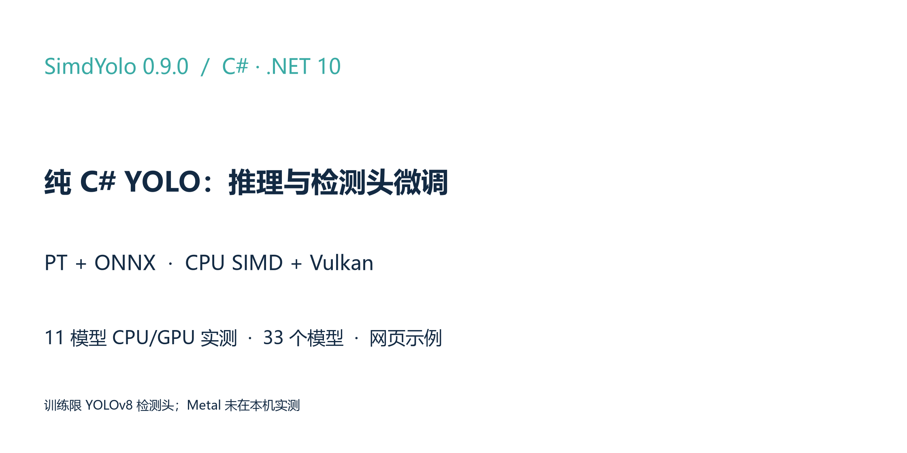

**仓库：** [hnlyf168/SimdYolo](https://github.com/hnlyf168/SimdYolo) · **下载：** [0.9.0 Release](https://github.com/hnlyf168/SimdYolo/releases/tag/v0.9.0) · [全部33个模型](https://github.com/hnlyf168/SimdYolo/releases/download/v0.9.0/SimdYolo-models-v0.9.0.zip)

0.9.0 包含纯 C# YOLO 推理、独立检测头微调库和 ASP.NET Core 网页示例。本文按当前程序集重新测量11模型，更新速度、首次使用、资源和配图；0.7.x、0.8.1 的报告继续作为历史证据保留。

## 1. 运行依赖与支持范围

主库和训练核心仅依赖 .NET 标准库。模型解析、计算图、CPU 运算、预处理和解码使用 C#；不调用 Python、PyTorch、TorchSharp、ORT、BLAS/MKL/OpenBLAS。GPU 使用系统 Vulkan/Metal API 和嵌入的 SPIR-V/MSL。原版 PyTorch 与 ORT 只出现在开发对照工具里。

| 系列 | 检测 | 分割/姿态推理 | 本轮检测头训练 |
| --- | --- | --- | --- |
| YOLOv8n | 已验证 | 已验证 | 已验证标准 v8n 头，骨干/FPN 冻结 |
| Ultralytics YOLOv9t | 已验证 | 未验证 | 未实现 |
| YOLOv10n | 已验证 | 未验证 | 未实现 |
| YOLO11n | 已验证 | 已验证 | 未实现 |
| YOLO26n | 已验证 | 已验证 | 未实现 |

仓库提供11个 PT、22个 ONNX，包含固定640、部分动态/opset12验证导出。PT 需要完整受支持 YOLO `nn.Module` 的 Torch ZIP；单独 `state_dict` 缺少结构，TorchScript、未知模块与量化图不支持。ONNX 仅支持已实现算子、布局和数据类型，其他尺度或模型必须再验证。

## 2. 模型解析、标签与执行

PT 解析器恢复符号模块和张量存储，不导入 Python，也不执行 pickle 的 Python 类。ONNX 通过 C# protobuf 读取器构建节点、初始权重和元数据。推理前只在形状、布局与所有权条件满足时融合，公开输出独立于下帧临时缓冲区。

```csharp
using SimdYolo;

var info = ModelInfo.Read("models/onnx/yolo26n.onnx");
foreach (var label in info.ClassNames)
    Console.WriteLine($"{label.Key}: {label.Value}");

using var detector = new YoloDetector("models/pt/yolo26n-seg.pt",
    new DetectorOptions { Device = ComputeDevice.Vulkan });
var instances = detector.Predict(rgb24, width, height);
```

`rgb24` 为调用方已解码的连续 RGB 字节。`ClassNames` 保留类别编号与 Unicode 文本；缺少标签返回空映射，`ClassCount` 表示输出通道数，不能用稀疏标签条目数替代。SYTRAIN 同样可以读取类别元数据。

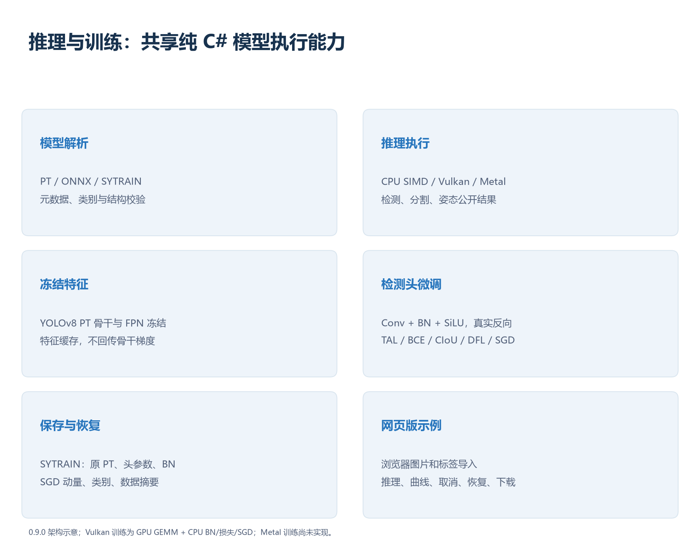

YOLO26 的无 DFL 回归、Proto26 和 Pose26 已适配；端到端 TopK 同时收集掩码系数/关键点字段，后处理按任务解释。其他 ONNX 输出布局存在歧义时，应显式设置 `Task`、`ClassCount` 和 `OutputLayout`。

## 3. CPU SIMD 与 Vulkan 的实现边界

CPU 使用 FP32 SIMD/intrinsics、分块 GEMM、Winograd、点卷积和 depthwise 专用路径。缓存行按实际地址划分，临时张量与公开结果有不同生命周期。训练头的参数持续变化，不能套用只读推理权重缓存；冻结网络特征可以有界缓存。

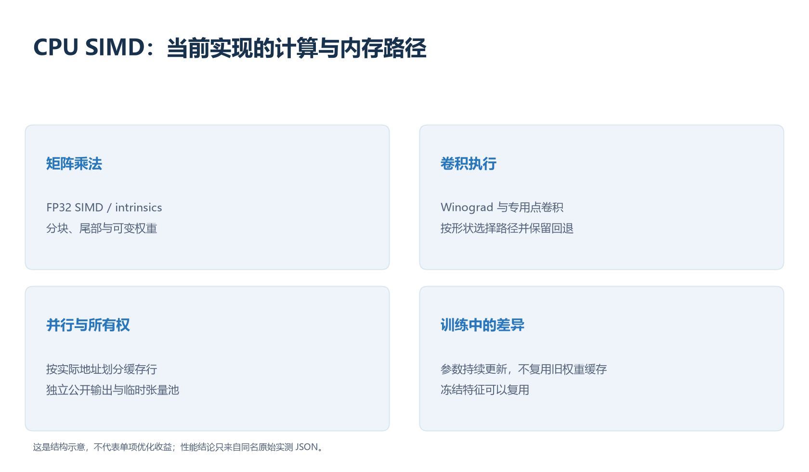

Vulkan 路径直接使用系统 loader 和兼容驱动，不需要 CUDA Toolkit、cuDNN、cuBLAS；SPIR-V 随包提供，普通运行不要求 Vulkan SDK。API 提供跨平台、跨厂商基础，但本轮仅实测 Windows/NVIDIA，不能说所有平台和 GPU 都已验证。Metal 有实现，本机没有 macOS 实测。

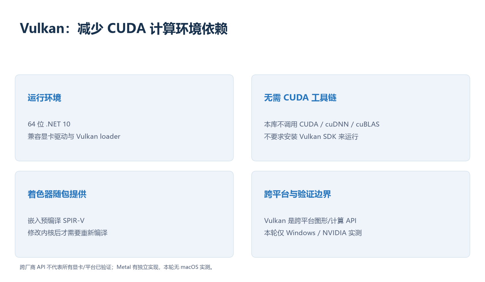

## 4. 当前0.9.0速度对比

测量：2026-10-15 10:53:49 +0800，i7-8700K / GTX 1050 Ti / 31.93 GiB RAM。FP32、batch=1、640×640、CPU线程12，11模型×8后端×2轮，**176窗口、39,134次推理、224项输出校验通过**。每窗口预热60次，计至少4秒/40帧；各后端独立进程、串行执行。

同一输入，以原版 PyTorch CPU 生成输出 oracle；端到端输出通过完整候选作唯一配对并检查整行附加字段。GPU包含输入上传和全部结果回读；计时包含网络前向与输出头解码，排除预处理、NMS、最终mask后处理和冷首帧。

## CPU / GPU 速度排名

每格为中位耗时 ms + 名次，①最快、④最慢，第一名加粗；重复窗口取各窗口中位数的中位数，按未舍入值排序。小幅差距不代表稳定胜出或统计显著性。

### CPU 速度排名

| 模型 | 原版 PyTorch CPU | 我们的 `.pt` CPU | 我们的 ONNX CPU | ORT CPU（.NET） |
| --- | ---: | ---: | ---: | ---: |
| yolov8n | 44.98 ④ | **21.74 ①** | 22.24 ② | 24.45 ③ |
| yolov9t | 77.56 ④ | **30.20 ①** | 33.62 ③ | 31.05 ② |
| yolov10n | 49.19 ④ | **21.57 ①** | 22.64 ② | 22.92 ③ |
| yolo11n | 51.80 ④ | **21.71 ①** | 22.72 ② | 23.64 ③ |
| yolo26n | 54.27 ④ | 22.76 ③ | 22.66 ② | **18.54 ①** |
| yolov8n-seg | 57.56 ④ | **28.07 ①** | 28.61 ② | 34.38 ③ |
| yolo11n-seg | 65.14 ④ | **27.99 ①** | 29.48 ② | 33.52 ③ |
| yolo26n-seg | 69.02 ④ | 30.58 ② | 31.44 ③ | **29.57 ①** |
| yolov8n-pose | 56.94 ④ | **26.88 ①** | 28.04 ② | 31.25 ③ |
| yolo11n-pose | 66.76 ④ | **23.27 ①** | 29.65 ③ | 25.35 ② |
| yolo26n-pose | 59.78 ④ | 24.98 ② | 25.49 ③ | **21.91 ①** |
| 第一名次数（完整四配置 11/11 模型） | 0 | 8 | 0 | 3 |

### GPU 速度排名

| 模型 | 原版 PyTorch CUDA | 我们的 `.pt` Vulkan | 我们的 ONNX Vulkan | ORT CUDA（.NET） |
| --- | ---: | ---: | ---: | ---: |
| yolov8n | **9.83 ①** | 10.39 ② | 10.63 ③ | 12.69 ④ |
| yolov9t | 22.27 ④ | **12.87 ①** | 14.09 ② | 17.81 ③ |
| yolov10n | 10.67 ③ | **10.07 ①** | 10.28 ② | 13.52 ④ |
| yolo11n | **10.52 ①** | 10.62 ② | 10.66 ③ | 13.69 ④ |
| yolo26n | 12.37 ③ | **10.99 ①** | 11.08 ② | 13.21 ④ |
| yolov8n-seg | **12.83 ①** | 13.75 ② | 13.88 ③ | 16.56 ④ |
| yolo11n-seg | 13.61 ② | **13.50 ①** | 13.66 ③ | 17.58 ④ |
| yolo26n-seg | 16.44 ③ | 14.75 ② | **14.57 ①** | 17.23 ④ |
| yolov8n-pose | **10.23 ①** | 10.55 ② | 10.86 ③ | 13.17 ④ |
| yolo11n-pose | 11.18 ② | **11.08 ①** | 11.26 ③ | 14.33 ④ |
| yolo26n-pose | 13.52 ③ | **12.00 ①** | 12.22 ② | 14.11 ④ |
| 第一名次数（完整四配置 11/11 模型） | 4 | 6 | 1 | 0 |


数值按未舍入中位数排名。两次窗口不足以证明小差距稳定领先；PyTorch 使用原版 `fuse()`，ORT开启图优化，未比较 `torch.compile`、TensorRT、FP16/INT8。

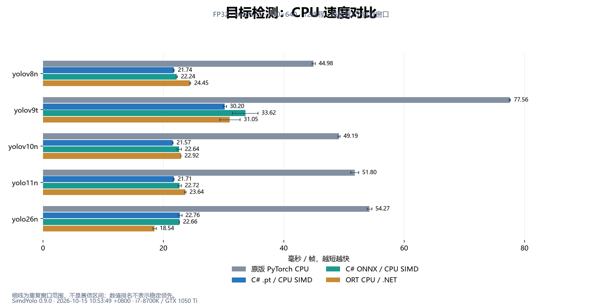

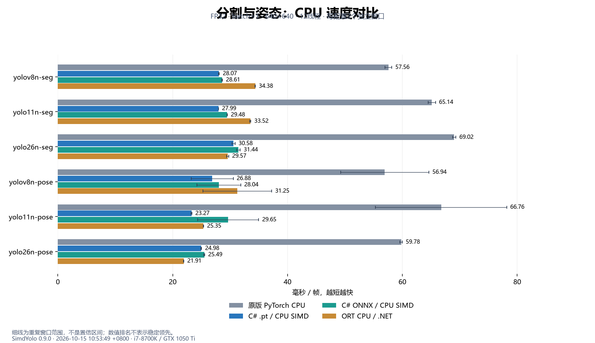

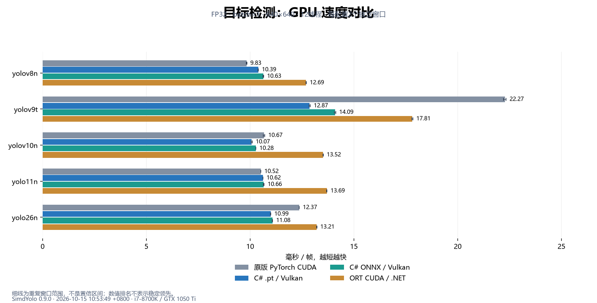

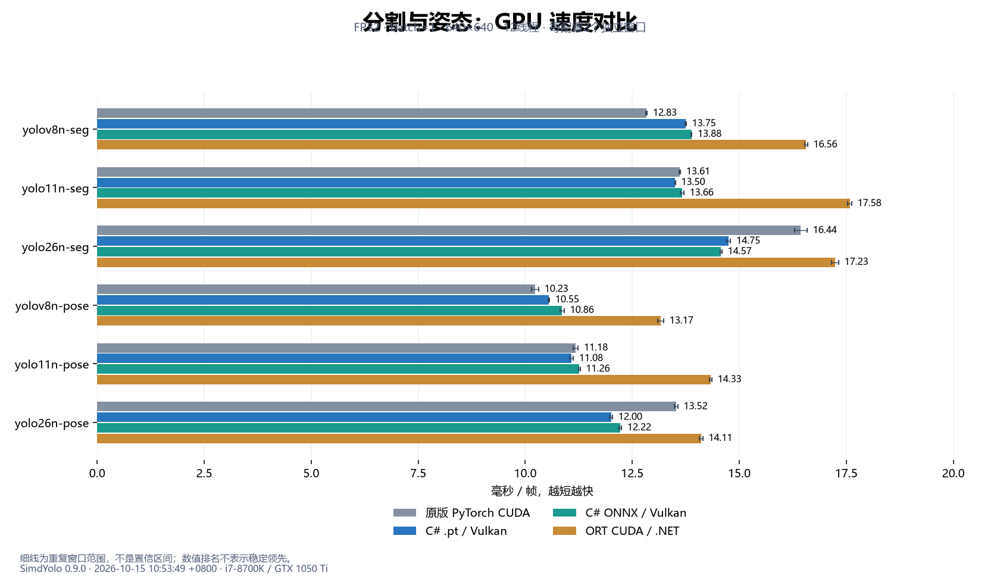

各图细线为重复窗口中位数范围，不是置信区间。原始结果包含所有窗口、输入/模型/原生ORT/DLL摘要，允许从数值复核排名。

## 5. 加载、首帧、CPU时间、RSS与GPU


`ModelLoadMs` 为读取、解析、融合和会话/设备创建；`FirstInferenceMs` 是第一轮前向及回读；`MedianMs` 是预热后稳态。宿主启动、Python导入与预热全部耗时在完整报告单列。进程重启不能清空系统/驱动缓存，不能将这些数值解释为全冷启动。


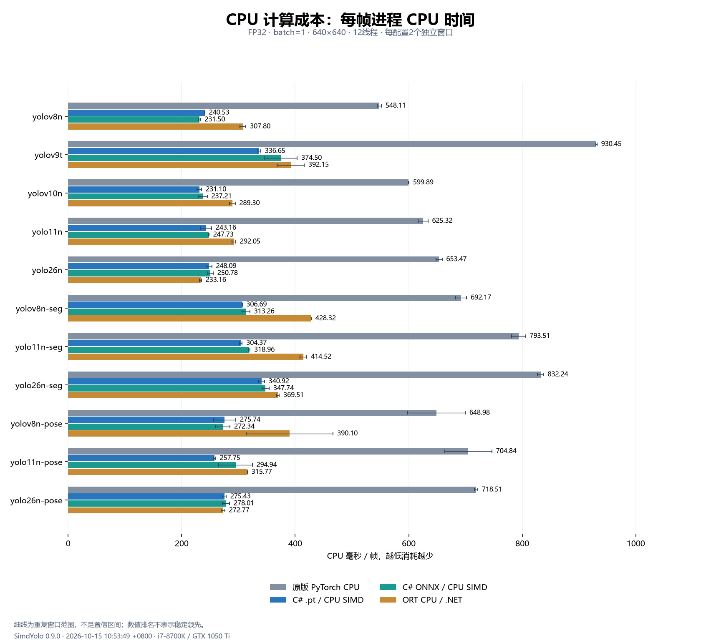

CPU% 按全机逻辑核心归一化，CPU ms/帧由进程累计 CPU 时间计算。RSS 为采样工作集，包含运行库、权重和缓存，和算子工作区不同；不能用更低CPU占用或更快延迟单独判断效率。

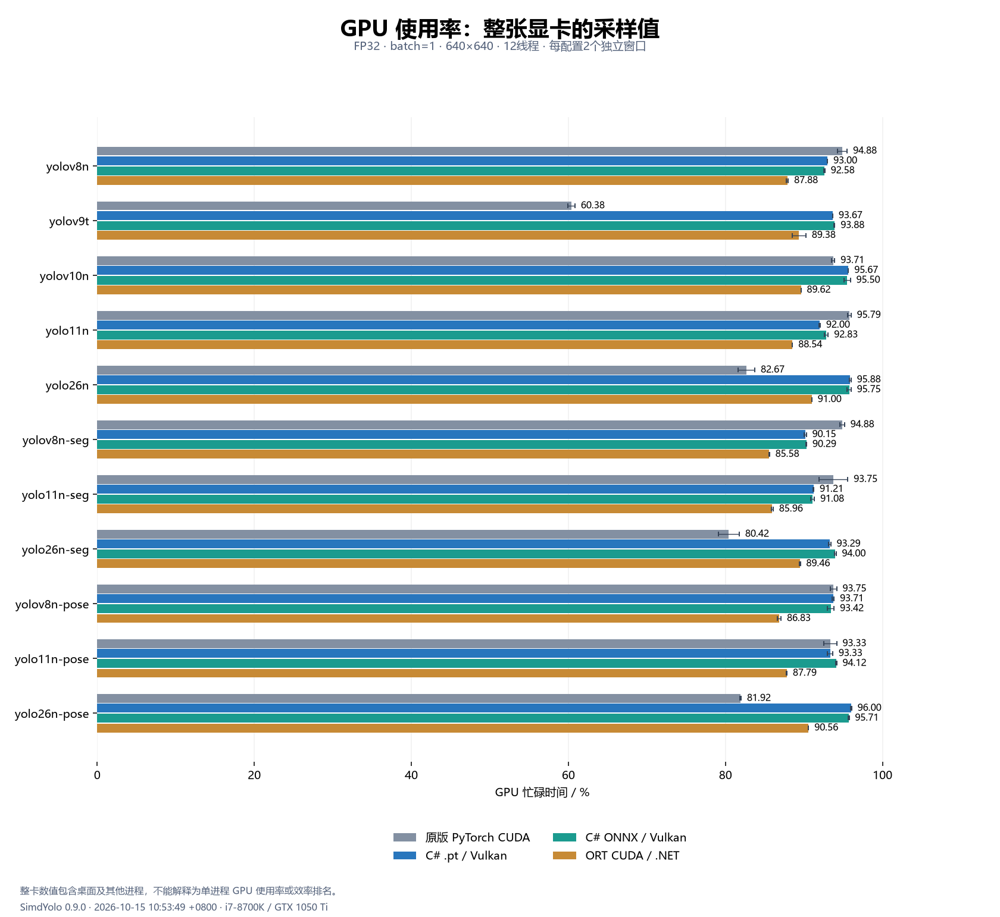

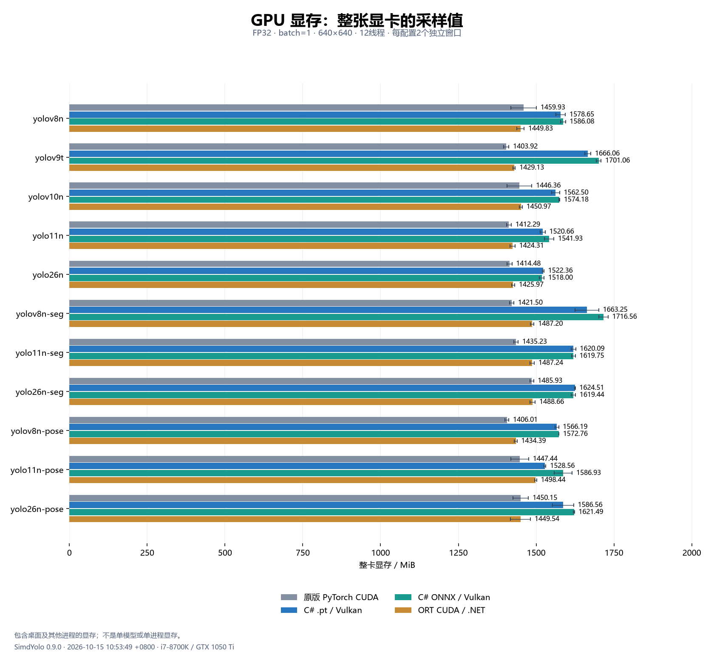

GPU与显存来自NVML整卡采样，包含桌面及其他进程。CPU后端的GPU背景数字不归因给CPU推理；不能据整卡数据计算单个模型显存或功耗。

## 6. 纯C#训练：先实现可验证的检测头微调

三尺度 YOLOv8 Detect 头的 `cv2/cv3` 分支参与更新，骨干/FPN保持冻结。卷积使用 im2col/GEMM，BN/SiLU实现对应反向；TAL停止梯度分配，BCE/CIoU/DFL产生回归和分类梯度。SGD保存动量，权重衰减仅用于卷积权重。

```csharp
using SimdYolo.Training;

var data = TrainingDataset.CreateDemo();
using var trainer = new YoloTrainer("models/pt/yolov8n.pt", data,
    new TrainingOptions { ImageSize = 128, Epochs = 20, LearningRate = .003f });
trainer.Train(".cache/train", item => Console.WriteLine(item.TotalLoss));
```

CPU使用SIMD，Vulkan加速冻结网络和前后向GEMM；BN、损失、SGD、im2col和搬运仍在CPU。梯度累加按图像平均，每图BN独立，区别于联合批次BN。尚无全参数、YOLO26、分割/姿态或Metal训练。

每轮原子保存 `last.sytrain`，包括原PT、头参数/BN、SGD动量、类别和数据集SHA256。取消回退到最近完整轮次；恢复校验数据集和超参数，可以更换CPU/Vulkan。该归档可直接推理，尚不导出PyTorch/ONNX。

固定 Ultralytics 8.4.0 / PyTorch 2.11.0 CPU 独立对照，CPU、Vulkan头GEMM、小目标、空标签共640项检查通过；训练测试12项、推理回归117项通过。这里只证明这些场景的数值和流程，没有训练性能、大数据集收敛或独立验证集mAP结论。

## 7. 网页示例和复现

```powershell
dotnet run --project examples/SimdYolo.Web -c Release
```

打开 `http://127.0.0.1:5188`，支持检测/分割/姿态推理，目录导入YOLO检测数据、真实损失曲线、取消/恢复和下载模型。浏览器完成JPEG/PNG解码，服务端调用C#；推理缓存最近两个会话。示例默认本地绑定，没有公网账号/鉴权。

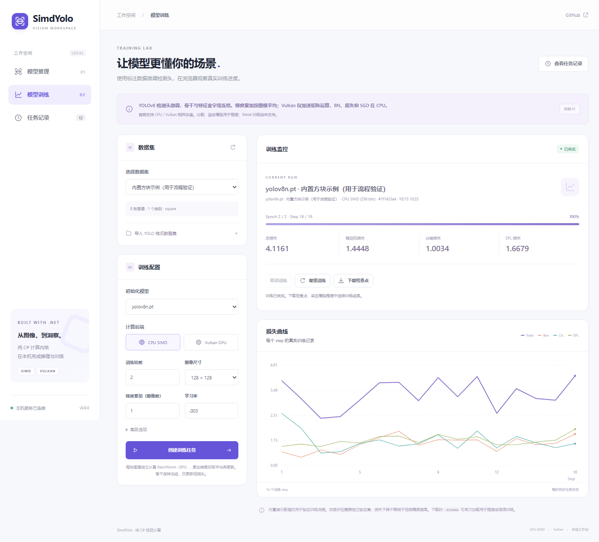

完整基准命令：

```powershell
python tools/compare-runtimes.py --model-dir models/pt --onnx-dir models/onnx --ultralytics-dir .cache/yolo26-release-reference --models yolov8n yolov9t yolov10n yolo11n yolo26n yolov8n-seg yolo11n-seg yolo26n-seg yolov8n-pose yolo11n-pose yolo26n-pose --engines torch-cpu net-cpu net-onnx-cpu ort-net-cpu net-vulkan net-onnx-vulkan torch-cuda ort-net-cuda --input .cache/image-validation/input.f32 --size 640 --threads 12 --warmup 60 --iterations 40 --duration 4 --repeats 2 --output artifacts/runtime-comparison-0.9.0.json
```

对照需要已有的隔离PyTorch/ORT CPU和CUDA开发环境，以及构建后的.NET ORT对照程序。不要将验证依赖加入主库运行时。实际采样口径、ORT原生构建、固定输入与输出容差见[完整报告](../../artifacts/runtime-comparison-0.9.0.md)。

文档ZIP附有 `benchmark/input-640.f32`，可作为 `--input` 保持原始输入SHA。首次默认随机输入下ORT CUDA的YOLO26分割存在TopK分数超差，[诊断](../../artifacts/validation/0.9.0-release/README.md)单独保留；正式矩阵使用与0.8.1相同的实拍图，未混用输入或放宽容差。

模型保留上游AGPL-3.0及来源，源码暂未新增许可证。[训练API](../training.md) · [推理API](../inference.md) · [发布附件](https://github.com/hnlyf168/SimdYolo/releases/tag/v0.9.0)
