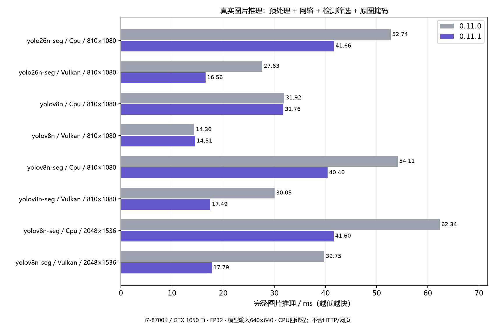
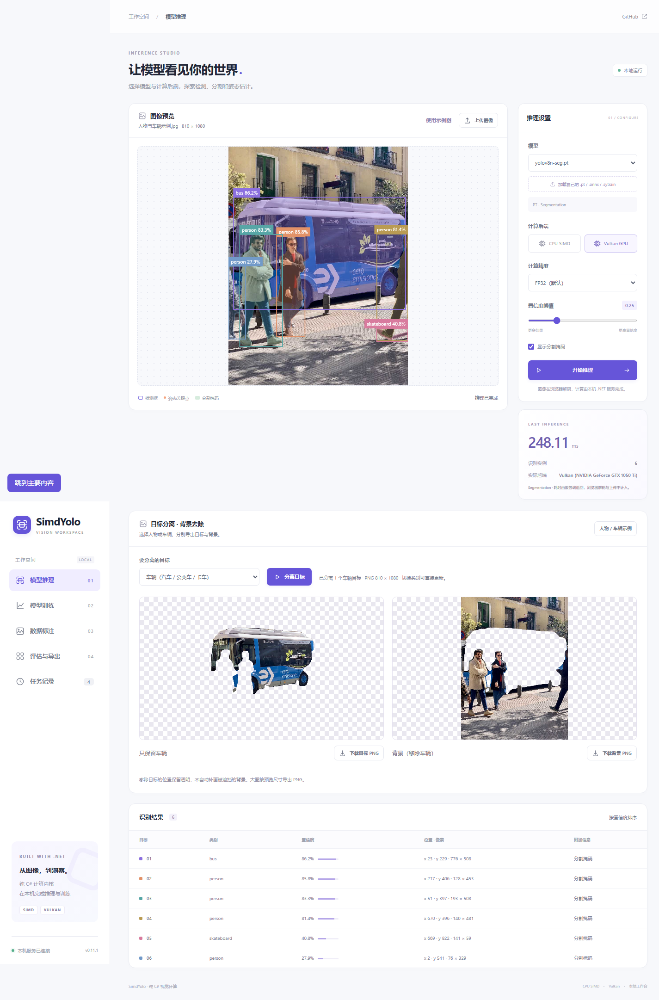
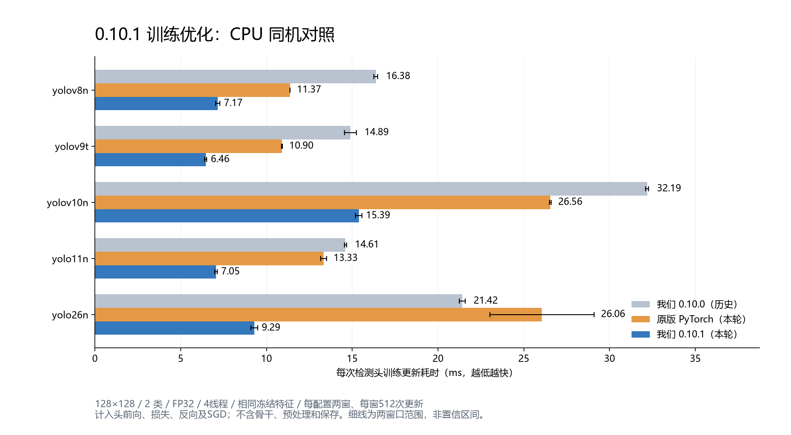
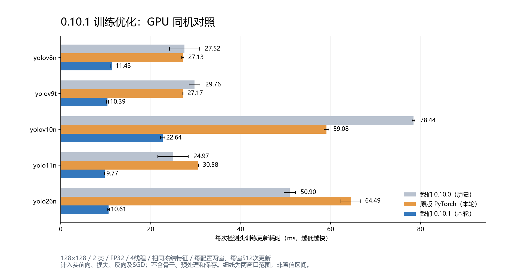
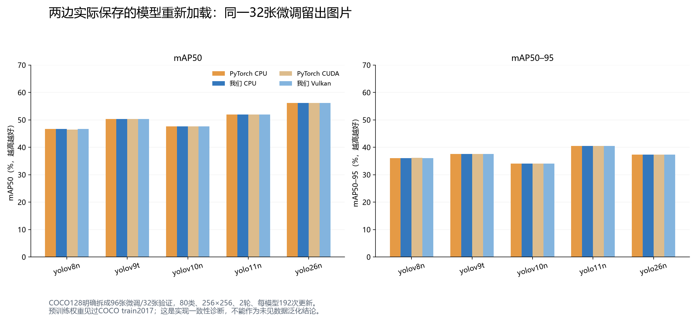
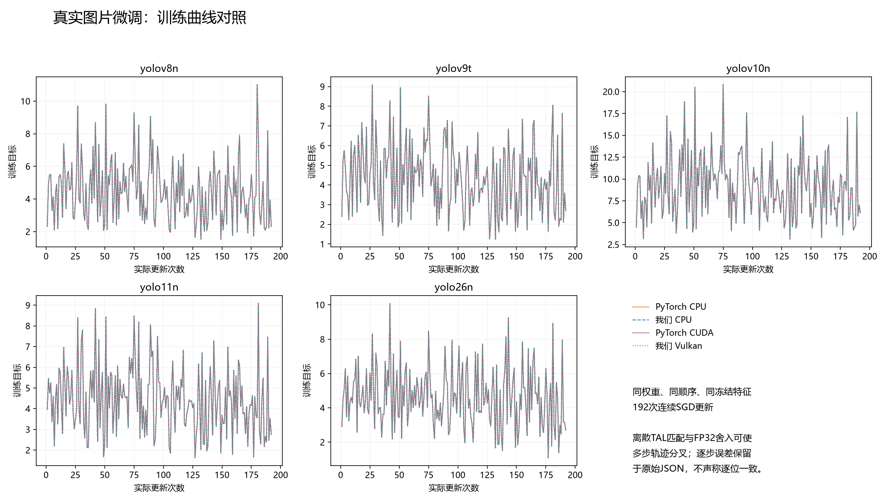
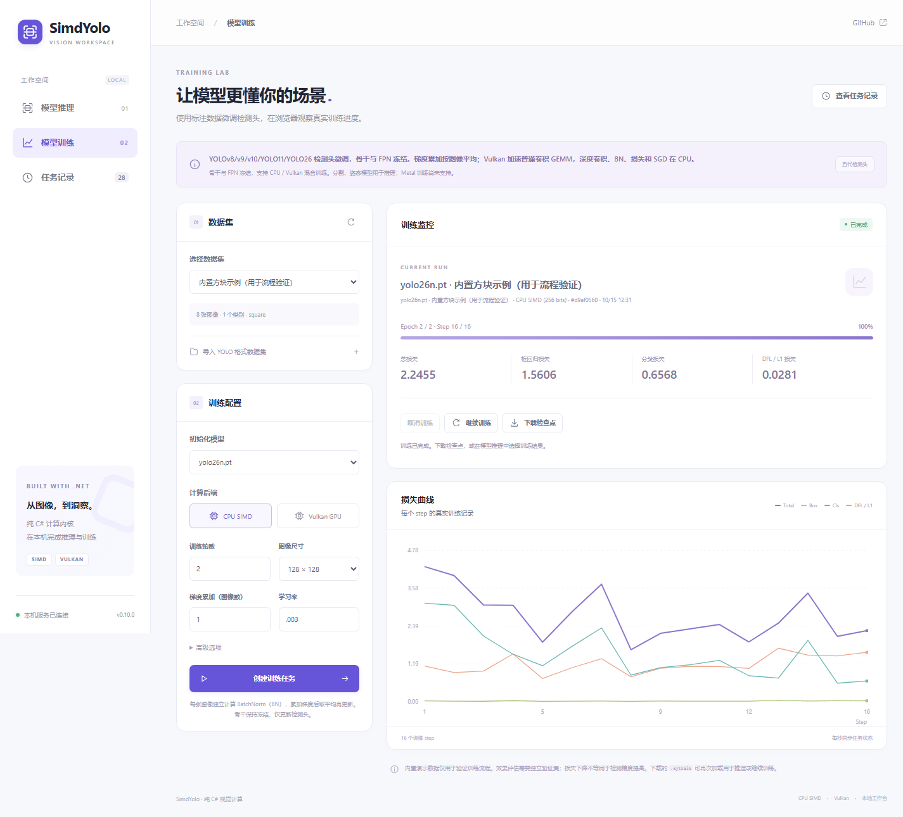
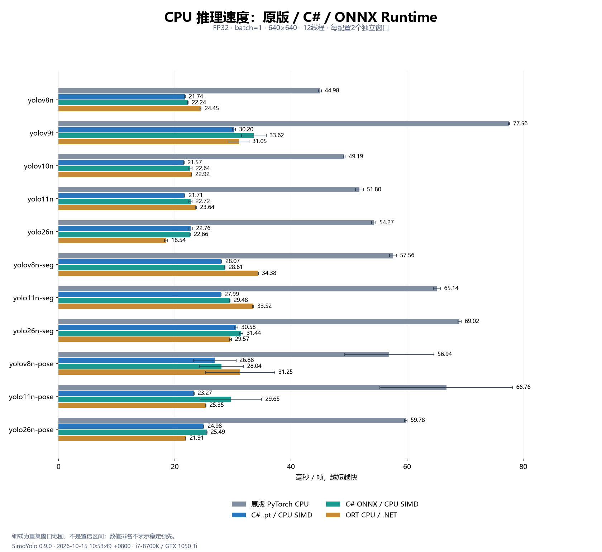
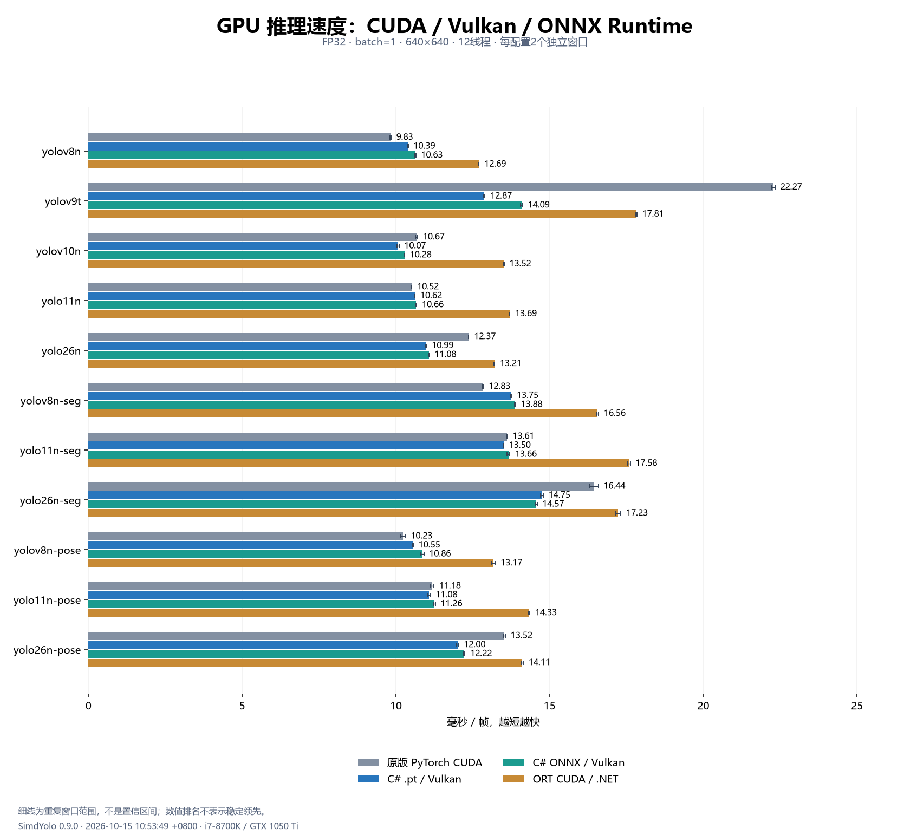

# SimdYolo 0.11.1：纯C#图片推理优化与人物、车辆背景分离

**仓库：** [hnlyf168/SimdYolo](https://github.com/hnlyf168/SimdYolo)

源码0.11.1新增实际图片推理和目标分离的优化：纯C#掩码SIMD、原型行缓存及多实例并行，网页改用RGB24二进制与有界掩码缓存，置信度变化不再重载模型。[CPU/Vulkan完整图片推理与网页实测](../../artifacts/image-pipeline-optimization-0.11.1.md)保留原始采样、数值门槛和测试范围。

源码更新到0.11.0后，已加入纯.NET训练验证/早停/最佳模型、PT与SYTRAIN导出标准ONNX、网页检测框标注和预标注，以及CPU FP16混合/INT8实验推理。[功能说明与实测](../model-workflows.md)包含当前限制；低精度暂未取得速度优势，GPU保持FP32。下文0.10.1评测与发布附件保留原始版本。

**当前源码与包：** [0.11.1下载及文档导航](../README.md)。**历史正式发布：** [0.10.1 Release](https://github.com/hnlyf168/SimdYolo/releases/tag/v0.10.1) · [33模型](https://github.com/hnlyf168/SimdYolo/releases/download/v0.10.1/SimdYolo-models-v0.10.1.zip)。历史运行包和图文ZIP保持0.10.1内容。

## 0.11.1：把原图掩码和网页重复处理降下来

同一FP32权重与实际照片、模型640×640、四线程；YOLOv8n-seg完整Predict包含预处理、网络、筛选与原图尺度掩码，单位ms。HTTP、JSON与网页另测。

| 原图 / 后端 | 冻结0.11.0 | 0.11.1 | 耗时下降 |
| --- | ---: | ---: | ---: |
| 810×1080 / CPU | 54.11 | 40.40 | 25.3% |
| 810×1080 / Vulkan | 30.05 | 17.49 | 41.8% |
| 2048×1536 / CPU | 62.34 | 41.60 | 33.3% |
| 2048×1536 / Vulkan | 39.75 | 17.79 | 55.2% |



托管后处理共享原图到原型的坐标表，以SIMD累加原型和计算概率；AVX2 Gather插值后缓存相邻原型行，大区域多实例按CpuThreads并行。临时logits使用ArrayPool，返回的概率数组独立持有；MaskConverter.ToBytes以SIMD窄化并保持中点取偶舍入。没有改GPU前向着色器，纯检测控制组基本持平。

网页复用RGB24缓冲区，通过有界二进制接口上传；二值和彩色掩码使用32 MiB画布LRU，改变图片或结果时清空。置信度使用逐次Predict参数覆盖，只影响本次后处理，不重载权重。目标/背景由同一张合并掩码合成互补透明PNG，保留孔洞与其他类别，不进行场景补全。



本轮24个串行窗口、12组最终帧约757万个概率对照通过；独立标量公式门槛3e-6，完整模型概率门槛2e-5。CPU/Vulkan回归116项、训练19项、网页41条及传输/缓存15项通过。[完整资源口径、采样与复现](../../artifacts/image-pipeline-optimization-0.11.1.md)。主要分割配置各两个独立进程，大图各一对；小幅波动不能声称稳定领先。本轮没有重测PyTorch/ORT，后文数字保持历史版本。

## 0.10.1训练与模型结果（历史评测）

0.10.1发布包含YOLOv8/v9/v10/YOLO11/YOLO26检测头微调、SIMD与工作区优化、Vulkan小矩阵分派，以及与官方参考训练后保存模型的对照。主库、训练库、网页与33模型均有历史附件。后文推理测量仍标为0.9.0，不把训练数字替换成推理数字。

## 1. 支持范围与运行依赖

| 系列 | 检测推理 | 分割/姿态推理 | 检测头微调实际权重 |
| --- | --- | --- | --- |
| YOLOv8 | 支持 | 已验证 | yolov8n.pt |
| Ultralytics YOLOv9 | 支持 | 本轮未验证 | yolov9t.pt |
| YOLOv10 | 支持 | 本轮未验证 | yolov10n.pt，完整双头 |
| YOLO11 | 支持 | 已验证 | yolo11n.pt，深度可分离分支 |
| YOLO26 | 支持 | 已验证 | yolo26n.pt，双头/直接距离L1 |

范围仍为冻结骨干/FPN的检测头微调；不含全参数、分割/姿态或Metal训练。小样本短程微调的验证精度有下降，两边趋势相同；COCO128来自预训练使用的COCO train2017，这32张只对本次微调留出，不能据此证明泛化或训练配方有效。

其他尺度按受支持模块结构解析但未逐份训练验证，原YOLOv9 DualDDetect/TripleDDetect不在训练范围。模型需包含受支持完整PT结构；普通ONNX只用于推理，不能初始化训练结构。

主库与训练核心只引用.NET标准库，CPU使用纯C# SIMD/intrinsics；GPU通过P/Invoke访问系统Vulkan/Metal。没有Python、PyTorch、TorchSharp、ORT或BLAS运行依赖。Vulkan部署不需要CUDA Toolkit/cuDNN/cuBLAS或Vulkan SDK，只需兼容驱动与loader；它提供跨平台/跨厂商基础，本机实际验证为Windows/GTX1050Ti/Vulkan，Metal没有macOS实机验证。

## 2. 训练优化针对哪些瓶颈

- 1×1卷积直接借用NCHW空间平面，连续行复制im2col，SIMD累加col2im。
- dW直接对未转置的连续行执行2×4 SIMD点积微内核，省去部分完整转置。
- SiLU/BN/SGD与有限性检查向量化，保留FP32与原单步误差门槛。
- 每会话有界临时矩阵池，最多保留32MiB空闲数组；第一份参数梯度直接写入，后续微批次正确累加。
- Vulkan按乘加项数选择路径，小于等于4,000,000的GEMM使用CPU SIMD，较大GEMM留在GPU；深度卷积/BN/损失/SGD仍在CPU。

该设备阈值针对本机提交/回读开销，不代表所有GPU最优。训练权重持续变化，不使用推理只读权重缓存。

## 3. 本版训练速度与资源

128×128、2类、FP32、4线程、相同初始权重与缓存特征；头前向、loss、反向、SGD与清零均计时，排除骨干、预处理和检查点。PyTorch使用固定官方Ultralytics8.4.0头/损失与SGD，不含完整train数据管线；CUDA每步同步，Vulkan包含上传回读。40个串行独立窗口，每窗预热10次后512次更新，合计20,480次计时更新。

| 模型 | 原版 PyTorch CPU | 我们 CPU SIMD | 原版 PyTorch CUDA | 我们 Vulkan 混合 |
| --- | ---: | ---: | ---: | ---: |
| yolov8n | 11.37 | **7.17** | 27.13 | **11.43** |
| yolov9t | 10.90 | **6.46** | 27.17 | **10.39** |
| yolov10n | 26.56 | **15.39** | 59.08 | **22.64** |
| yolo11n | 13.33 | **7.05** | 30.58 | **9.77** |
| yolo26n | 26.06 | **9.29** | 64.49 | **10.61** |





图中0.10.0列来自历史同机结果，PyTorch与0.10.1本轮重测。细线为两个窗口范围，不是置信区间；本组数字不外推到640尺寸全参数训练。[CPU/RSS/GPU/显存资源表](../../artifacts/training-optimization-0.10.1.md)保留进程与整卡采样归属，普通ORT推理不充当训练基线。

## 4. 保存模型与多步训练结果

训练结果另外用COCO128做固定96张微调/32张验证，80类、256×256、2轮、每模型192次SGD。两边保存的`.pt`与`.sytrain`重新加载，运行完整骨干和检测头。mAP50–95最大差约0.088个百分点；直接参数门槛9/10通过，v8 Vulkan/CUDA未通过项保留，PyTorch自身CPU/CUDA出现同量级漂移。固定CPU参数控制10/10、保存模型指标门槛10/10通过，不声称参数逐位一致。





第1/16/96/192步比较全部训练参数与BN，记录动量和原始输出误差。多步参数门槛固定0.002+0.01×|参考值|，指标差门槛0.02；原有单步严格容差不变。v8直接Vulkan/CUDA参数门槛未通过，额外PyTorch CPU/CUDA控制出现同量级漂移。TAL离散匹配放大FP32舍入是控制实验支持的解释，不能据mAP接近称参数逐位一致。

范围仍为冻结骨干/FPN的检测头微调；不含全参数、分割/姿态或Metal训练。小样本短程微调的验证精度有下降，两边趋势相同；COCO128来自预训练使用的COCO train2017，这32张只对本次微调留出，不能据此证明泛化或训练配方有效。

19项训练回归、117项推理回归、22,332项单步数值检查通过；[原始结果与摘要](../../artifacts/validation/0.10.1/README.md)同时保留未通过项、完整模型SHA与复现命令。

## 5. API与网页

```csharp
using SimdYolo.Training;

var data = TrainingDataset.CreateDemo();
using var trainer = new YoloTrainer("models/pt/yolo26n.pt", data,
    new TrainingOptions { ImageSize = 128, Epochs = 20, LearningRate = .003f });
trainer.Train(".cache/train", item => Console.WriteLine(item.TotalLoss));
```

骨干/FPN冻结，单/双分支完整更新；YOLO26使用渐进双头权重、直接距离和L1，损失调度总轮数随检查点保存。SGD只对卷积权重衰减；未连接分支保持grad=None语义。BatchSize是图像梯度累加，每图独立BN，不能当成联合BN。

`.sytrain`自包含原PT、参数、BN、动量、类别和数据集摘要；按完整轮次原子保存，可直接推理及恢复，不导出PyTorch/ONNX。兼容读取旧v8归档格式。

```powershell
dotnet run --project examples/SimdYolo.Web -c Release
```

浏览器打开`http://127.0.0.1:5188`，支持图片检测/分割/姿态推理、YOLO检测数据导入、五代检测头训练、取消/恢复、下载上传检查点。可下载发布后的框架依赖网页包，安装.NET10/ASP.NET Core运行时并解压33模型包到同目录。网页默认回环绑定，没有公网账号/鉴权。



## 6. 历史推理测量继续标注版本

以下为**0.9.0冻结DLL**的历史实拍图基准：640×640、FP32、batch1、12线程，176窗口、39,134次推理、224项输出校验；不是0.10.1重测。GPU包含上传和输出回读，排除预处理、NMS、最终mask后处理和加载首帧。

## CPU / GPU 速度排名

每格为中位耗时 ms + 名次，①最快、④最慢，第一名加粗；重复窗口取各窗口中位数的中位数，按未舍入值排序。小幅差距不代表稳定胜出或统计显著性。

### CPU 速度排名

| 模型 | 原版 PyTorch CPU | 我们的 `.pt` CPU | 我们的 ONNX CPU | ORT CPU（.NET） |
| --- | ---: | ---: | ---: | ---: |
| yolov8n | 44.98 ④ | **21.74 ①** | 22.24 ② | 24.45 ③ |
| yolov9t | 77.56 ④ | **30.20 ①** | 33.62 ③ | 31.05 ② |
| yolov10n | 49.19 ④ | **21.57 ①** | 22.64 ② | 22.92 ③ |
| yolo11n | 51.80 ④ | **21.71 ①** | 22.72 ② | 23.64 ③ |
| yolo26n | 54.27 ④ | 22.76 ③ | 22.66 ② | **18.54 ①** |
| yolov8n-seg | 57.56 ④ | **28.07 ①** | 28.61 ② | 34.38 ③ |
| yolo11n-seg | 65.14 ④ | **27.99 ①** | 29.48 ② | 33.52 ③ |
| yolo26n-seg | 69.02 ④ | 30.58 ② | 31.44 ③ | **29.57 ①** |
| yolov8n-pose | 56.94 ④ | **26.88 ①** | 28.04 ② | 31.25 ③ |
| yolo11n-pose | 66.76 ④ | **23.27 ①** | 29.65 ③ | 25.35 ② |
| yolo26n-pose | 59.78 ④ | 24.98 ② | 25.49 ③ | **21.91 ①** |
| 第一名次数（完整四配置 11/11 模型） | 0 | 8 | 0 | 3 |

### GPU 速度排名

| 模型 | 原版 PyTorch CUDA | 我们的 `.pt` Vulkan | 我们的 ONNX Vulkan | ORT CUDA（.NET） |
| --- | ---: | ---: | ---: | ---: |
| yolov8n | **9.83 ①** | 10.39 ② | 10.63 ③ | 12.69 ④ |
| yolov9t | 22.27 ④ | **12.87 ①** | 14.09 ② | 17.81 ③ |
| yolov10n | 10.67 ③ | **10.07 ①** | 10.28 ② | 13.52 ④ |
| yolo11n | **10.52 ①** | 10.62 ② | 10.66 ③ | 13.69 ④ |
| yolo26n | 12.37 ③ | **10.99 ①** | 11.08 ② | 13.21 ④ |
| yolov8n-seg | **12.83 ①** | 13.75 ② | 13.88 ③ | 16.56 ④ |
| yolo11n-seg | 13.61 ② | **13.50 ①** | 13.66 ③ | 17.58 ④ |
| yolo26n-seg | 16.44 ③ | 14.75 ② | **14.57 ①** | 17.23 ④ |
| yolov8n-pose | **10.23 ①** | 10.55 ② | 10.86 ③ | 13.17 ④ |
| yolo11n-pose | 11.18 ② | **11.08 ①** | 11.26 ③ | 14.33 ④ |
| yolo26n-pose | 13.52 ③ | **12.00 ①** | 12.22 ② | 14.11 ④ |
| 第一名次数（完整四配置 11/11 模型） | 4 | 6 | 1 | 0 |






完整历史输入、冷首帧及资源见[0.9.0原始报告](../../artifacts/runtime-comparison-0.9.0.md)；随机输入下ORT CUDA/YOLO26分割超差[单独保留](../../artifacts/validation/0.9.0-release/README.md)，不混入固定图片结果。

## 7. 复现与下载

```powershell
python tools/validate-training-optimization.py
python tools/render-training-optimization.py
```

开发对照额外需要固定官方源码、隔离PyTorch CPU/CUDA与COCO128，具体步骤见验证目录；这些不是应用运行依赖。文档包附历史640推理输入以保持SHA，训练128性能夹具与256真实图片分开重建。

模型包仍为11个PT和22个ONNX，原始SHA与AGPL-3.0来源保留，源码暂未新增许可证。[训练API](../training.md) · [推理API](../inference.md) · [0.10.1 Release](https://github.com/hnlyf168/SimdYolo/releases/tag/v0.10.1) · [33模型](https://github.com/hnlyf168/SimdYolo/releases/download/v0.10.1/SimdYolo-models-v0.10.1.zip) · [网页版](https://github.com/hnlyf168/SimdYolo/releases/download/v0.10.1/SimdYolo-Web-v0.10.1.zip) · [中文图文包](https://github.com/hnlyf168/SimdYolo/releases/download/v0.10.1/SimdYolo-docs-v0.10.1.zip)
