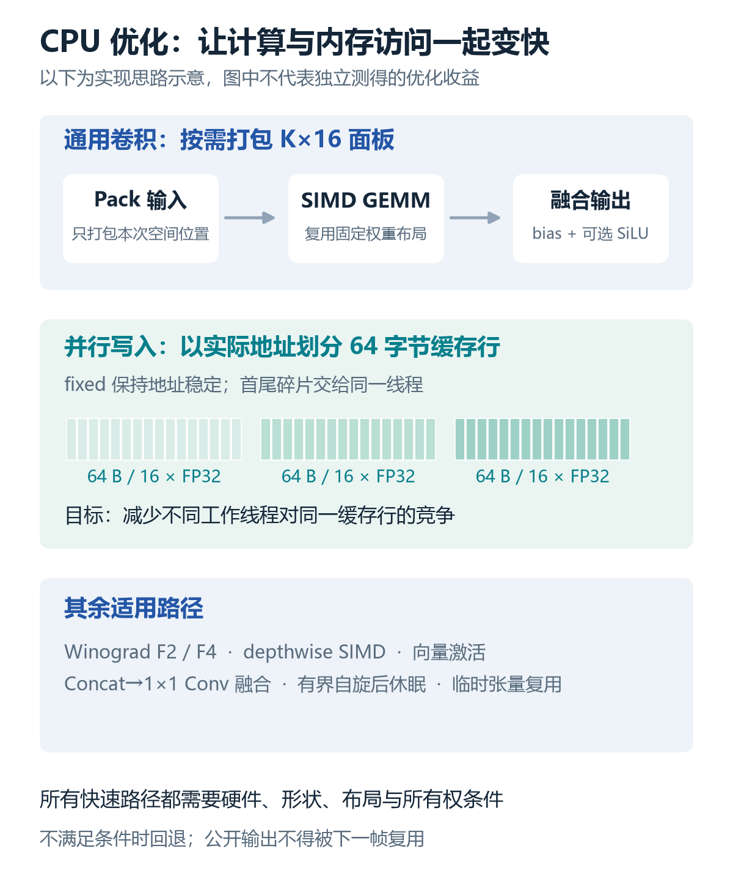
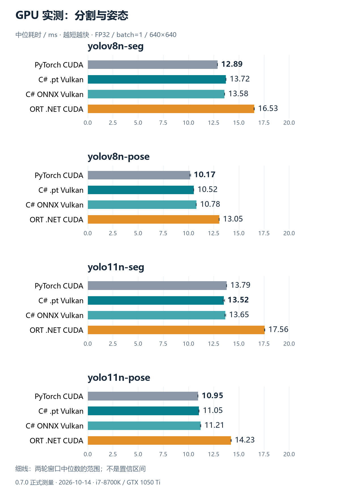
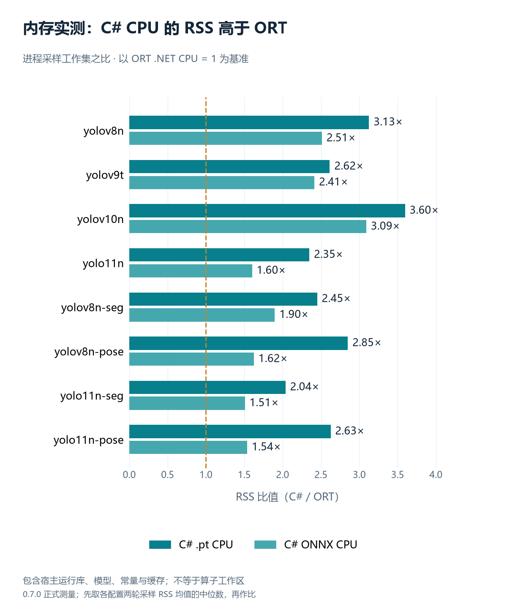

# SimdYolo：纯 C# YOLO 推理实现，CPU SIMD / Vulkan 架构与 PyTorch、ORT 实测


**项目仓库：** [https://github.com/hnlyf168/SimdYolo](https://github.com/hnlyf168/SimdYolo)

**发布包与模型：** [0.7.1 Release](https://github.com/hnlyf168/SimdYolo/releases/tag/v0.7.1) · [24 个模型 ZIP 直链](https://github.com/hnlyf168/SimdYolo/releases/download/v0.7.1/SimdYolo-models-v0.7.1.zip)

我实现了一个面向 .NET 应用的 YOLO 推理库 **SimdYolo**：C# 直接解析支持范围内的 `.pt` 和 ONNX，CPU 使用 SIMD/intrinsics，GPU 通过系统 Vulkan、Metal API 执行嵌入着色器。目前已验证常见 YOLOv8、YOLOv9、YOLOv10、YOLO11 的检测模型，以及 YOLOv8、YOLO11 的分割和姿态模型。

本文介绍模型加载、CPU/GPU 执行路径、同机性能排名和复测方法。项目主库为纯托管 C# 程序集，没有外部 NuGet 运行依赖；GPU 路径会调用系统原生图形 API。Python、PyTorch 和 ORT 用于开发时的导出与对照，主库推理不调用它们。

**当前发布版本为 0.7.1，性能表对应 0.7.0 冻结 DLL。** 0.7.1 增补中文注释与 XML 文档；方法签名和 IL 共 1,636 个与 0.7.0 一致。本文沿用已有正式测量数据，不把旧测量写成新一轮基准。

## 1. 模型兼容范围

已验证范围如下，其他尺寸和自训练模型应结合模块、算子及导出结构单独验证：

| 模型系列 | 已验证检测模型 | 已验证分割/姿态 | 已验证格式 |
| --- | --- | --- | --- |
| YOLOv8 | yolov8n | yolov8n-seg、yolov8n-pose | `.pt`、opset 17 ONNX |
| YOLOv9 | Ultralytics yolov9t | 当前未验证 | `.pt`、opset 17 ONNX |
| YOLOv10 | yolov10n | 当前未验证 | `.pt`、opset 17 ONNX |
| YOLO11 | yolo11n | yolo11n-seg、yolo11n-pose | `.pt`、opset 17 ONNX |
| YOLO26（0.8.0 开发版） | yolo26n | yolo26n-seg、yolo26n-pose | 官方 `.pt`、静态/动态 opset 17 ONNX，CPU/Vulkan |

本地 0.8.0 开发版新增 YOLO26 支持，处理 `reg_max=1` 的直接回归、SPPF 残差、Proto26 多尺度融合、Pose26 单倍偏移加半像素锚点，以及端到端 TopK 的掩码/关键点收集。已验证 128/640 输入、动态 160 输入和 batch=2；其他大小、分类、OBB 未在本次逐一验证。上方 0.7.1 Release 和 24 模型 ZIP 尚未包含这些新增内容，本文历史速度排名继续只覆盖原有八个模型。

0.8.0 还提供独立的 `ModelInfo.Read(path)`：PT 仅读取 Pickle 元数据，ONNX 流式跳过节点、权重和外部数据文件，不创建执行后端。`ClassNames` 保留原始编号、中文、引号和反斜线，支持 JSON/Python 字典或列表；缺少名称返回空映射，非法或重复编号拒绝。已加载会话可直接读取 `detector.ClassNames` 和 `detector.Info`；`ClassCount` 是通道数，不能用稀疏标签的条目数量替代。

YOLOv9 这里特指实际参与测试的 Ultralytics YOLOv9t。原 YOLOv9 仓库的部分模块也有实现，但原仓库检查点仍需单独验证，不能按模型文件名推断兼容性。

### `.pt`：恢复执行结构，再读取权重

`PtModel` 与 `PickleReader` 在 C# 中读取 Torch ZIP 的元数据和 storage，恢复支持的模块连接与权重。GLOBAL、REDUCE 按数据或符号对象处理，不导入或执行 Python。支持 FP32、FP16、BF16 storage，内部计算使用 FP32。

检查点需要保存完整 YOLO `nn.Module`，例如 `model` 或 `ema`，也支持直接保存完整模型。**只有 `state_dict` 时缺少执行结构，当前加载器不能自动推断任意自定义网络。** TorchScript、旧式非 ZIP pickle、未知自定义模块和量化图不在当前支持范围内。

### ONNX：在 C# 中解析图，而后执行已支持算子

`OnnxReader` 解析 protobuf，`OnnxModel` 构建和执行算子图，支持动态输入及相对模型目录解析的 external data。普通 `ai.onnx` 域中已实现的算子覆盖主要 YOLO 路径；opset 的版本范围不等于该版本内所有算子均受支持。

包含未知算子、其他域、内嵌 NonMaxSuppression 的导出，以及分类/OBB 等任务需要按当前实现范围判断。Resize 主要覆盖 YOLO 常用的 nearest/asymmetric/floor 路径。通用 shape/index 运算使用 FP32，也有精确整数范围限制。


## 2. CPU 优化：算力与数据访问要一起处理

源码可以从以下入口读起：

| 文件 | 主要职责 |
| --- | --- |
| [CpuConvolution.cs](https://github.com/hnlyf168/SimdYolo/blob/main/src/SimdYolo/CpuConvolution.cs) | 通用卷积空间面板打包与实际地址对齐调度 |
| [CpuGemm.cs](https://github.com/hnlyf168/SimdYolo/blob/main/src/SimdYolo/CpuGemm.cs) | AVX/FMA 分块 GEMM 与回退路径 |
| [CpuPackedGemm.cs](https://github.com/hnlyf168/SimdYolo/blob/main/src/SimdYolo/CpuPackedGemm.cs) | 固定权重布局缓存 |
| [CpuActivation.cs](https://github.com/hnlyf168/SimdYolo/blob/main/src/SimdYolo/CpuActivation.cs) | 向量指数、Sigmoid 和 SiLU |
| [CpuExecutor.cs](https://github.com/hnlyf168/SimdYolo/blob/main/src/SimdYolo/CpuExecutor.cs) | 后端专属工作线程、任务发布和休眠交接 |
| [CpuTensorPool.cs](https://github.com/hnlyf168/SimdYolo/blob/main/src/SimdYolo/CpuTensorPool.cs) | 临时张量复用与输出所有权 |

### 2.1 通用卷积按需打包空间面板

通用卷积每次物化当前微内核需要的 16 个空间位置，将输入打包成 K×16 面板，再执行矩阵乘法。这样可以减少完整 im2col 中间矩阵的分配和内存往返。

适用的固定权重可缓存打包布局。微内核写入结果后补加 bias，并在需要时融合 SiLU，减少单独遍历输出。适用的 Concat→1×1 Conv 还可以从多个输入直接打包，省去完整拼接张量。

矩阵块宽度需要结合寄存器、尾部和调度成本选择。项目保留适用的 16/24/48 列等路径；某些更宽内核、F6 或分块调参没有表现出稳定收益，没有设为默认发布路径。

### 2.2 适用卷积与激活使用 SIMD

适用的 3×3 卷积使用 F2/F4 Winograd；输入、输出变换与边界有 SIMD 路径。depthwise、池化、转置和常见激活也有专用实现。

`CpuActivation` 的常见有限值指数路径使用 FP32 范围缩减、多项式近似和 AVX2/FMA。极值、NaN 或硬件条件不满足时保留原有回退行为；数值误差由输出对照测试约束。CPU 计算仍为 FP32，没有把结果当作 FP16/INT8 加速成绩。

.NET 提供 `Vector<T>`、固定宽度向量和硬件 intrinsics 等层次的 SIMD API。项目根据具体路径选择 API，并检查硬件支持；不同 CPU 上的实际性能仍需测量。[Microsoft 的 SIMD 文档](https://learn.microsoft.com/en-us/dotnet/standard/simd)介绍了这些 API 的分工。

### 2.3 实际地址对齐与线程预算

并行写入时，相邻任务可能竞争同一缓存行。通用卷积的适用路径会在 `fixed` 作用域中读取输出数组的实际地址，按 64 字节边界划分任务，并把首尾碎片交给同一线程。

数组索引按 16 个 float 对齐，仍需考虑底层数组地址。实现以实际地址为准，并通过固定作用域维持地址有效性。

CPU 后端拥有专属执行器，调用线程也参与计算、计入线程上限；工作线程在有界自旋后休眠。任务发布、休眠和唤醒之间使用完整内存屏障，并通过强制休眠压力测试检查交接行为。内部嵌套计算也要避免扩张线程数量。



*图中展示实现思路，各优化项没有在本文中被单独测量收益。历史版本耗时变化也不能全部归因于某个内核。*

### 2.4 临时池与公开输出的生命周期

中间张量按计算图存活引用及时回收。固定权重与形状计划可缓存，但缓存受到适用条件和保留上限约束。

公开输出需要脱离临时池：下一帧不能覆盖上一帧的返回结果，调用方修改输出也不能破坏模型常量。内部设备分片可以共享底层存储，但必须遵守帧、后端和偏移约束；这种内部借用视图与公开结果的所有权不同。

## 3. 为什么 GPU 选择 Vulkan：部署、可移植性与执行成本

性能通过实测评估，部署依赖和设备覆盖也是选择后端时的重要因素。SimdYolo 的 Vulkan 路径直接调用系统 API，配合嵌入的 SPIR-V，减少额外计算运行库的分发与配置。

### 3.1 运行不依赖 CUDA Toolkit、cuDNN 或 cuBLAS

**使用本库的 Vulkan GPU 推理，无需安装 CUDA Toolkit，也无需打包 cuDNN、cuBLAS 等 CUDA 计算库。** 模型解析、计算调度由 C# 实现，GPU 算子由项目自己的着色器执行，省去维护 CUDA 计算库版本组合的成本。

库已包含预编译 SPIR-V，普通构建和运行无需 Vulkan SDK。只有修改 GLSL 着色器并重新编译时，才需要 glslang 等开发工具。本库要求 64 位进程，Vulkan loader 与兼容显卡驱动仍然是必要条件；Windows 通常随显卡驱动提供 Vulkan 支持，Linux 则需确保 loader 与设备驱动已安装。[NVIDIA 的驱动说明](https://developer.nvidia.com/vulkan-driver)也列出了 Windows/Linux 的 Vulkan 支持。

0.7.1 的 NuGet 包为 **726,875 字节，约 710 KiB**，包含库、中文文档和嵌入着色器；模型、.NET 运行时及显卡驱动不包含在这个数字里。具体文件和依赖清单见 [包审计](https://github.com/hnlyf168/SimdYolo/blob/main/artifacts/validation/0.7.1/package-audit.json)。

部署应区分开发工具链与运行库。CUDA 应用可以通过框架包或容器提供运行依赖；[NVIDIA 的容器安装说明](https://docs.nvidia.com/datacenter/cloud-native/container-toolkit/1.12.0/install-guide.html)给出了宿主机只需驱动、不必安装完整 CUDA Toolkit 的情况。SimdYolo 的部署优势是 Vulkan 路径免除了 CUDA 计算库及其版本配套成本。

### 3.2 Vulkan API 跨平台、跨厂商

Vulkan 是面向多平台、多厂商的标准 API。支持所需计算队列和着色器能力的 NVIDIA、AMD、Intel 等设备可以沿用同一后端设计，减少对单一厂商计算库的依赖；核函数、设备能力、内存类型和工作组限制仍需按设备检查与验证。[Khronos 产品名录](https://www.khronos.org/conformance/adopters/conformant-products/vulkan)列出了多家厂商的实现，[Vulkan 官网](https://www.vulkan.org/)介绍了标准的可移植性方向。

Windows、Linux、Android 等平台提供 Vulkan 生态，计算逻辑与 SPIR-V 内核具有复用基础。API 的跨平台能力与项目完成的平台验证分别说明：

| 平台 | 本项目的后端情况 | 验证状态 |
| --- | --- | --- |
| Windows | Vulkan，加载 `vulkan-1.dll` | 已在 GTX 1050 Ti 上实测 |
| Linux | Vulkan 加载路径使用 `libvulkan.so.1` | 尚未实机验证 |
| macOS | 使用独立 Metal 后端 | 尚未实机验证 |
| Android 等移动平台 | Vulkan API 有生态支持；本库仍需平台适配与验证 | 尚未验证 |

macOS 的路径需要单独考虑；本项目选择 Metal，不能把 Windows/Vulkan 结果直接外推到该平台。[Khronos 的平台说明](https://docs.vulkan.org/guide/latest/platforms.html)区分了原生 Vulkan 与可移植层的情况。


### 3.3 减少传输、提交与记录成本

Vulkan 路径使用系统 API 与包内嵌入的 SPIR-V，包含卷积、常见空间算子、逐元素运算和适用的检测头解码路径。实现重点包括：

- 固定权重驻留设备，中间张量尽量保留在复用的显存块中。
- 多个算子记录到同一个命令缓冲区，在确实需要主机结果时提交并等待。
- 公开输出批量回读，减少单个输出各自同步。
- 对适用卷积形状使用 GPU timestamp 选核；管线和选核缓存绑定设备、驱动及着色器等条件。
- 适用的固定形状、全设备图在预热后重放命令缓冲区，每帧仍上传实际输入并回读输出。

动态形状、CPU 数据依赖、中途同步或未覆盖的算子可能触发回退，并阻止捕获/重放。`LayerCompleted` 会主动同步层执行，用于诊断；性能测试应关闭该回调。

Metal 后端提供系统 Metal API、MSL 和共享内存实现。目前没有 macOS 实机正确性或性能测量，下面的 GPU 结论只对应 Vulkan 与 CUDA 对照。

## 4. 基准条件与统计方式

| 项目 | 配置 |
| --- | --- |
| 测量日期 | 2026-10-14，北京时间 |
| CPU | Intel Core i7-8700K，12 个逻辑处理器 |
| GPU | NVIDIA GeForce GTX 1050 Ti |
| 系统 / SDK | Windows 11、.NET SDK 10.0.401 |
| 输入 | 同一张示例图预处理后的 FP32 张量，batch=1、640×640 |
| CPU 线程预算 | 12 |
| 测量安排 | 独立进程，配置串行执行，两轮 |
| 预热与窗口 | 30 次预热；每窗口至少 8 秒且至少 40 次推理 |
| 总量 | 8 模型 × 8 配置 × 2 轮，128 个窗口、57,628 次计时推理 |

PyTorch 使用原版 `model.fuse()`；ORT 开启图优化、默认自旋及自动 CUDA 算法。ORT 对照使用 .NET 宿主，输入、输出在主机，结果复制为托管数组，与本库公开返回方式对应。

此机器的 NuGet ORT GPU 原生构建存在 Pascal 内核兼容问题，对照通过 .NET 调用官方 GPU wheel 中同版本、已验证的原生 DLL。DLL 哈希保存在 JSON。ORT 模型执行由 .NET 调用完成，没有用 Python 进程执行这条对照路径。

计时包含网络前向和输出头解码；GPU 包含上传与全部回读。排除图片预处理、NMS、最终 mask 后处理和冷首帧。

每个独立窗口先求单帧中位耗时，再对两轮窗口中位数求中位数。**按未舍入值排名，展示值保留两位小数。** 两轮不足以证明小差距具有统计显著性；图中的细线是窗口中位数范围，不是置信区间。

测量数据保留了模型、输入和 DLL 哈希，以及每次计时、资源采样和输出对照。它们适合核对本次实现，也为后续复测提供条件记录。

## 5. CPU 完整排名

每格为中位耗时 ms + 名次，①最快、④最慢，粗体为数值上的第一名。

| 模型 | PyTorch CPU | C# .pt CPU | C# ONNX CPU | ORT CPU（.NET） |
| --- | ---: | ---: | ---: | ---: |
| yolov8n | 44.87 ④ | **21.99 ①** | 22.64 ② | 24.25 ③ |
| yolov9t | 77.42 ④ | 29.80 ② | 31.45 ③ | **28.48 ①** |
| yolov10n | 60.57 ④ | **22.33 ①** | 22.74 ③ | 22.36 ② |
| yolo11n | 51.45 ④ | **22.21 ①** | 22.94 ② | 23.34 ③ |
| yolov8n-seg | 56.83 ④ | **28.41 ①** | 28.81 ② | 33.84 ③ |
| yolov8n-pose | 47.69 ④ | **23.14 ①** | 23.95 ② | 25.17 ③ |
| yolo11n-seg | 63.39 ④ | **28.29 ①** | 29.21 ② | 33.03 ③ |
| yolo11n-pose | 54.54 ④ | **23.80 ①** | 24.91 ③ | 24.81 ② |


`.pt` CPU 比 PyTorch CPU 更快 8/8 个模型，按汇总数值比 ORT 更快 7/8 个；C# ONNX CPU 比 ORT 更快 5/8 个。

YOLOv9t 的 ORT 为 28.48 ms，C# `.pt` 为 29.80 ms，仍有差距。YOLOv10n 的 C# `.pt` 与 ORT 未舍入差值只有 0.030775 ms，约 0.138%，两轮排名交换，应视为接近持平。

## 6. GPU 完整排名

比较 PyTorch CUDA、两条 C# Vulkan 路径与 ORT CUDA；仍包含输入上传和全部输出回读。

| 模型 | PyTorch CUDA | C# .pt Vulkan | C# ONNX Vulkan | ORT CUDA（.NET） |
| --- | ---: | ---: | ---: | ---: |
| yolov8n | **9.89 ①** | 10.46 ② | 10.55 ③ | 12.69 ④ |
| yolov9t | 21.76 ④ | **12.86 ①** | 14.12 ② | 17.73 ③ |
| yolov10n | 12.80 ③ | **10.08 ①** | 10.24 ② | 13.53 ④ |
| yolo11n | 10.61 ② | 10.64 ③ | **10.60 ①** | 13.72 ④ |
| yolov8n-seg | **12.89 ①** | 13.72 ③ | 13.58 ② | 16.53 ④ |
| yolov8n-pose | **10.17 ①** | 10.52 ② | 10.78 ③ | 13.05 ④ |
| yolo11n-seg | 13.79 ③ | **13.52 ①** | 13.65 ② | 17.56 ④ |
| yolo11n-pose | **10.95 ①** | 11.05 ② | 11.21 ③ | 14.23 ④ |




两条 Vulkan 路径在本次 8 模型汇总中均低于 ORT CUDA。相对 PyTorch CUDA，`.pt` Vulkan 数值更快 3/8 个，ONNX Vulkan 更快 4/8 个。

其中 YOLO11n 的 ONNX Vulkan 与 PyTorch CUDA 只有 0.008325 ms 的差值，约 0.079%，两轮名次交换。同样不能据此宣称稳定领先。

CUDA 与 Vulkan 是不同实现路径；这些结果应结合算子、融合、缓存及传输处理理解，不能直接推导为语言本身的快慢。

## 7. CPU 时间与内存成本

CPU% 按全机逻辑核心归一化。CPU ms/帧来自测量窗口内进程累计 CPU 时间除以帧数；并行执行时，它可能大于单帧墙钟时间。

以下是逐模型比值的范围：

| 路径 | CPU ms/帧 ÷ PyTorch | CPU ms/帧 ÷ ORT | RSS ÷ PyTorch | RSS ÷ ORT |
| --- | ---: | ---: | ---: | ---: |
| `.pt` CPU | 0.33～0.45× | 0.73～0.96× | 1.24～1.45× | 2.04～3.60× |
| ONNX CPU | 0.32～0.45× | 0.73～0.98× | 0.75～1.24× | 1.51～3.09× |

RSS 包含运行库、模型、常量和缓存，不等于算子工作区。在当前测量里，C# CPU 相对 ORT 的内存成本更高，后续仍需优化。



GPU 使用率与显存是整卡采样，包含桌面和其他进程，不能当作本库的单进程显存或功耗。速度、累计 CPU 时间和内存分别反映不同成本，应一起评估。

## 8. 在 .NET 项目中使用

### 8.1 获取源码与模型

需要 .NET 10 SDK。使用 Git LFS 下载：

```powershell
git lfs install
git clone https://github.com/hnlyf168/SimdYolo.git
cd SimdYolo
git lfs pull
dotnet build -c Release
```

Release 也提供源码下载与独立模型 ZIP。模型目录有 8 个 `.pt` 和 16 个 ONNX；通常静态 opset-17 模型为 640×640，动态模型另有标记，`*-opset12.onnx` 则是固定 128×128。

应用可引用仓库中的 `src/SimdYolo/SimdYolo.csproj`。也可从 Release 下载 `SimdYolo.0.7.1.nupkg` 并使用本地 NuGet 源；当前文章提供的是 GitHub 包下载，不假设 NuGet.org 已有同名包。

### 8.2 先检查原始推理结果

以下为控制台顶层代码，使用常量张量演示 API 调用和输出形状；它不验证真实图片的检测效果。

```csharp
using SimdYolo;

using var detector = new YoloDetector("models/pt/yolov8n.pt",
    new DetectorOptions
    {
        Device = ComputeDevice.Cpu,
        CpuThreads = 12
    });

var input = new Tensor(1, 3, 640, 640);
Array.Fill(input.Data, 0.5f);

// 复用同一会话，先预热。
for (int i = 0; i < 3; i++) detector.PredictRaw(input);

Tensor[] outputs = detector.PredictRaw(input);
foreach (Tensor output in outputs)
    Console.WriteLine(string.Join(" × ", output.Shape));
```

支持的 ONNX 只需更换模型路径。显式选择 `Vulkan` 或 `Metal` 时，初始化失败会报错；`Auto` 允许在已知初始化失败条件下回退 CPU，可通过 `FallbackReason` 查看原因。

`PredictRaw` 输入按 NCHW、RGB、0～1 排列，batch 取决于模型支持范围；`.pt` 输入宽高必须是 32 的倍数。

### 8.3 图像检测、分割和姿态

下面假定调用方已解码 RGB24 字节，并得到图像宽高：

```csharp
using SimdYolo;

using var detector = new YoloDetector("models/pt/yolo11n-seg.pt",
    new DetectorOptions
    {
        Device = ComputeDevice.Cpu,
        CpuThreads = 12,
        Confidence = 0.25f,
        IouThreshold = 0.45f
    });

IReadOnlyList<YoloInstance> instances =
    detector.Predict(rgbBytes, imageWidth, imageHeight);

foreach (YoloInstance instance in instances)
{
    Detection box = instance.Box;
    InstanceMask? mask = instance.Mask;
    IReadOnlyList<Keypoint> points = instance.Keypoints;
    Console.WriteLine($"类别={box.ClassId}, 置信度={box.Confidence:F3}");
}
```

`Predict` 返回任务实例；`Detect` 只返回框并跳过 mask 解码；`PredictRaw` 返回原始张量。换成姿态模型可以获取关键点，换成检测模型可以获取框。

`InstanceMask` 是原图坐标中的裁剪掩码：`X/Y` 为起点，`Width/Height` 为尺寸，概率按行保存在 `Probabilities`，可用阈值生成二值掩码。关键点也使用原图坐标。

会话应复用并提前预热，最终调用 `Dispose` 或使用 `using`。公开输出保留独立存储，但同一会话串行执行推理；多路并发场景还需按工作负载规划会话和线程预算。

## 9. 复测与正确性检查

先用单模型 CLI 检查 CPU 与 Vulkan：

```powershell
dotnet run --project src/SimdYolo.Cli -c Release -- bench models/pt/yolov8n.pt cpu 640 40 12 30
dotnet run --project src/SimdYolo.Cli -c Release -- bench models/onnx/yolov8n.onnx vulkan 640 40 12 30
```

这是上手检查。完整比较需要另外准备开发环境，包含 NumPy、psutil、Ultralytics、CPU/CUDA PyTorch、ONNX 及对应 ORT/CUDA 原生库；脚本的缓存目录和依赖要求见仓库 README。以下命令不会自动安装整套对照环境。

准备一张 P6 RGB PPM 图片，生成共同的输入张量，再运行两轮正式口径的比较。新结果写到独立目录，以保留已有测量：

```powershell
dotnet build -c Release
dotnet build tools/OrtBenchmark/OrtBenchmark.csproj -c Release

New-Item -ItemType Directory -Force artifacts/local-retest | Out-Null

dotnet src/SimdYolo.Cli/bin/Release/net10.0/SimdYolo.Cli.dll preprocess image.ppm artifacts/local-retest/input.f32 640

python tools/compare-runtimes.py `
  --model-dir models/pt --onnx-dir models/onnx `
  --vision --threads 12 --warmup 30 --iterations 40 `
  --duration 8 --repeats 2 `
  --engines torch-cpu net-cpu net-onnx-cpu ort-net-cpu net-vulkan net-onnx-vulkan torch-cuda ort-net-cuda `
  --input artifacts/local-retest/input.f32 `
  --output artifacts/local-retest/comparison.json
```

复测时运行的是当前源码，输入图片、驱动和环境也可能变化，应以新 JSON 为准。0.7.0 的原始结果继续保持冻结。用于对照的 Python/ORT 依赖不会变成 SimdYolo 主库的运行依赖。

当前 0.7.1 的回归命令：

```powershell
dotnet run --project tests/SimdYolo.Tests -c Release -- --vulkan --models models/pt
```

验证记录包括：

- 0.7.1 Release 构建零警告、零错误；CPU/Vulkan 与 4 个真实模型共 90 项回归通过。
- 0.7.0 正式比较的 160 个输出校验通过，其中 20 个是 PyTorch CPU 自对照，140 个是跨实现对照。
- 另有真实图片、改输入、多帧重放、动态形状、输出所有权、SIMD 尾部及特殊值等记录。
- 中文文档覆盖主库 625 个声明、测试 144 个声明；包内 XML 含 1,064 个中文成员说明。

## 10. 资料与下载

当前实现的优势，是在 .NET 中提供模型加载、CPU 算子和任务解码的一条完整路径，同时保留可检查的性能与正确性证据。继续优化的重点包括 YOLOv9 CPU、内存成本、更多模型变体和 Metal 实机验证。

- [SimdYolo 仓库与使用说明](https://github.com/hnlyf168/SimdYolo)
- [0.7.1 发布包与模型 ZIP](https://github.com/hnlyf168/SimdYolo/releases/tag/v0.7.1)
- [模型清单、输入尺寸与来源](https://github.com/hnlyf168/SimdYolo/blob/main/models/README.md)
- [CPU/GPU 完整报告](https://github.com/hnlyf168/SimdYolo/blob/main/artifacts/optimized-runtime-comparison.md)
- [原始 JSON](https://github.com/hnlyf168/SimdYolo/blob/main/artifacts/optimized-runtime-comparison.json)
- [验证记录](https://github.com/hnlyf168/SimdYolo/blob/main/VALIDATION.md)
- [0.7.1 文档覆盖数据](https://github.com/hnlyf168/SimdYolo/blob/main/artifacts/validation/0.7.1/chinese-documentation.json)
- [方法 IL 一致性审计](https://github.com/hnlyf168/SimdYolo/blob/main/artifacts/validation/0.7.1/il-audit.json)

模型保留上游 AGPL-3.0 许可证和来源，项目源码当前未新增许可证，详见仓库的 [第三方说明](https://github.com/hnlyf168/SimdYolo/blob/main/THIRD_PARTY_NOTICES.md)。
