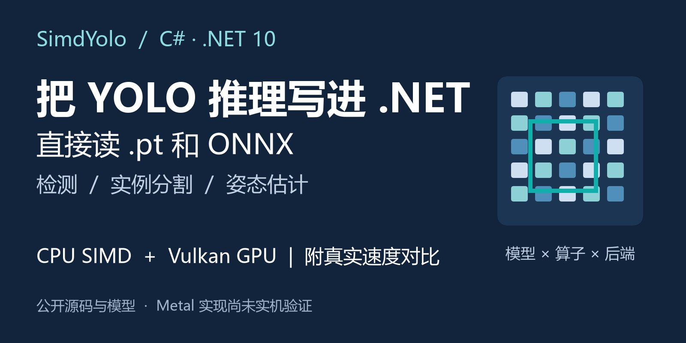
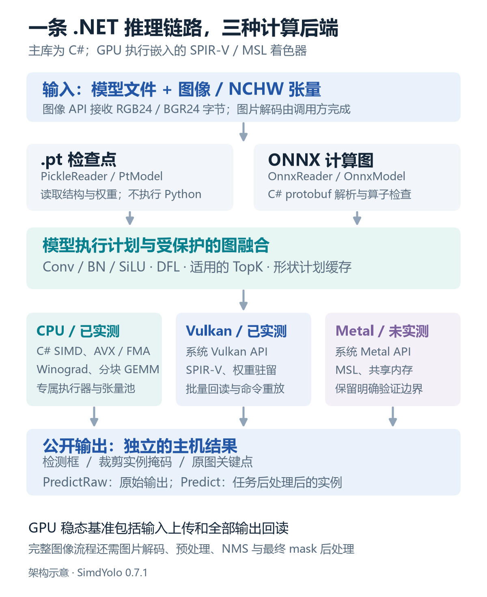
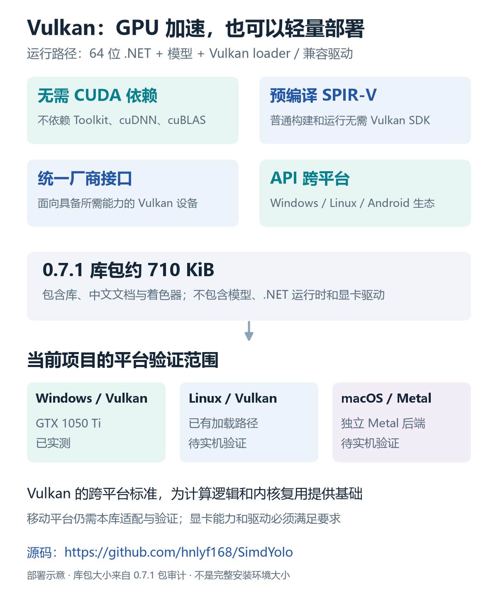
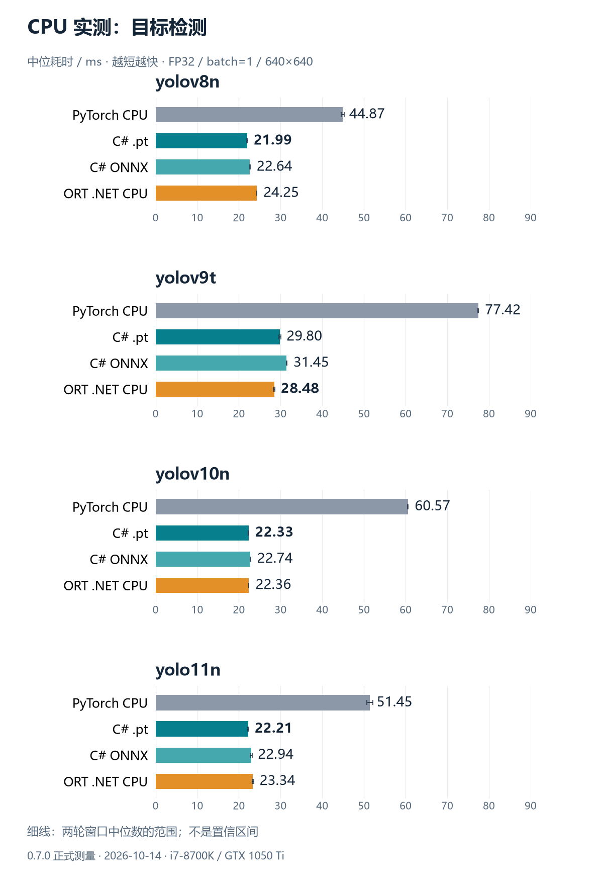
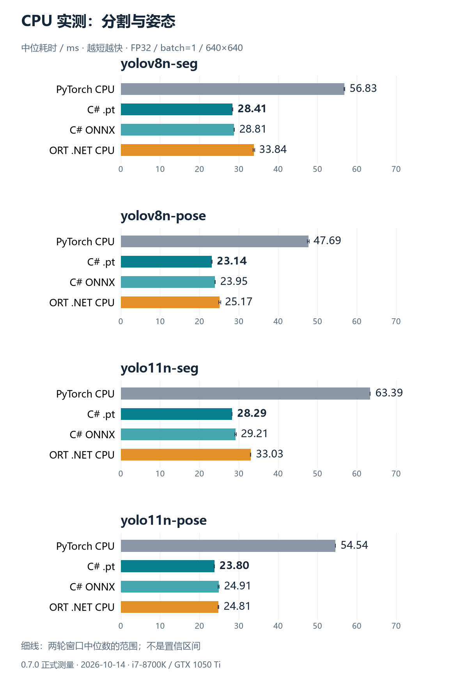
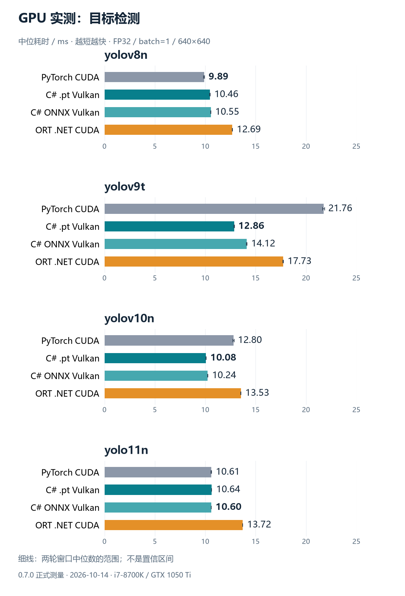

# 纯 C# 跑 YOLO：我把它和 PyTorch、ORT 放在同一台电脑上实测

> **0.8.1 更新：** 首次加载、首帧和稳态推理已重新实测，当前 CPU/GPU 排名及优化前后对照见 [0.8.1 性能结果](https://github.com/hnlyf168/SimdYolo/blob/main/artifacts/optimization-0.8.1.md)。
>
> 本文下方的旧速度表和性能插图属于 **0.7.x 历史记录**，不代表当前版本速度，也不用于宣传当前性能；评估新版本请以这份 0.8.1 实测为准，其中同时保留跨窗口波动和未领先的结果。



**源码仓库：** [https://github.com/hnlyf168/SimdYolo](https://github.com/hnlyf168/SimdYolo)

**发布包与模型：** [0.7.1 下载页面](https://github.com/hnlyf168/SimdYolo/releases/tag/v0.7.1) · [24 个模型 ZIP 直链](https://github.com/hnlyf168/SimdYolo/releases/download/v0.7.1/SimdYolo-models-v0.7.1.zip)

我做了一个叫 **SimdYolo** 的 YOLO 推理库，希望在 .NET 应用里直接加载模型、执行推理，再拿到检测框、分割掩码和姿态关键点。

这个项目最关心两件事：**主库保持纯 C#，推理速度要有实际使用价值。**

所以，模型解析、计算图、CPU 算子、预处理和结果解码都写在 C# 里。CPU 用 SIMD；GPU 通过系统 Vulkan、Metal API 执行着色器。主库没有 Python、PyTorch、TorchSharp 或 ONNX Runtime 的运行依赖。

代码和模型已经放到公开仓库。下面先看它能做什么，再看同机实测结果。

## 一份模型，直接接入 .NET 应用

SimdYolo 可以直接读取支持范围内的 `.pt` 检查点，也可以读取 ONNX。

这里的“直接读取 `.pt`”，是由 C# 解析 Torch ZIP 中的模块结构和权重，**运行时无需先转成 ONNX**。不过，单独的 `state_dict` 缺少网络结构，不能据此还原任意自定义模型；TorchScript 和未知模块也不在当前支持范围内。

目前已经验证的模型包括：

- YOLOv8n、Ultralytics YOLOv9t、YOLOv10n、YOLO11n 的目标检测。
- YOLOv8n、YOLO11n 的实例分割和姿态估计。
- 对应的 `.pt` 和 ONNX 推理路径。

本地 **0.8.0 开发版**还补齐了 YOLO26n 的检测、分割、姿态：官方 PT、静态/动态 ONNX 在 CPU/Vulkan 上通过数值和真实图片对照。新版本包含无 DFL 回归、Proto26 多尺度原型、Pose26 坐标解码和端到端实例结果。目前上方的 0.7.1 Release 及 24 模型 ZIP 尚未包含这些新增内容；旧性能表也不包含 YOLO26。

标签也可以独立读取：调用 `ModelInfo.Read(modelPath).ClassNames`，即可获取 PT 或 ONNX 保存的“类别编号 → 名称”，无需初始化 GPU、加载权重数据。已加载的会话直接使用 `detector.ClassNames`。支持中文和转义字符，缺少标签时返回空映射，不默认填入 COCO 名称；模型通道数使用 `ClassCount`，稀疏标签不能直接按条目数计数。

如果你的应用已经用 C# 处理摄像头、视频帧或图片，可以把解码后的 RGB/BGR 字节交给这个库。图片解码仍由调用方完成，库负责后续预处理、推理和结果解码。



*架构图中的 Metal 已有实现，当前还没有 macOS 实机验证结果。本文的 GPU 数据来自 Windows/Vulkan。*

## 选 Vulkan，还有一个直接的好处：部署更轻

对 .NET 项目来说，我也希望 GPU 加速能少一些环境配置。

**SimdYolo 的 Vulkan 路径不依赖 CUDA Toolkit、cuDNN 或 cuBLAS。** 不需要为本库另外安装一套庞大的 CUDA 开发工具链，也不需要在应用中携带这些 CUDA 计算库。运行所需的是 64 位 .NET 进程、模型文件，以及可用的 Vulkan loader 和兼容显卡驱动。

仓库已经提供预编译的 SPIR-V，普通构建和运行也无需安装 Vulkan SDK；修改着色器后重新生成 SPIR-V，才需要相应编译工具。0.7.1 的库包约 **710 KiB**，包含中文文档和着色器；这个大小不包含模型、.NET 运行时或显卡驱动。

Vulkan 还有两个适合部署的特点：

- **跨厂商。** 支持所需 Vulkan 计算能力的 NVIDIA、AMD、Intel 等设备可以采用统一 API 路径，减少对单一厂商计算生态的绑定。不同型号的兼容性和性能仍要验证，厂商支持可查 [Khronos 产品名录](https://www.khronos.org/conformance/adopters/conformant-products/vulkan)。
- **API 本身跨平台。** Windows、Linux、Android 等平台都有 Vulkan 生态，计算内核和执行逻辑具备复用基础。[Khronos 的平台说明](https://docs.vulkan.org/guide/latest/platforms.html)列出了各平台情况。



项目当前已实测的是 **Windows + Vulkan**；Linux 路径仍待实机验证，移动平台尚未验证。macOS 这边使用独立 Metal 后端，当前同样待验证；不能把 Vulkan API 的跨平台能力写成所有平台已经测试通过。

这里的优势是减少本库的 CUDA 依赖和配置成本。比较部署体积时，应查看各实现实际分发的运行库；本库的 Vulkan 路径免除了 CUDA 计算库及其版本配套成本。

## 先把测试条件摆出来

我用同一台电脑比较了原版 PyTorch、SimdYolo 和 ONNX Runtime：

- CPU：Intel Core i7-8700K，线程上限统一为 12。
- GPU：NVIDIA GeForce GTX 1050 Ti。
- 输入：同一份 640×640 张量，batch=1，FP32。
- 每种配置独立进程，串行跑两轮；预热 30 次，每个窗口至少 8 秒、40 次推理。

8 个模型、8 种 CPU/GPU 配置，共 **128 个测量窗口、57,628 次计时推理**。

计时包含网络前向和输出头解码；GPU 还包含输入上传、全部输出回读。图片预处理、NMS、最终 mask 后处理和冷首帧没有算进去。因此，下文的耗时适合比较稳态推理，完整视频或图像流程还需单独测量。

本文图表使用 **0.7.0 冻结程序集**的正式数据。当前下载版本为 0.7.1，补齐了中文代码注释和 IDE XML 文档；1,636 个方法的签名与 IL 与 0.7.0 一致，没有重新生成性能测量数据。

## CPU：纯 C# 路径已经跑出可用的成绩

先看目标检测。图中每个数字是中位耗时，越小越快；细线表示两轮窗口中位数的范围。



拿 YOLOv8n 举例：

| 实现 | 中位耗时 |
| --- | ---: |
| 原版 PyTorch CPU | 44.87 ms |
| SimdYolo `.pt` CPU | **21.99 ms** |
| SimdYolo ONNX CPU | 22.64 ms |
| ORT CPU（.NET） | 24.25 ms |

在这组配置里，C# `.pt` 路径把中位耗时从约 45 ms 降到了约 22 ms。分割和姿态也一起测了：



按本次汇总数值，`.pt` CPU 路径在 **8/8 个模型上快于原版 PyTorch CPU，在 7/8 个模型上快于 ORT CPU**；C# ONNX CPU 路径相对 ORT 更快的是 5/8 个。

有两个结果需要单独读：

- **YOLOv9t 仍由 ORT 领先**：ORT 为 28.48 ms，C# `.pt` 为 29.80 ms。
- **YOLOv10n 基本持平**：C# `.pt` 为 22.33 ms，ORT 为 22.36 ms；未舍入差值只有约 0.031 ms，两轮排名发生交换。

所以，数值排在前面，也要结合波动看。小幅差距还不足以证明稳定领先。

## 速度来自算子、内存访问和调度一起优化

这次 CPU 优化涉及的内容包括：

- 卷积按需打包空间面板，减少完整 im2col 的分配和内存往返。
- 使用 AVX/FMA 与分块 GEMM，复用固定权重布局，融合偏置和 SiLU。
- 为适用的卷积、depthwise、激活和转置提供 SIMD 路径。
- 按实际内存地址划分缓存行，减少并行写入竞争。
- 用专属执行器和临时张量池控制线程、调度与分配成本。

这些结果比较的是几套完整推理实现。PyTorch 自身也使用高度优化的底层算子，语言名称无法解释全部性能差异。

## GPU：Vulkan 在这张显卡上的表现怎么样？



YOLOv9t 这一项，PyTorch CUDA 为 **21.76 ms**，C# `.pt` Vulkan 为 **12.86 ms**，ORT CUDA 为 **17.73 ms**。

完整 8 模型结果中，C# 的 `.pt` 和 ONNX Vulkan 路径都低于 ORT CUDA 的中位耗时。不过，PyTorch CUDA 在多个模型上仍然更快，例如 YOLOv8n；YOLO11n 的 C# ONNX 与 PyTorch CUDA 只有约 0.008 ms 的差值，两轮名次交换，同样接近持平。

GPU 的优化重点是让固定权重留在设备上、中间结果尽量留在显存里，并减少命令记录和回读次数。符合条件的固定形状图还能重放命令缓冲区，每帧仍会上传新输入并回读实际输出。

这些结论对应当前显卡、FP32 和测试实现。Metal、TensorRT、FP16/INT8、`torch.compile` 等配置没有包含在本次比较里。

## 还有一项代价：内存

速度之外，进程内存也要看。此次测量中，C# `.pt` CPU 路径的 RSS 约为 ORT 的 **2.04～3.60 倍**，ONNX CPU 路径约为 **1.51～3.09 倍**。

RSS 包括宿主运行库、模型和缓存。当前内存成本仍有优化空间；不能由速度排名推导出资源占用全面领先。CPU 时间、RSS、GPU 使用率及整卡显存采样都保留在完整报告中。

## 下载后怎么试？

使用 Git LFS 下载源码和模型：

```powershell
git lfs install
git clone https://github.com/hnlyf168/SimdYolo.git
cd SimdYolo
git lfs pull
dotnet build -c Release
```

需要 .NET 10 SDK。随后可以先跑一个 CPU 模型：

```powershell
dotnet run --project src/SimdYolo.Cli -c Release -- bench models/pt/yolov8n.pt cpu 640 40 12 30
```

有 Vulkan 驱动的机器可以把 `cpu` 改成 `vulkan`。这条命令用于单模型上手，完整对比的两轮及持续时间由仓库里的比较工具控制。

业务代码中，假定已准备好 RGB24 的 `rgbBytes`、`imageWidth` 和 `imageHeight`：

```csharp
using SimdYolo;

using var detector = new YoloDetector("models/pt/yolo11n-seg.pt",
    new DetectorOptions { Device = ComputeDevice.Cpu });

IReadOnlyList<YoloInstance> results =
    detector.Predict(rgbBytes, imageWidth, imageHeight);
```

换成 `yolo11n-pose.pt` 可返回关键点；换成检测权重可返回框。支持的 ONNX 模型也直接传入文件路径。实际处理连续帧时，应复用检测器并先预热，最后释放会话。

不使用 Git LFS，也可以在 Release 下载源码和独立模型 ZIP。模型包内有 **8 个 `.pt`、16 个 ONNX**、来源和哈希清单；其中 `*-opset12.onnx` 固定输入为 128×128，需要按该尺寸运行。

## 源码、模型和实测数据

- [SimdYolo 公开仓库](https://github.com/hnlyf168/SimdYolo)
- [0.7.1 包与模型下载](https://github.com/hnlyf168/SimdYolo/releases/tag/v0.7.1)
- [模型格式、输入尺寸及来源](https://github.com/hnlyf168/SimdYolo/blob/main/models/README.md)
- [CPU/GPU 完整报告](https://github.com/hnlyf168/SimdYolo/blob/main/artifacts/optimized-runtime-comparison.md)
- [原始测量 JSON](https://github.com/hnlyf168/SimdYolo/blob/main/artifacts/optimized-runtime-comparison.json)

模型保留上游 AGPL-3.0 许可证及来源，源码当前未新增许可证。这个阶段的目标，是让 .NET 项目获得一个能直接接入、性能有记录、限制有说明的 YOLO 推理实现。
