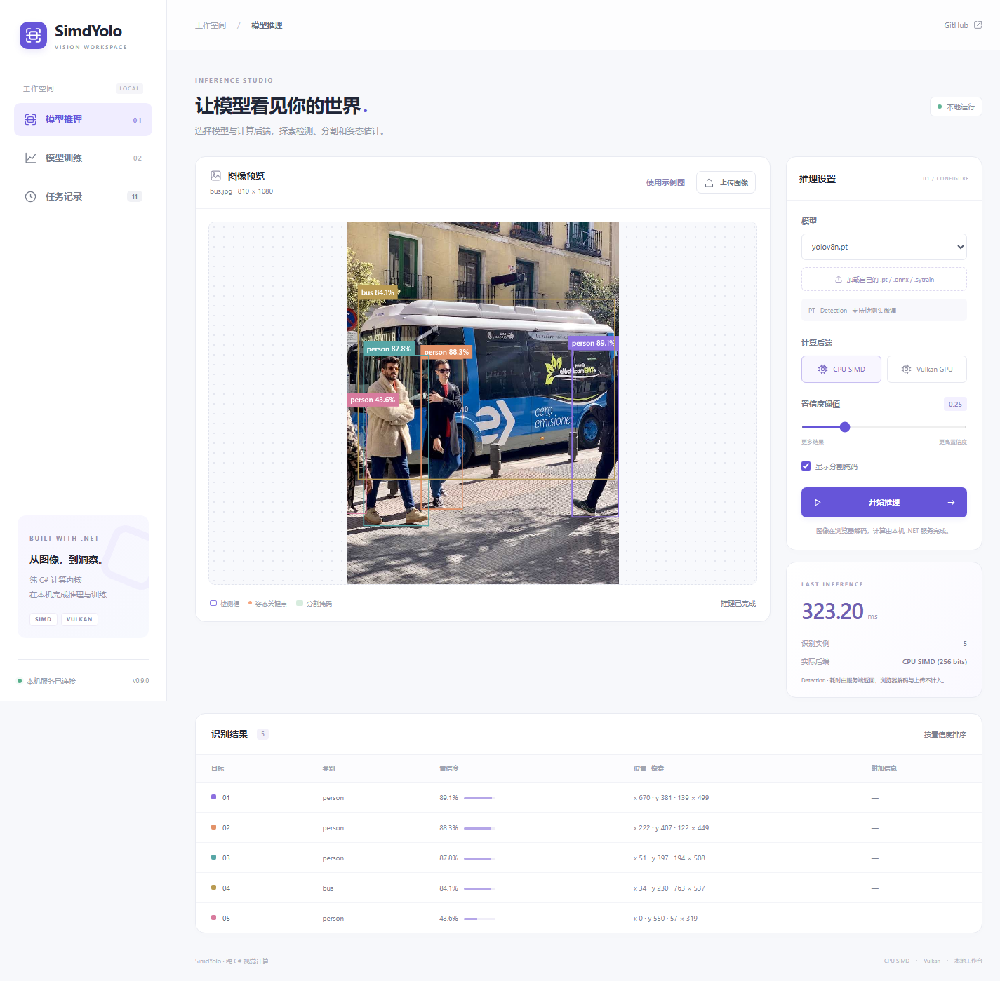

# 纯 C# 训练：YOLOv8 检测头微调

0.9.0 实现可实际更新权重、保存、恢复和推理的第一阶段训练。训练模块单独位于 `SimdYolo.Training`，仅引用 `SimdYolo` 和 .NET 标准库，应用运行无需 Python、PyTorch、TorchSharp、ORT 或原生数学库。GPU 通过现有 Vulkan API 调用；网页使用 ASP.NET Core 和浏览器原生 JavaScript。

## 本阶段支持范围

| 能力 | 当前实现 |
| --- | --- |
| 初始化 | 标准 YOLOv8 检测 `.pt`；已实测仓库内 `yolov8n.pt` |
| 更新范围 | 三尺度 Detect 的 `cv2`、`cv3` 分支，包含卷积、BN 参数和运行统计 |
| 冻结范围 | 骨干网络、颈部/FPN；可缓存其特征，默认上限 512 MiB |
| 标签 | YOLO 检测格式 `class cx cy w h`，支持自定义类别和空标签背景图 |
| 损失 | TAL 分配、BCE、CIoU、DFL，分配目标停止梯度 |
| 优化器 | SGD + momentum；卷积权重衰减；每轮确定性洗牌 |
| CPU | 复用纯 C# SIMD GEMM 与冻结网络执行器 |
| Vulkan | 冻结网络及训练头前向/反向 GEMM 在 GPU；BN、损失、SGD、im2col 和数据搬运在 CPU |
| 检查点 | 自包含 `.sytrain`，保留原 PT、完整头参数/BN、SGD 动量、类别及数据集摘要 |
| 推理 | `YoloDetector` 直接加载 `.sytrain`；输入尺寸使用保存时的训练尺寸 |
| 网页 | 图片推理、导入数据、启动训练、真实损失曲线、取消、恢复、下载及重新加载 |

**本阶段是检测头微调。** 全参数训练、YOLOv9/10/11/26 训练、分割/姿态训练、Metal 训练，以及 AdamW、学习率调度、EMA、数据增强和 mAP 验证尚未实现。普通推理 ONNX 不含本训练器需要的原始训练结构，只能用于推理。`.sytrain` 为本项目的归档格式，不能重命名为 `.pt` 交给 PyTorch，也尚不提供 ONNX 导出。

`BatchSize` 表示**梯度累加的图像数**：每图独立执行 BN，累加梯度按图像数平均，然后更新一次参数。这与多图联合 BatchNorm 不同。Vulkan 当前需要各次 GEMM 的上传/回读，是混合训练路径，尚未测量与 PyTorch 的训练性能对比。

## 运行网页

需要 .NET 10 SDK；使用 Vulkan 时还需要显卡驱动提供 Vulkan。无需 CUDA。

```powershell
git clone https://github.com/hnlyf168/SimdYolo.git
cd SimdYolo
git lfs pull
dotnet run --project examples/SimdYolo.Web -c Release
```

打开 **http://127.0.0.1:5188**。页面包含推理、训练和任务记录三个入口，详见 [网页示例说明](../examples/SimdYolo.Web/README.md)。




## 在 C# 中训练

项目引用 `src/SimdYolo.Training/SimdYolo.Training.csproj`，或使用本仓库 `artifacts` 下的 0.9.0 NuGet 包。可先运行不需要外部数据的方块示例：

```csharp
using SimdYolo;
using SimdYolo.Training;

var dataset = TrainingDataset.CreateDemo(count: 8, seed: 26);
using var trainer = new YoloTrainer("models/pt/yolov8n.pt", dataset, new()
{
    Device = ComputeDevice.Cpu, // 也可显式选 Vulkan
    ImageSize = 128,
    Epochs = 20,
    BatchSize = 1,
    LearningRate = .003f,
    CpuThreads = 4
});
trainer.Train(".cache/my-training", progress =>
    Console.WriteLine($"epoch={progress.Epoch}, step={progress.Step}, loss={progress.TotalLoss:F5}"));
```

训练输出 `last.sytrain` 和逐步 `history.jsonl`。同步 `Train` 可以在自己的后台线程执行，回调在训练线程调用；同一会话不允许并发训练、评估、保存或释放。输出目录失败后会释放运行标志，调用方可以修正路径后重试。

自定义数据由调用方提供 RGB24 字节和 YOLO 标注，图像字节顺序为 R、G、B，不含行填充。浏览器示例负责解码 JPEG/PNG；训练库不引入图片编解码依赖。

```csharp
// rgb24 为 width * height * 3 字节的已解码图像。
var dataset = new TrainingDataset(
    ["person", "helmet"],
    [new TrainingImage("001.jpg", rgb24, width, height,
        "0 0.50 0.50 0.40 0.60\n1 0.50 0.25 0.20 0.15")]);
```

类别编号从 0 开始，坐标相对于原图归一化，框须位于原图范围内。预处理保持比例并填边，与推理的 letterbox 一致。类别数变化时重建末层分类通道，同名类别尝试复用原权重，其余通道按种子初始化。

## 恢复、取消和直接推理

```csharp
using var resumed = YoloTrainer.Resume(
    ".cache/my-training/last.sytrain", dataset,
    totalEpochs: 30, device: ComputeDevice.Cpu, cpuThreads: 4);
resumed.Train(".cache/my-training");

using var detector = new YoloDetector(".cache/my-training/last.sytrain");
var results = detector.Predict(rgb24, width, height);
var metadata = ModelInfo.Read(".cache/my-training/last.sytrain");
```

`totalEpochs` 是恢复后的总轮数，必须大于检查点轮数。恢复校验类别和数据集 SHA256，包括图像次序、尺寸、RGB、标注；修改数据后需要重新开始。学习率、动量、衰减、种子、梯度累加和输入尺寸来自检查点，可以切换 CPU/Vulkan 和线程数。

取消通过 `CancellationToken`，会抛出 `OperationCanceledException`。每个完整轮次原子替换检查点；取消时丢弃未完成轮次的参数、BN 和动量，当前会话也回退到该边界。中途取消且尚未完成首轮时保留初始化检查点。`history.jsonl` 可以保留被取消轮次的过程记录，恢复以检查点的 epoch/step 为准。

官方仓库权重按原始 SHA256 识别，生成归档包含 `LICENSE-AGPL-3.0.txt` 和 `source-provenance.json`。未知自定义权重写入来源待确认说明，使用者仍须保留其供应方许可证；未给项目源码新增许可证。

## 当前验证结果

| 验证 | 实际结果 |
| --- | --- |
| 训练单元和集成测试 | 12 项通过：差分梯度、SGD、空标签、恢复、取消、并发拒绝、坏快照、Vulkan 训练及快照推理 |
| 原版独立数值对照 | 固定 Ultralytics 8.4.0 + PyTorch 2.11.0 CPU，四组共 640/640 检查通过 |
| 对照场景 | CPU、Vulkan 头矩阵运算、小目标、空标签；覆盖前向、损失、logits 梯度、参数梯度和 BN 统计 |
| 小样本真实更新 | 固定单图、64×64、100 轮，推理模式损失 4.365893 → 1.162812 |
| 原推理回归 | CPU/Vulkan 117 项通过 |
| 网页 API / 浏览器 | 推理、训练、恢复、取消、下载、上传检查点、会话复用、Vulkan 训练和移动布局通过 |

单图损失下降仅证明真实反向传播和更新可工作，**不是独立验证集的精度或 mAP 结论**。未完成全数据集收敛、训练速度或显存占用对比，不能据此宣称训练性能超越 PyTorch。

[验证与复现](../artifacts/validation/0.9.0/README.md)保留原始结果、固定参考版本和实际程序集摘要。历史 0.8.1 速度表属于历史冻结 DLL，未用来表示 0.9.0 的速度。
