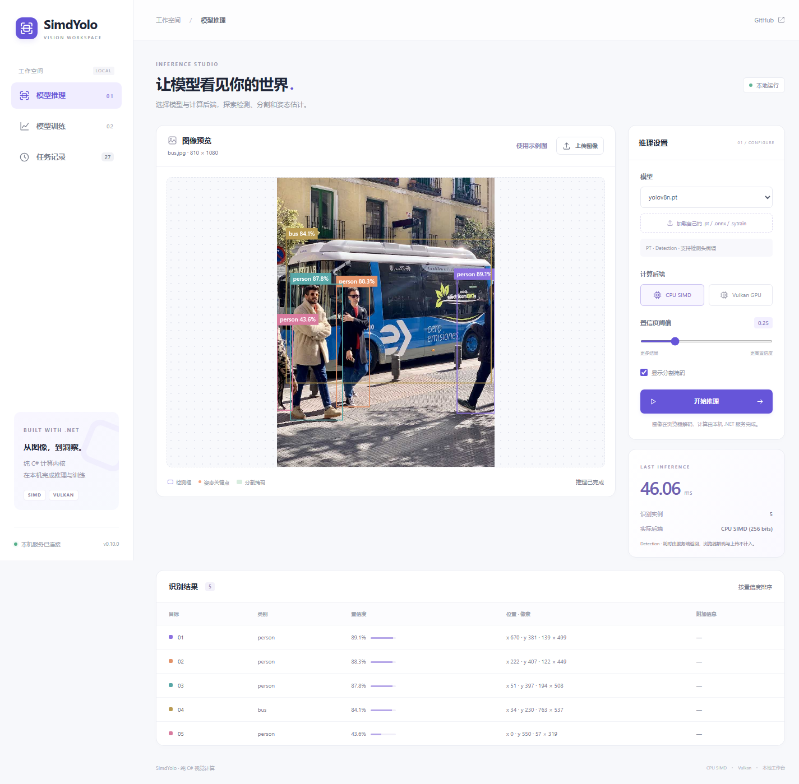
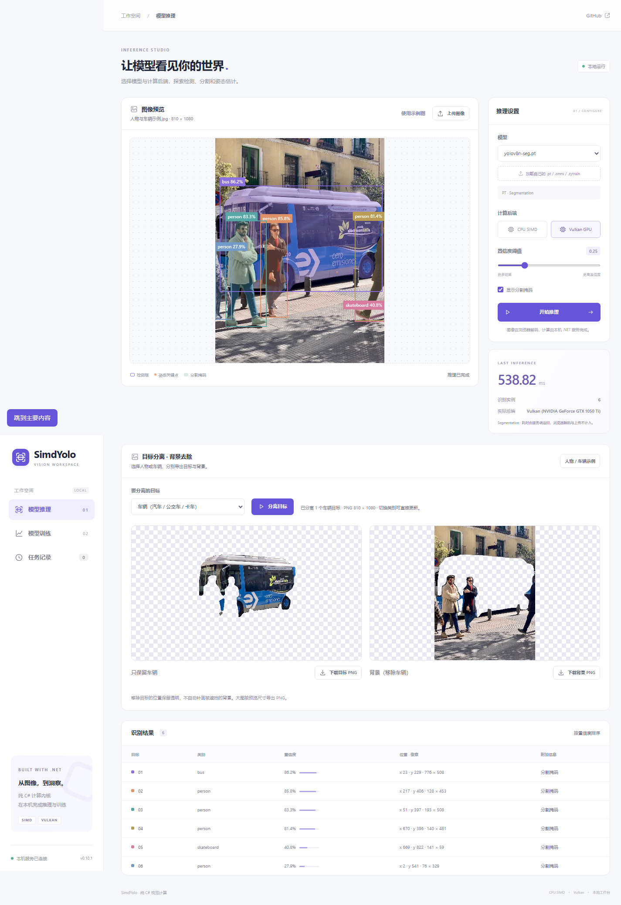

# 网页推理与训练示例

ASP.NET Core 后端直接调用本仓库的纯 C# 推理和训练库。前端为原生 HTML/CSS/JavaScript，不使用 CDN，也没有 npm 构建步骤。

**当前源码0.11.0新增**：[独立验证集、早停、最佳模型、模型比较、ONNX导出、网页标注与预标注、CPU低精度及校准](../../docs/model-workflows.md)。这些计算全部由.NET执行，Python/ORT仅出现在开发验证工具中。低精度目前未取得速度优势，默认仍为FP32；FP16采用FP32累加，Vulkan/Metal继续使用FP32。


当前发布版0.10.1优化CPU SIMD与Vulkan混合训练，五代检测模型入口保持一致。[训练速度及保存模型结果对比](../../artifacts/training-optimization-0.10.1.md)区分训练内核计时和真实图片验证指标；[0.10.1运行包](https://github.com/hnlyf168/SimdYolo/releases/download/v0.10.1/SimdYolo-Web-v0.10.1.zip)已包含五代检测头训练，模型另下[33模型包](https://github.com/hnlyf168/SimdYolo/releases/download/v0.10.1/SimdYolo-models-v0.10.1.zip)，按[启动说明](../../docs/releases/web-runtime.md)运行。

## 启动

在仓库根目录运行：

```powershell
git lfs pull
dotnet run --project examples/SimdYolo.Web -c Release
```

打开 **http://127.0.0.1:5188**。需要 .NET 10 SDK；Vulkan 需要显卡驱动支持。CPU 路径不需要 GPU、CUDA 或 Python。




## 推理

1. 选择仓库中的 PT/ONNX 模型，也可上传 `.pt`、`.onnx` 或 `.sytrain`。
2. 上传 JPEG/PNG，选择 CPU SIMD 或可用 GPU 后端，点击运行。
3. 检测显示框和类别，分割叠加掩码，姿态显示关键点。训练生成的模型出现在同一列表。

浏览器将图片解码成 RGB24，后端执行真正的模型推理。界面展示预处理、前向和后处理的服务端耗时，不含 HTTP 传输；API 另外返回 `modelLoadMs` 和 `reusedSession`。最近两个模型会话按模型/设备/精度/校准记录复用；调整置信度复用同一会话。切换后端或第三个会话可能重新加载，首帧仍可能包含 JIT 和 GPU 编译成本。

0.11.1对同一图片复用有界RGB缓冲区，优先通过`POST /api/infer-rgb`发送原始RGB24字节，数据体比Base64少25%；元数据放在不超过4096字符的`X-SimdYolo` JSON请求头，字段沿用下述旧接口但省略pixels。`/api/info.binaryRgb`声明支持；旧`POST /api/infer` JSON接口保留。服务端校验尺寸及精确字节数，在取得串行推理队列后才分配RGB数组，支持有界chunked传输。[专项验证与优化前后速度](../../artifacts/validation/0.11.1/README.md)。

### 大图（当前源码新增）

支持上传4K、8K等大尺寸JPG/PNG。浏览器先将预览和上传RGB等比例缩放到最长边2048，保留原图尺寸；模型仍使用自身输入尺寸做整图推理。结果表中的检测框和姿态关键点使用原图像素坐标，掩码按原图范围叠加到有界预览，不按原图面积扩展概率数组。大图的细小目标分辨率取决于模型输入尺寸。

原图允许单边最多65535、总计256 Mi像素，实际能否解码还取决于浏览器和本机内存。前端不会对全分辨率原图调用`getImageData`；RGB上传最多12 MiB（Base64最多16 MiB）。训练目录导入也会先缩小大图，YOLO归一化标注保持不变。

直接调用`POST /api/infer`时，`width`、`height`、`pixels`表示已经缩放的RGB24；可同时传入`originalWidth`、`originalHeight`取得原图坐标，省略两者则兼容原有API。响应的`image`包含原图和处理尺寸；`mask.width/height`表示概率位图尺寸，`mask.x/y`与`mask.displayWidth/displayHeight`表示原图坐标中的绘制范围。

此修复尚未加入历史0.10.1下载包，使用当前源码启动即可体验。[真实浏览器验证与截图](../../artifacts/validation/web-large-images/README.md)。

### 人物 / 车辆分离与背景去除（当前源码新增）

推理页新增“目标分离 · 背景去除”：

1. 点击“人物 / 车辆示例”，会载入含公交车和人物的真实照片，并自动使用实例分割模型。也可上传自己的照片后点击“分离目标”。
2. 选择“车辆”“人物”“全部已识别目标”，或单独选取结果中的某一类别。车辆快捷选择包含`car/bus/truck`及对应中文类别名；自定义模型可使用单独类别选项，不依赖COCO类别编号。
3. 左侧预览“只保留目标”，右侧预览“背景（移除目标）”，分别点击下载透明PNG。切换类别直接复用分割结果，无需再次运行模型。

采用真实实例掩码（概率阈值0.5），同类别多个实例取合并区域。其他类别保留在背景层；未匹配到目标时会提示并禁用下载。移除的位置保留透明，不自动生成被遮挡的场景；轮廓质量取决于分割模型。大图导出为最长边2048的预览尺寸，页面显示实际PNG宽高，棋盘格不会写入图片。

模型推理由本机纯C#后端完成，浏览器合成RGBA与编码PNG，无额外服务和运行依赖。示例照片来源及原许可证保留在`wwwroot/samples/`中。此功能尚未加入历史0.10.1下载包。

0.11.1使用32 MiB上限的掩码画布LRU缓存，复用二值掩码和彩色叠加层；切换人物/车辆无需重新Base64解码。切换图片或获得新结果时释放缓存，尺寸及概率内容变化也会使缓存失效。极大的单张掩码作为临时结果处理，不长期占用缓存。目标和背景继续使用同一张合并掩码合成，保持透明区域互补，不补画被遮挡背景。



[实际导出的目标PNG](../../artifacts/validation/web-cutout/cutout-foreground.png) · [实际导出的背景PNG](../../artifacts/validation/web-cutout/cutout-background.png) · [验证记录](../../artifacts/validation/web-cutout/README.md)

## 训练自己的检测头

先选择内置的八张方块数据，使用 `yolov8n.pt`、CPU、128×128、20 轮和学习率 0.003，验证完整流程。内置数据用于演示，不代表真实业务精度。

导入自己的数据时填写类别列表，并选择包含图像和 YOLO `.txt` 的目录：

```text
my-data/
  images/
    001.jpg
    002.png
  labels/
    001.txt
    002.txt
```

标注格式为每行 `class cx cy w h`，类别从 0 开始，坐标归一化。支持 `images`/`labels` 对应相对路径和同名文件；缺少匹配标签的图像导入为空标签背景样本，请核对目录与页面导入数量。若同名文件存在歧义，页面会提示。分割多边形和姿态标签不能作为本阶段训练标注。

创建任务后显示实际 step、轮数和 Total/Box/Cls/DFL或L1损失。取消保留最近完整轮次；继续训练填写新的**总轮数**，从该检查点恢复。下载得到自包含 `.sytrain`，可重新上传、用 `YoloDetector` 推理，或继续微调。

0.10.1 源码与发布包支持 YOLOv8/v9/v10/YOLO11/YOLO26 检测头训练，训练下拉列表按真实 PT 结构识别能力，重命名文件不影响判断。v10、YOLO26 同时更新 one2many/one2one；骨干和 FPN 冻结。梯度累加不等于联合批次 BN，Vulkan 是普通卷积 GEMM 加速的混合路径；分割、姿态暂仅用于推理，Metal 不支持训练。旧0.9.0包保持原内容，仅支持v8训练。详细 API、支持矩阵与评测见[训练说明](../../docs/training.md)。

## 数据、任务与配置

默认输出 `.cache/web-example/`：`models/` 保存上传模型，`datasets/` 保存导入的 RGB/标注，`runs/任务编号/` 保存状态、历史和检查点。重启会载入记录；中断任务标记为已取消，可从完整检查点恢复。原仓库模型保持原文件。

| 配置键 | 用途 |
| --- | --- |
| `SimdYolo:RepositoryRoot` | 仓库路径，默认从程序目录向上查找 `SimdYolo.sln` |
| `SimdYolo:DataRoot` | 上传、数据集和任务保存位置，默认仓库 `.cache/web-example` |

例如发布到独立目录后，可通过环境变量 `SimdYolo__RepositoryRoot` 指向完整仓库。模型文件必须是 Git LFS 拉取后的实际权重。

示例限制：单模型上传64 MiB、单张上传RGB最长边2048（大图自动缩小）、单次数据集最多200张且缩放后RGB合计不超过48 MiB；训练任务串行、最多四个等待任务，推理串行并缓存两个会话。较大的数据集应在自己的C#程序中调用训练API。

这是绑定本机回环地址的示例，没有账号/鉴权或公网部署配置；不要直接将该训练服务暴露到公网。网页中的 CPU/Vulkan 状态由本机实际探测，Metal 推理仍需要 macOS；本机未验证 Metal。

## 验证

```powershell
dotnet run --project tests/SimdYolo.Training.Tests -c Release -- --integration --vulkan
# 启动服务后，开发环境可用 Python + Pillow 验证 API，Node 22+ 和 Edge/Chromium 验证界面：
python tools/validate-web.py --version 0.10.1 --output artifacts/validation/0.10.1/web-api.json --image .cache/bus.jpg
node tools/validate-web-browser.mjs --image .cache/bus.jpg
# 4K/8K检测、分割、Vulkan姿态、原图坐标、有界缓冲区及非法请求验证：
node tools/validate-web-browser.mjs --image .cache/bus.jpg --large-images --output artifacts/validation/web-large-images
# 分离人物/车辆、实际下载并重新解码透明PNG，可与大图验证一起运行：
node tools/validate-web-browser.mjs --image .cache/bus.jpg --cutout --large-images --output artifacts/validation/web-cutout
# 新增标注、验证、最佳模型、对比、导出、校准与低精度网页流程：
node tools/validate-web-browser.mjs --image .cache/bus.jpg --features --output artifacts/validation/0.11.0/web-workflows
```

`--image` 应指向包含人的真实照片；现有验证使用 Ultralytics 官方 `bus.jpg`。浏览器工具默认 Windows Edge，可通过 `--browser` 指定 Chromium 路径。Python、Pillow、Node 与浏览器仅为验证工具，应用运行不依赖它们。
